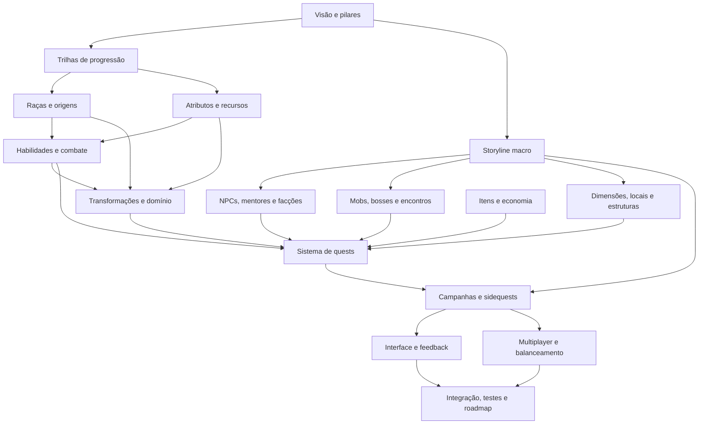

# Mapa modular do game design

> **Bloco atual — 28/10/2026:** [M13 — Campanhas e sidequests](13-campanhas-e-sidequests.md), `EM ESPECIFICAÇÃO`, com foco **somente na campanha principal**. M11 foi adiado explicitamente; 07A/B já aprovados (Zanpakutō pessoal preservada na morte comum e sem desgaste comum selada/Shikai). Formação/quests raciais, fillers e demais histórias laterais ficam para depois. M13-01A/02A decididos: contexto escrito/apresentação breve e missões executadas pelo jogador; início por NPC ou painel/HUD quando o evento permitir, com criação do confronto. Encenação de Ichigo/Rukia como abertura obrigatória substituída; 01B reformulado por atividade jogável, sem aprovação automática dos sete blocos. M13-03A/B aprovados: abertura com Rukia/confronto Hollow curto e conclusão após objetivo válido, com retorno ao NPC quando necessário. M13-04A/B aprovados: Rukia encaminha o caso de Orihime e objetivo é vencer o Hollow, sem barra de defesa. M13-05A/B aprovados: Chad/Shrieker direto e missão curta de Kon por Urahara com início no painel junto da escola. M13-06A aprovado: Grand Fisher, vitória jogável e retirada narrativa. M13-07A/B aprovados: Don Kanonji em texto e crise de Uryū em duas missões, Hollows e Menos. M13-08A aprovado: Renji vencível e prisão no desfecho. 08B/C aprovados no alcance estrutural: incluir avaliação com perseguição cronometrada de Ururu e duelo de um golpe válido contra Urahara antes da viagem. 09A/B aprovados: 60 segundos/limite de 30% como valores provisórios e Ururu concluída preservada se falhar depois contra Urahara. 10A/B aprovados: travessia breve, Kōtotsu no contexto, Jidanbō jogável e Gin no desfecho. 11A/B decididos: incluir Ganju jogável e aceitar exercício/lançamento com Kūkaku. 12A/B aprovados: vitória completa de Ganju e sequência Ikkaku/Yumichika com retenção da primeira. 13A/B aprovados: Jirōbō jogável e rota de Hanatarō sem escolta. 14A/B aprovados: segundo Renji/interlúdio de Aizen em texto e Shunsui jogável. 15A/B aprovados: contato com Rukia/Byakuya em texto e Mayuri com retirada após vitória. 16A/B decididos: preparação própria do jogador com Yoruichi e Tōsen/Komamura em duas missões. 17A/B aprovados: circuito de Yoruichi e resgate por interação, Sōkyoku em texto. 18A/B aprovados: Byakuya contínuo e Soi Fon jogável/Yamamoto em texto. 19B aprovado com revisão: Aizen em contexto, Byakuya último boss. Roteiro/seleção Substituto e Soul Society consolidados em M13/10.32/10.33; 28 missões, realização pendente. Publicação documental autorizada ao fechar este arco; próximo arco Arrancar em rodada posterior. Manter na main local e publicar somente ao concluir Soul Society, conforme esclarecimento explícito. Não reenviar decisões aprovadas. M12 ainda não tem documento próprio; dependências de realização ficam identificadas, sem impedir o trabalho de roteiro autorizado.

> **Checkpoint anterior — 23/10/2026:** checkpoint de revisão/complementos funcionais concluído no alcance de [12.1 do parecer M01–M10](00-revisao-cobertura-m01-a-m10-2026-10-23.md#121-conclusão-do-checkpoint-autorizado--23102026). M09-12C aprovado: aldeões como civis vivos caçáveis; RAC-30/RAC-31A e M06-CS-01A/B/C/D decididos, com integração M08/M09 e retorno em M10b/9.4.1. Publicação documental autorizada após conferência. Próximo M11 com retorno M05; M08/M09/M10 mantêm suas entregas de conteúdo e implementação.

> **Revisão de cobertura vigente — 23/10/2026:** diagnóstico inicial e acompanhamentos preservados no parecer. Fechamento da rodada não equivale a catálogos completos; responsáveis/momentos de retorno estão em 12.1. Não repetir retornos dirigidos já concluídos. Registros de continuidade abaixo conservam o histórico de decisões.

> **Direção vigente REV-SP-02 — 22/10/2026:** Spiritual Points compram **skills e transformações**, conforme esclarecimento explícito do usuário, usando Dragon Mine Z como referência para a compra. **Mastery é desenvolvida pela prática e não é comprada.** Requisitos/contexto disponibilizam a aquisição; SP paga a compra/desbloqueio; usar a capacidade depois segue os custos próprios de Energia/Stamina. [Contrato comum em M05/11.2](05-atributos-e-recursos.md#112-rev-sp-02--compra-de-skills-e-transformações-com-spiritual-points). Preços e exceções concretas permanecem nas fichas; a compra não pode ser removida genericamente por interpretação de M05/M06.

**Última revisão de continuidade:** 23/10/2026. M09-01–11 decididos, regras gerais `ESPECIFICADO CONCEITUALMENTE` e catálogo em especificação; [revisão 09b](09b-revisao-m09-2026-10-23.md) explicita entregas. [M10](10-dimensoes-locais-e-estruturas.md) aberto `EM ESPECIFICAÇÃO`, 01A/B e 02A/B decididos, 02C com duas vias de abertura; 03B/C e 04A decididos; 03A revisado por 03D aprovado: locais conhecidos e acessíveis. 03E decidido: visita e registro manual. 05A decidido: Rukongai com atividades próprias. 05B decidido: pequenos refúgios distribuídos. 05C decidido: Karakura adaptada. 06A decidido: bases com abastecimento local. 07A decidido: transição breve. 07B decidido: convidados da mesma party. 07C decidido: custo ao formar e janela sem manutenção. 07D/E decididos: preparo parado e autonomia do objeto pago. 07F/G decididos: uma passagem ativa e ida/volta. Bloco comum revisado; 08A decidido condicionalmente à pesquisa, com água transportada funcional como adaptação; 08B decidido sobre ponto de renascimento no mundo escolhido; 08C decidido sobre recuperação na falha do ponto; 08D decidido sobre ausência de seleção e posição no retorno; bloco espacial consolidado; 08E decidido no recorte Hueco Mundo: sono a qualquer horário possível; 08F decidido sobre passagem da noite; 08G decidido sobre criaturas por região; catálogo M10b aberto e 09A decidido sobre primeiros percursos; 09B decidido sobre operadores da primeira rota a Hueco Mundo; 09C decidido: primeiro acesso por missão e contexto da campanha, separado de abertura própria. M01–M08 mantêm seus alcances/revisões; nenhum fechamento documental equivale a runtime, teste ou aceite.

**Discussão anterior preservada:** complementos M08/M09 após o retorno dirigido M06a/Combat State, no bloco de revisão de M10 — Dimensões, locais e estruturas. Núcleos planejados com áreas geradas e proteção localizada aprovados em 01A/B. Rotas/serviços inicialmente e skills de abertura sem exclusividade racial absoluta aprovados em 02A; passagens comuns fora de combate em 02B. Técnica como a de Urahara e dispositivo como o de Mayuri em 02C. 03A revisado por 03D: skills próprias escolhem locais conhecidos/acessíveis, inclusive locais do jogador. Busca próxima aprovada em 03B; sem solução, permanecer na origem em 03C. Retorno comum aprovado em 04A. 03D/E decididos: locais conhecidos/acessíveis, visita e registro manual. 05A decidiu função jogável própria do Rukongai junto aos espaços institucionais da Soul Society. 05B decidiu pequenos refúgios distribuídos em Hueco Mundo. 05C decidiu Karakura adaptada ao Minecraft. 06A decidiu bases espirituais com abastecimento local. 07A decidiu transição breve nas viagens comuns e percursos em situações próprias. 07B decidiu convidados autorizados da mesma party. 07C decidiu Energia ao formar e janela sem manutenção. 07D/E decidiram preparo parado/cancelável e autonomia da passagem paga em regiões ativas. 07F/G decidiram uma passagem ativa com fechamento manual e ida/volta. Bloco comum consolidado conceitualmente em 10a; 08A decidiu água transportada funcional como adaptação após pesquisa sem proibição explícita localizada; 08B decidiu ponto de renascimento no mundo escolhido; 08C decidiu recuperação na falha do ponto; 08D decidiu ausência de seleção e posição no retorno; bloco espacial consolidado em 8.30; 08E decidiu sono de Hueco Mundo a qualquer horário possível; 08F decidiu passagem da noite por mundo; 08G decidiu criaturas por região; catálogo M10b aberto em especificação; 09A decidiu proximidade dos primeiros percursos humanos; 09B aprovou operadores nas duas pontas, com funções em M08a/9.38; 09C decidiu acesso por missão e contexto do arco/campanha, com transporte por fonte pertinente e abertura própria adquirida separadamente; missão/marco concretos em M12/M13. A condição fora de combate acompanha a passagem comum, independentemente da fonte. Nascimento físico no Overworld é herança de M04. M09a conserva fichas incompletas, M08 conserva currículos/acesso/serviços e os demais responsáveis completam as dependências antes de cada entrega. [Handoff](00-handoff-atual.md) registra a continuidade; perguntas seguem após respostas sem pedido adicional.

## Propósito deste documento

Este documento organiza o planejamento do Bleach Mod em módulos independentes. Ele não especifica todos os sistemas e não declara nenhuma ideia como implementada. Sua função é definir:

- quais assuntos terão documentos próprios;
- o que pertence e o que não pertence a cada módulo;
- quais decisões precisam ser tomadas antes de outras;
- como impedir que storyline, quests, NPCs e progressão se tornem um único sistema acoplado;
- como avançar um módulo por vez sem perder a visão do jogo completo.

Os documentos de `Docs/arquitetura/` continuam descrevendo principalmente a engenharia reversa do Dragon Mine Z e a implementação técnica atual. Os documentos de `Docs/game-design/` descreverão a experiência desejada para o Bleach Mod.

Referência de preparação: [Base de conhecimento — Bleach dentro de Minecraft](00-base-conhecimento-minecraft-bleach.md), pesquisada em 20/10/2026, reúne fontes oficiais, versões do projeto e revisões entre módulos. Ela complementa este mapa e não aprova novas decisões de produto.

Para retomar, usar o [handoff vigente](00-handoff-atual.md). A skill do projeto é [bleach-game-design](../../.agents/skills/bleach-game-design/SKILL.md); as referências externas foram adaptadas ao método deste mapa.

Entrada adicional de 20/10/2026: [reconciliação do handoff externo Hollow](00-reconciliacao-handoff-hollow-2026-10-20.md). Recupera discussões de outra sessão sem sobrescrever IDs. Após o parecer, o usuário aprovou a direção em M06-08G e escolheu Grimmjow como primeira linhagem; fan arts podem orientar formas faltantes, com procedência identificada. Requisitos concretos de evolução permanecem em M07.

O usuário esclareceu depois que o detalhamento específico das linhagens e das artes fica para uma etapa posterior. Continuar os sistemas gerais e a sequência modular; Grimmjow será o primeiro caso quando chegar a etapa de conteúdo específico.

## Regra central de trabalho

Cada etapa deve tratar apenas um módulo principal. Outros módulos podem ser citados como dependências, mas suas decisões não serão fechadas antecipadamente.

Exemplo: M08 define quem oferece qual repertório, atividade ou serviço, com competência, motivo e condições de acesso. M06 define como as habilidades funcionam; M13 desenvolve as quests que encenam o aprendizado. M08 precisa selecionar o conteúdo oferecido em integração com esses contratos; dizer apenas que “mentores ensinam” não cumpre sua função. Fórmulas, execução das técnicas e roteiro completo continuam nos módulos responsáveis.

## Estados permitidos

Cada documento de módulo deve mostrar um destes estados no início:

| Estado | Significado |
|---|---|
| `NÃO INICIADO` | O módulo está apenas listado neste mapa. |
| `IDEALIZADO` | Existem possibilidades e referências, mas as decisões continuam abertas. |
| `DECIDIDO` | As principais decisões de produto foram aceitas. |
| `EM ESPECIFICAÇÃO` | Há blocos em elaboração e decisões ainda abertas, identificados no documento. |
| `ESPECIFICADO CONCEITUALMENTE` | A arquitetura está definida; fórmulas, calibração ou tradução para implementação continuam explicitamente delegadas. |
| `ESPECIFICADO` | Regras, dados, integrações e critérios estão definidos para implementação. |
| `IMPLEMENTADO` | O código ou conteúdo correspondente existe. Não significa que foi testado. |
| `TESTADO` | Há evidência técnica de funcionamento nos cenários definidos. |
| `AUDITADO` | Houve revisão com escopo e resultados registrados; não substitui teste ou aceite. |
| `ACEITO` | O resultado foi avaliado e aprovado como experiência de jogo. |
| `PENDENTE` | Existe uma dependência ou decisão conhecida impedindo o próximo estado. |

Um módulo pode ter partes em estados diferentes. Nesse caso, o documento deve separar claramente cada parte. Implementação, teste e aceitação nunca avançam automaticamente juntos.

## Separação entre sistema e conteúdo

Para evitar acoplamento, cada domínio será analisado em duas camadas:

| Camada | Pergunta |
|---|---|
| Sistema | Quais regras e ferramentas permitem criar esse tipo de conteúdo? |
| Conteúdo | Quais personagens, inimigos, lugares, técnicas e missões existirão? |

Exemplos:

- O sistema de NPCs define diálogo, rotina, interação e treinamento. Rukia e Urahara são conteúdo de NPC.
- O sistema de mobs define IA, atributos, fases e recompensas. Hollow comum e Menos Grande são conteúdo de mob.
- O sistema de quests define objetivos, pré-requisitos e estados. “O Nome que Faltava” é conteúdo de campanha.
- O sistema de dimensões define viagem, geração e persistência. Soul Society e Hueco Mundo são conteúdo de mundo.
- O sistema de transformações define desbloqueio, ativação, custo e domínio. Shikai e Bankai são conteúdo Shinigami.

## Módulos de game design

### Fundação

| Ordem | Documento futuro | Responsabilidade | Não decide |
|---:|---|---|---|
| 01 | [`01-visao-e-pilares.md`](01-visao-e-pilares.md) | Fantasia do jogador, identidade do projeto e princípios de design | Números, quests ou catálogo de conteúdo |
| 02 | [`02-trilhas-de-progressao.md`](02-trilhas-de-progressao.md) | Todas as formas de progresso e a relação entre elas | Fórmulas detalhadas de cada sistema |
| 03 | [`03-storyline-macro.md`](03-storyline-macro.md) | Ordem dos grandes arcos e papel do personagem original no cânone | Quests individuais e diálogos completos |

### Personagem e poder

| Ordem | Documento futuro | Responsabilidade | Não decide |
|---:|---|---|---|
| 04 | [`04-racas-e-origens.md`](04-racas-e-origens.md) | Shinigami, Hollow, Quincy, Fullbringer, híbridos e origem do personagem | Todas as transformações de cada raça |
| 05 | `05-atributos-e-recursos.md` | Atributos, reiatsu, vida, stamina, crescimento e Battle Power | Técnicas e formas específicas |
| 06 | `06-habilidades-e-combate.md` | Zanjutsu, Hakuda, Hohō, Kidō, técnicas ativas, passivas e combate | Quando a storyline concede cada habilidade |
| 07 | [`07-transformacoes-e-dominio.md`](07-transformacoes-e-dominio.md) | Estágios, despertar, mastery, ativação, custo, manutenção e reversão | Campanhas completas de desbloqueio |

### Habitantes e ameaças

| Ordem | Documento futuro | Responsabilidade | Não decide |
|---:|---|---|---|
| 08 | [`08-npcs-mentores-e-faccoes.md`](08-npcs-mentores-e-faccoes.md) | NPCs, diálogo, serviços, mentores, reputação, esquadrões e facções | Objetivos completos das campanhas |
| 09 | [`09-mobs-bosses-e-encontros.md`](09-mobs-bosses-e-encontros.md) | Famílias de inimigos, IA, tiers, bosses, fases e encontros | História de cada boss dentro da campanha |

### Mundo

| Ordem | Documento futuro | Responsabilidade | Não decide |
|---:|---|---|---|
| 10 | [`10-dimensoes-locais-e-estruturas.md`](10-dimensoes-locais-e-estruturas.md) | Mundo Humano, Soul Society, Hueco Mundo, Garganta, Senkaimon e estruturas | Lista completa de quests de exploração |
| 11 | [`11-itens-e-economia.md`](11-itens-e-economia.md) | Equipamentos, materiais, crafting, recompensas, moedas e recuperação de itens | Progressão narrativa e balanceamento final de combate |

### Orquestração da experiência

| Ordem | Documento futuro | Responsabilidade | Não decide |
|---:|---|---|---|
| 12 | `12-sistema-de-quests.md` | Tipos de objetivo, estados, falhas, grupos, NPCs, encontros e recompensas | Enredo e texto de campanhas específicas |
| 13 | [`13-campanhas-e-sidequests.md`](13-campanhas-e-sidequests.md) | Campanha principal pelos acontecimentos principais da obra; campanhas raciais, incluindo formação Shinigami; fillers como side quests opcionais, conforme STR-08 | Regras internas dos sistemas utilizados |
| 14 | `14-interface-e-feedback.md` | Diário, HUD, mapa, diálogos, tutoriais e comunicação de progresso | Autoridade do servidor e persistência técnica |
| 15 | `15-multiplayer-e-balanceamento.md` | Party, escala, propriedade de encontros, PvE/PvP e cooperação narrativa | Infraestrutura externa sem necessidade demonstrada |

### Entrega e evolução

| Ordem | Documento futuro | Responsabilidade | Não decide |
|---:|---|---|---|
| 16 | `16-integracao-testes-e-roadmap.md` | Dependências finais, fatias jogáveis, testes, migrações e ordem de implementação | Novas funcionalidades fora das decisões aprovadas |

## Relações entre os módulos

O diagrama representa dependências de decisão, não uma ordem rígida de programação. A storyline macro aparece cedo para dizer quais experiências serão necessárias. As campanhas detalhadas aparecem somente depois que os sistemas capazes de sustentá-las estiverem definidos.

## Contratos de fronteira

Estas regras devem permanecer válidas durante todo o planejamento:

1. **Storyline não concede poder diretamente.** Ela registra acontecimentos e autorizações; transformações e habilidades aplicam as regras de desbloqueio.
2. **Quests não calculam combate.** Elas observam eventos e pedem resultados ao sistema responsável.
3. **NPCs não alteram dados livremente.** Mentores solicitam operações aos serviços de progressão, habilidades e quests.
4. **Mobs não conhecem campanhas específicas.** Encontros aplicam configurações fornecidas pelo sistema de quests ou pelo mundo.
5. **Raça não é transformação.** Raça define natureza, compatibilidades e repertórios disponíveis; cada transformação tem seu próprio contrato. Isso não recupera skill tree como modelo principal, superado em M06-07.
6. **Dimensão não é storyline.** Lugares podem existir fora de uma campanha; a storyline apenas controla quando e por que o jogador os acessa.
7. **Aquisição, requisitos e domínio têm funções distintas.** REV-SP-02/M05-11.2: Spiritual Points compram skills e transformações, além dos atributos. Requisitos de acesso, vínculo e provas disponibilizam a compra; SP não os ignora. Mastery cresce pela prática. Compra persistente não se repete por ativação; Energia/Stamina custeiam o uso conforme a capacidade. Preços e exceções concretas exigem ficha.
8. **Mastery representa uso e domínio.** Não deve ser apenas outra moeda comprável.
9. **UI informa, não autoriza.** Regras decisivas continuam no servidor.
10. **Conteúdo canônico e adaptação Minecraft devem ser identificados.** Quando uma mecânica não vier diretamente da obra, o documento deverá marcá-la como adaptação de game design.

## Template obrigatório para cada módulo

Cada novo documento deverá usar esta estrutura:

1. **Estado do módulo** — estado atual, responsável pela decisão e última revisão.
2. **Objetivo** — qual problema do jogo este módulo resolve.
3. **Fantasia do jogador** — o que o jogador deve sentir e conseguir fazer.
4. **Base canônica** — conceitos de Bleach usados e fontes consultadas.
5. **Adaptação para Minecraft** — mudanças necessárias para funcionar como jogo aberto e multiplayer.
6. **Escopo** — o que pertence e não pertence ao módulo.
7. **Modelo conceitual** — entidades, estados e relações sem exigir código.
8. **Regras principais** — comportamentos e invariantes.
9. **Integrações** — entradas e saídas para outros módulos.
10. **Conteúdo e cobertura** — inventário funcional do horizonte conhecido, com estados e pendências; destacar separadamente a menor amostra necessária para validar o sistema. A amostra não substitui a cobertura do jogo planejado.
11. **Visão completa** — possibilidades futuras sem tratá-las como compromisso imediato.
12. **Decisões abertas** — alternativas, custos, riscos e recomendação.
13. **Critérios de aceitação** — como saber se a experiência ficou correta.
14. **Impacto técnico conhecido** — relação com o código e a documentação atuais.
15. **Próximos passos** — o que pode começar depois da aprovação.

## Método para trabalhar módulo por módulo

Para cada módulo:

1. Ler integralmente as fontes atuais relacionadas.
2. Pesquisar o material canônico relevante.
3. Registrar fatos, adaptações e ideias em seções separadas.
4. Apresentar as decisões que realmente mudam o produto.
5. Comparar alternativas e fazer uma recomendação explícita.
6. Obter a decisão antes de escrever uma especificação fechada.
7. Definir a menor fatia jogável do módulo.
8. Mapear dependências e riscos técnicos.
9. Só então autorizar implementação.
10. Manter implementação, teste e aceitação como gates separados.

### Contratos comuns, perfis e exceções — método vigente em 22/10/2026

Por solicitação do usuário, consolidar contratos repetidos em uma fonte comum, com cobertura e aprovações rastreáveis. Cada novo bloco apresenta um pacote: referências herdadas, perfil/natureza, diferenças reais, exceções justificadas, pendências com responsáveis e critérios. Perguntar somente novas escolhas de produto, ampliações de abrangência, consequências ou conflitos; não votar novamente a mesma regra por raça, evento de sessão ou detalhe de implementação. Exemplo vigente em M07/seções 7.1/7.2.

Preservar registros de respostas/IDs/datas e diferenças aprovadas. Generalizar a redação não aprova automaticamente nova mecânica: expansão realmente necessária é proposta uma vez para a classe de perfis cobertos; após aprovação, suas fichas a referenciam. Fichas técnicas e pesquisa canônica seguem exigidas onde pertinentes, sem inventar parâmetros ou uniformizar custos/conquistas/retornos. Exceção identifica qual contrato altera, motivo e consequência antes de ser adotada. Implementação, teste e aceite continuam gates separados.

## Cobertura e profundidade — orientação de revisão em 23/10/2026

Por solicitação do usuário, revisar também decisões deixadas genéricas ou detalhadas antes da hora. Cada domínio precisa identificar seus elementos importantes conhecidos e explicar sua função, relação com a jornada e estado: aprovado, candidato, adiado explicitamente ou ainda sem definição. Um nome ou exemplo isolado não certifica o catálogo completo; registrar um candidato também não o aprova.

Uma ficha funcional responde o que o jogador faz, com quem ou com o quê, por qual motivo, em quais condições e com qual resultado/continuidade. Coordenadas, falas e valores finais podem acompanhar a produção posterior, desde que não escondam uma escolha de funcionamento ainda necessária. Delegar exige **responsável principal, entrega concreta e momento de retorno**. Não é preciso completar todas as fichas na mesma profundidade para avançar o planejamento, mas não declarar esse conteúdo concluído.

Aplicação e achados desde M01: [revisão de cobertura M01–M10](00-revisao-cobertura-m01-a-m10-2026-10-23.md). M10 continua em especificação; o próximo foco são lugares, atividades, ambiente, acesso e retorno, seguido dos retornos dirigidos ali registrados. Contratos comuns e decisões anteriores permanecem válidos.

## Sequência de abertura dos módulos

O primeiro módulo deve ser **Visão e pilares** (`01-visao-e-pilares.md`). Ele fechará a fantasia central do jogador, sua relação com os personagens canônicos e os princípios que diferenciam este projeto de uma coleção de conteúdo de Bleach.

Em seguida vem **Trilhas de progressão** (`02-trilhas-de-progressao.md`), porque NPCs e quests precisam saber o que ensinam, desbloqueiam e avaliam. Nenhum dos dois documentos definirá números finais, catálogo completo de NPCs ou campanhas inteiras.

Depois das trilhas, a sequência recomendada é:

1. Visão e pilares.
2. Trilhas de progressão.
3. Storyline macro, apenas no nível dos grandes arcos.
4. Raças e origens.
5. Atributos e recursos.
6. Habilidades e combate.
7. Transformações e domínio.
8. NPCs, mobs e dimensões, um documento por vez.
9. Sistema de quests.
10. Campanhas detalhadas.
11. Interface, multiplayer e roadmap de integração.

## Estado deste mapa e dos módulos — atualização em 23/10/2026

O mapa permanece `DECIDIDO` quanto à divisão modular e ao método. A leitura deve considerar as revisões explícitas entre os documentos.

| Módulo | Estado documental vigente | Continuidade |
|---|---|---|
| 01 — Visão e pilares | `DECIDIDO` | Preservar D01–D06 e observar as revisões explícitas posteriores sobre progressão. |
| 02 — Trilhas de progressão | `DECIDIDO` arquiteturalmente | Aplicar `REV-M02-01` a `REV-M02-05` de M05 e os refinamentos de M06. |
| 03 — Storyline macro | `DECIDIDO` arquiteturalmente | STR-08 (28/10/2026) explicita formação Shinigami racial, campanha principal pelos acontecimentos principais e fillers em side quests opcionais. Preserva STR-01–07/D05; conteúdo concreto e multiplayer continuam nos módulos próprios. |
| 04 — Raças e origens | `ESPECIFICADO CONCEITUALMENTE` nesta etapa | RAC-26, REV-RAC27-01 e RAC-28A/B consolidam criação/continuidade: personagem único e reset NPC; múltiplos personagens futuros. Fronteiras e condições de reabertura no quarto bloco; conteúdo e migração executável pendentes. |
| 05 — Atributos e recursos | `ESPECIFICADO CONCEITUALMENTE` | Calibração, fórmulas e conciliação com o código continuam pendentes. |
| 06 — Habilidades e combate | `ESPECIFICADO CONCEITUALMENTE` | Base universal, quatro caminhos e integração consolidados; A–Y aprovados. Seção 48 registra fichas/integrações pendentes e condições de retorno; M07 também concluído conceitualmente, continuidade principal em M08. |
| 07 — Transformações e domínio | `ESPECIFICADO CONCEITUALMENTE` | Fullbringer M07-09A–C aprovado, C em 8.95; caminho consolidado estruturalmente. Revisão comum e fechamento conceitual de M07 na seção 15, sem perguntas gerais pendentes. M07 ESPECIFICADO CONCEITUALMENTE; próximo M08 — NPCs, mentores e facções. Valores, fichas de poder/corpo/item/prova/recuperação, efeitos e integração/validação permanecem com responsáveis; nenhuma implementação/teste/aceite. |
| 08 — NPCs, mentores e facções | Regras gerais: `ESPECIFICADO CONCEITUALMENTE`; conteúdo: `EM ESPECIFICAÇÃO` | M08-01–04 preservados; catálogo vinculado com M08-05A/B aprovados e seis fichas iniciais. Academia/Gotei em catálogo/9.1–9.5, M08-06A/B aprovados; especializadas em catálogo/9.6–9.10 e M08-07A aprovado quanto às funções. Quincy em catálogo/9.11–9.16, M08-08A/B aprovados: funções e Ryūken para recuperação. Fullbringer/Xcution em catálogo/9.17–9.21, M08-09A aprovado. Hollow/Arrancar em catálogo/9.22–9.26, M08-10A/B aprovados. Rede Urahara em 9.27–9.30, M08-11A decidido, sem pergunta pendente. Revisão em 08b: oito lacunas com responsáveis. Fontes/repertório inicial M08-12A/B aprovados em 9.31–9.37/12.10–12.11; próximo M09. Complemento M10-09B: operadores de passagem originais em 9.38, funções aprovadas; nomes/condições ainda por ficha. Execução e restante do catálogo pendentes. |
| 09 — Mobs, bosses e encontros | Regras gerais: `ESPECIFICADO CONCEITUALMENTE`; catálogo: `EM ESPECIFICAÇÃO` | M09-01–11 aprovados, funções da amostra e chefe opcional preparados; revisão 09b registra entregas/condições de retorno. 10B: primeiro elegível a concluir, sem reserva. Planejamento segue M10; nenhuma implementação/teste/aceite novo. |
| 10 — Dimensões, locais e estruturas | `EM ESPECIFICAÇÃO` | 01A/B e 02A/B decididos; técnica e dispositivo como vias de abertura em 02C. 03A revisado por 03D; 03B/C decididos: busca próxima e permanência na origem sem solução. 04A decidido sobre retorno; 03D/E decididos: locais conhecidos e registro manual após visita; 05A decidido sobre Rukongai/Seireitei; 05B decidido sobre refúgios distribuídos; 05C decidido: Karakura adaptada; 06A decidido sobre abastecimento local; 07A decidido sobre transição breve; 07B decidido com restrição à mesma party; 07C decidido sobre custo/janela; 07D/E decididos sobre preparo/ciclo; 07F/G decididos sobre limite/fechamento/sentido; bloco comum consolidado em 10a; 08A decidido condicionalmente à pesquisa; 08B decidido sobre ponto de renascimento no mundo escolhido; 08C decidido sobre recuperação na falha do ponto; 08D decidido sobre ausência de seleção e posição no retorno; bloco espacial consolidado; 08E decidido no recorte Hueco Mundo: sono a qualquer horário possível; 08F decidido sobre passagem da noite; 08G decidido sobre criaturas por região; catálogo M10b aberto e 09A decidido sobre primeiros percursos; 09B decidido sobre operadores da primeira rota a Hueco Mundo; 09C decidido: primeiro acesso por missão e contexto da campanha, separado de abertura própria. |
| 11 — Itens e economia | `EM ESPECIFICAÇÃO`; detalhamento adiado por solicitação de 28/10/2026 | Aprovações até 07A/B preservadas; pendências materiais/de recuperação permanecem. Não retomar agora; foco M13 somente campanha principal. |
| 12 — Sistema de quests | `NÃO INICIADO` como documento próprio | Dependências do roteiro registradas em M13; não há especificação executável aprovada por esta mudança de foco. |
| 13 — Campanhas e sidequests | `EM ESPECIFICAÇÃO` | Campanha principal em especificação. 01A/02A decididos: execução direta, NPC/painel e criação do confronto; 01B reformulado, catálogo ainda rascunho. Próximo MAIN-SUB-01 por objetivo/inimigo/conclusão. Raciais/fillers/laterais adiados. |
| 14–16 | `NÃO INICIADOS` como documentos próprios | Dependências e código relacionado não equivalem a especificação ou aceite. |

**Continuidade vigente — 23/10/2026:** M10/8.36 e 12.32 e M10b/12.3, 09C decidido: primeiro acesso por missão/contexto, sem estágio universal; marco concreto em M12/M13; 09B decidido sobre operadores nas duas pontas; 09A decidido sobre proximidade inicial; 08G decidido sobre criaturas regionais; 08F decidido sobre passagem da noite por mundo; 08E decidido no recorte Hueco Mundo, sono a qualquer horário possível; 08D decidido e bloco espacial consolidado em 8.30; 08C decidido sobre recuperação na falha do ponto; 08B decidido sobre ponto de renascimento no mundo escolhido; 08A decidido conforme a condição da resposta e evidência disponível; 07A–G, 06A, 05A/B/C e 03D/E decididos, 03A revisado. Revisão em 10a; M10 continua em especificação. 03C decidido; 03B, 04A e 02A/B/02C preservados. M09 geral concluído conceitualmente no seu recorte; catálogo/fichas e condições de entrega em 09b continuam pendentes. M08 e módulos anteriores conservam seus alcances. Não repetir nascimento no Overworld ou contratos de combate/forma já aprovados.

### Registro de continuidade anterior — 22/10/2026

O parágrafo abaixo conserva o encaminhamento antes da abertura de M09; a indicação de que não havia documento próprio foi superada em 23/10/2026.

**Continuidade registrada naquela rodada:** M04 e regras gerais de M08 consolidados conceitualmente; conteúdo individual de M08 em especificação por solicitação posterior. Bloco atual no catálogo: Academia/Gotei, M08-06A/B aprovados em 12.1–12.2; especializadas em 9.6–9.10 e M08-07A aprovado em 12.3, sem pergunta pendente. Quincy em 9.11–9.16 e M08-08A/B aprovados em 12.4–12.5, sem pergunta pendente. Fullbringer/Xcution em 9.17–9.21, M08-09A aprovado em 12.6, sem pergunta pendente. Relações Hollow/Arrancar e estrutura Aizen/Las Noches/Espada elaboradas em catálogo/9.22–9.26; M08-10A/B aprovados em 12.7–12.8 quanto às funções. Rede Urahara/serviços elaborados em catálogo/9.27–9.30; M08-11A DECIDIDO em 12.9, sem pergunta pendente. Revisão de lacunas realizada: [revisão de M08](08b-revisao-do-catalogo-2026-10-22.md). Complemento de [fontes e repertório inicial](08a-catalogo-funcional-de-npcs-e-faccoes.md#931-fontes-iniciais--bloco-conjunto-das-quatro-origens) elaborado em 9.31–9.37; M08-12A/B DECIDIDOS em 12.10–12.11, sem pergunta pendente. Próximo módulo de planejamento: M09; práticas concretas, itens/SP, cobertura executável por era e demais fichas continuam condições antes das respectivas entregas. M09 é o próximo módulo novo, ainda sem documento próprio. A sequência abaixo registra o fechamento anterior de M07 e conserva seu contexto histórico; a informação de que M08 não foi iniciado naquele momento está superada pelo registro vigente acima.

[M07 — Transformações e Domínio](07-transformacoes-e-dominio.md) está especificado conceitualmente; o próximo documento principal é M08 — NPCs, mentores e facções. Shikai, Bankai, evolução Hollow e Arrancarização mantêm seu fechamento estrutural. Resurrección A–Q consolidada estruturalmente em 21/10/2026: dezessete decisões aprovadas, nenhuma pergunta pendente. Q encerra preparo/manifestação no ciclo de vida, conservando condição e conquistas, com retorno manual; efeitos e tempos seguem os contratos herdados. Revisão, entregas/responsáveis e condições de retorno na seção 15; panorama geral na seção 12.3. Fullbringer A–C consolidado estruturalmente e revisão comum de M07 concluída no nível conceitual; fichas e realização executável continuam pendentes. Fichas, valores, conteúdo, corpos/poses, intervenções do mundo, arma/inventário e evidência técnica continuam pendentes; não herdar regras de outra raça por associação. M05/M06 mantêm pendências conceituais; M08–M16 ainda não iniciados como documentos próprios. Aprovações não equivalem a implementação/teste/aceite; Grimmjow e artes continuam adiados. **Continuidade vigente de M07:** Fullbringer M07-09A–C aprovado, C em 8.95; caminho consolidado estruturalmente. Revisão comum e fechamento conceitual de M07 na seção 15, sem perguntas gerais pendentes. M07 ESPECIFICADO CONCEITUALMENTE; próximo M08 — NPCs, mentores e facções. Valores, fichas de poder/corpo/item/prova/recuperação, efeitos e integração/validação permanecem com responsáveis; nenhuma implementação/teste/aceite. Aprovações gerais de 22/10/2026 abrangem ciclo de vida e passagem/retorno. Evoluções permanentes e consequências especiais preservadas. O fechamento das formas Quincy é estrutural; não declara todo o caminho racial ou suas fichas concluídos.
