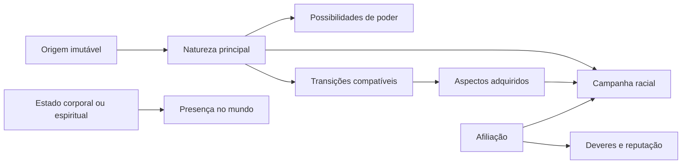

# Raças e origens

> **Direção vigente REV-SP-02 — 22/10/2026:** Spiritual Points compram **skills e transformações**, conforme esclarecimento explícito do usuário, usando Dragon Mine Z como referência para a compra. **Mastery é desenvolvida pela prática e não é comprada.** Requisitos/contexto disponibilizam a aquisição; SP paga a compra/desbloqueio; usar a capacidade depois segue os custos próprios de Energia/Stamina. [Contrato comum em M05/11.2](05-atributos-e-recursos.md#112-rev-sp-02--compra-de-skills-e-transformacoes-com-spiritual-points). Preços e exceções concretas permanecem nas fichas; a compra não pode ser removida genericamente por interpretação de M05/M06.

## Estado do módulo

| Campo | Valor |
|---|---|
| Estado | `ESPECIFICADO CONCEITUALMENTE` no escopo desta etapa; requisitos executáveis e conteúdo continuam delegados |
| Responsável pela decisão | Equipe do Bleach Mod |
| Última revisão | 22/10/2026 — criação/continuidade consolidadas após RAC-26, REV-RAC27-01 e RAC-28A/B; fronteiras e pendências registradas |
| Decisões herdadas | D01–D06, complemento de poderes canônicos, PRG-01–PRG-08 e STR-01–STR-07 |
| Decisões deste módulo | RAC-01–RAC-26, RAC-28A/B e REV-RAC27-01: um personagem por conta em cada mundo/servidor nesta etapa; múltiplos personagens adiados; RAC-29B guarda princípio futuro de posição própria |
| Próximo uso | M08 — NPCs, mentores e facções; aplicar os contratos às fichas de ensino, serviço de reset e continuidade |

Este documento trata da natureza espiritual e do começo jogável do personagem no **mod completo**. Ele ainda não autoriza implementação e não transforma possibilidades futuras em funcionalidades já prometidas.

O módulo foi organizado em partes:

1. **Identidade e transições:** significado de raça, origem, estado atual, aspectos adquiridos, híbridos e morte.
2. **Origens por caminho:** abertura Shinigami, Hollow, Quincy e Fullbringer.
3. **Regras de convivência:** diferenças raciais, vantagens, limitações, hostilidade e cooperação.
4. **Criação e continuidade:** confirmação da escolha, troca de personagem, reinício e migração de saves.

**Histórico de maturidade:** a conclusão original declarou `ESPECIFICADO`; a revisão de 22/10/2026 identificou que criação/continuidade ainda não tinha sido fechada. A discussão posterior registrou RAC-26, REV-RAC27-01 e RAC-28A/B e permitiu o fechamento **conceitual** abaixo. O antigo rótulo não representa ficha executável ou aceite técnico. Custos, técnicas, transformações, quests, dados e balanceamento continuam nos responsáveis.

## Leitura vigente e resultado da revisão — 22/10/2026

Este quadro orienta a leitura do registro acumulado abaixo. Os trechos antigos foram preservados; uma nota de revisão não é uma nova aprovação de produto. [Relatório completo](00-revisao-modulos-01-a-07-2026-10-22.md). [Cópia integral anterior a esta revisão](historico/2026-10-22-m04-antes-revisao-transversal.md).

| Tema | Contrato vigente e referência |
|---|---|
| Identidade e convivência | Origem, natureza, estado corporal, afiliação, cargo, principal e manifestação distintos; quatro origens, cooperação multirracial, morte comum sem troca racial. RAC-01–RAC-25 preservados |
| Pontos, fundamentos e técnicas | REV-SP-02/M05-11.2: SP compra skills e transformações, além dos atributos. Contexto/requisitos abrem aquisição; domínio/Mastery cresce pela prática, sem compra. Débito de aquisição e recursos de uso são diferentes |
| Início Fullbringer | F2/F12 refinam RAC-10 e exemplos anteriores: fundamentos sem objeto pessoal obrigatório; vetor do poder canônico só na aquisição, conforme F4. M06-10 detalha fundamentos/Bringer Light; não é preciso adquirir o Fullbring primeiro |
| Evolução Hollow e Arrancar | H8/H9 e M07-04/05: Arrancarizar em Gillian, Adjuchas ou Vasto Lorde; a passagem encerra a evolução Hollow normal. Vasto Lorde é conquista exigente determinística, não pergunta ainda aberta ou transformação temporária |
| Identidade Hollow | REV-H6-01/M06-08G permitem preparar a identidade antes de Arrancarizar em rota compatível; nenhuma linhagem universal para toda origem. Perfis corporais funcionais de M06, sem vantagem por cosmético |
| Corpo e trajetória Arrancar | M07-05D/E/F: base humanoide jogável nas três origens, domínio compatível preservado e trajetórias/preparo diferentes, sem bônus fixo ou teto menor só pela origem. Isso é adaptação do mod; medidas/viabilidade concretas pendentes |
| Troca Fullbring | M07-09C: processo contextual fora de combate; um principal disponível, histórico específico preservado e indisponível, sem copiar Mastery. Retorno exige reacesso. Não estender automaticamente a Zanpakutō, linhagem, Schrift ou raça |
| Criação e continuidade | RAC-26: confirmar antes do prólogo. REV-RAC27-01: um personagem por conta/mundo ou servidor nesta etapa; experimentar outra origem por reset NPC RAC-28A/B, preservando itens comuns/XP vanilla e mundo. Múltiplos personagens adiados; posição própria RAC-29B fica para essa expansão. Integrações e migração em M08/M10/M11/M14/M15/M16 |

**Conclusão vigente:** identidades raciais e criação/continuidade do escopo atual estão consolidadas conceitualmente. M04 não é especificação executável de todas as fichas; o fechamento abaixo distingue as decisões tomadas das entregas necessárias à implementação.

## Quarto bloco — Criação e continuidade — abertura em 22/10/2026

**Estado: CONSOLIDADO CONCEITUALMENTE em 22/10/2026. RAC-26 e RAC-28A/B decididos; REV-RAC27-01: um personagem por conta/mundo ou servidor nesta etapa, com reset por NPC. Múltiplos personagens e troca adiados; RAC-29B guarda posição própria para essa expansão.** Fronteiras e condições de reabertura no fechamento abaixo; nenhuma pergunta de troca bloqueia a etapa atual. São adaptações de produto para Minecraft, sem atribuir seleção de personagens ou reset ao cânone de Bleach.

### Base já decidida

- RAC-02: escolha informada da origem e prólogo próprio, com fantasia, condição inicial e permanência compreensíveis.
- RAC-04/RAC-06: origem permanece; transições narrativas compatíveis e morte de gameplay têm regras próprias. Reiniciar/criar personagem é uma operação separada.
- M03/STR-06: cronologia do mundo e progresso pessoal são distintos. Um personagem novo não reinicia a era do servidor.
- REV-SP-02/M05-11.2: skills e transformações são compradas com SP; Mastery é desenvolvida pela prática. Não revisar esse contrato nesta rodada.
- M07-09C: trocar o Fullbring principal no mesmo personagem é um processo específico; não equivale a criar outra identidade nem autoriza troca livre de raça.

### RAC-26 — Em que momento a escolha inicial é confirmada?

**DECIDIDO em 22/10/2026. Resposta:** “Confirmar antes do prólogo (recomendado)”. Permitir rever a seleção até uma confirmação explícita, antes de começar o prólogo racial. Confirmar cria a identidade com aquela origem; o prólogo apresenta e ensina a escolha já feita. Não há uma segunda seleção de raça como recompensa ao terminar a introdução.

O resumo anterior à confirmação deve explicar a fantasia, o começo e a permanência da origem. Não precisa expor o catálogo inteiro de poderes ou exigir a escolha imediata de Zanpakutō, linhagem, Schrift ou Fullbring canônico. Voltar entre alternativas antes de confirmar não gera compras, recompensas ou progresso jogável.

| Alternativa | Efeito para o jogador | Avaliação |
|---|---|---|
| A — Confirmar antes do prólogo | Escolhe com informação e começa a viver a origem confirmada | Recomendada: separa seleção e jornada, evitando refazer uma introdução por seleção acidental |
| B — Confirmar somente depois de experimentar o prólogo | Pode testar uma abertura antes de assumir a origem | Exige definir o que acontece com itens, recompensas, ações no mundo e progresso ao voltar; experiência prévia não está especificada |

M04 define o compromisso da escolha; M14 define apresentação e comandos; M13 detalha a introdução; M16 define gravação e retomada. Sair ou falhar na confirmação não pode ser confundido com ter completado uma origem. A retomada precisa preservar a origem já confirmada e o andamento da introdução, sem tratar desconexão como nova seleção ou conceder novamente recompensas concluídas. Gravação e recuperação executáveis ficam em M16.

### RAC-27 — Política de personagem e prioridade de entrega

#### REV-RAC27-01 — Um personagem nesta etapa; múltiplos personagens depois

**DECIDIDO por revisão explícita do usuário em 22/10/2026.** Resposta integral à pergunta de troca: “Não sei se a ideia de ter vários personagens é a melhor agora, acredito que o cara apenas resetar e começar de novo por enquanto com a evolução de ter isso depois, mas isso é possivel em mods de minecraf?”.

**Direção vigente:** um personagem por conta em cada mundo/servidor nesta etapa. Para recomeçar e escolher outra origem no mesmo mundo, usar o reset por NPC de RAC-28A/B. O reset substitui a progressão Bleach anterior; não conserva outra jornada selecionável ou cria um slot oculto para recuperá-la. Mantém inventário comum, XP vanilla, mundo e construções conforme o alcance aprovado.

**Evolução futura:** vários personagens por conta no mesmo mundo/servidor permanecem no horizonte, com jornadas separadas e um ativo por vez, sem compromisso de entrega imediata. Quantidade, interface, inventários por identidade, vínculos, economia, migração e segurança da troca serão especificados quando essa expansão entrar no escopo. Não exigir agora tela de seleção ou serviço NPC de troca.

**Histórico:** RAC-27 havia aprovado personagens separados com complemento de reset por NPC; REV-RAC27-01 altera sua prioridade/abrangência de entrega, preservando RAC-26 e RAC-28A/B. [Registro anterior do bloco](historico/2026-10-22-m04-antes-adiamento-multiplos-personagens.md). Não interpretar a aprovação anterior como obrigação de implementar múltiplos personagens já.

**Impacto técnico conferido em 22/10/2026:** `PlayerData` possui um `CharacterData` e conjuntos de recursos, skills, atributos e quests pessoais; `PlayerProvider` mantém um `PlayerData` e serializa para NBT; `CapabilityEvents` o anexa à entidade do jogador. Essa estrutura consultada corresponde a um conjunto de progressão por jogador, não demonstra um gerenciador pronto de perfis independentes. Conferência dirigida desses arquivos e de `ConfirmCharacterC2S`; não auditoria completa do runtime ou compatibilidade de mods.

**Viabilidade futura, como análise técnica:** Forge 1.20.1 permite dados próprios persistentes anexados ao jogador, com sincronização administrada pelo mod. Isso fornece meios para construir perfis, mas não entrega múltiplos personagens automaticamente. Separar inventário/XP/posição, quests, itens vinculados, pets e permissões exige uma camada de identidade e integração, especialmente com sistemas que identificam o jogador pela conta. Fonte primária consultada em 22/10/2026: [Forge 1.20.1 — Capabilities](https://docs.minecraftforge.net/en/1.20.1/datastorage/capabilities/), seções Attaching Capabilities, Synchronizing Data with Clients e Persisting across Player Deaths. Viabilidade é inferência de arquitetura apoiada nesses mecanismos e no código local; sem implementação/prova de troca nesta rodada.

### RAC-28 — Reset de personagem por NPC

#### RAC-28A — Existência do serviço

**DECIDIDO em 22/10/2026**, pelo complemento da resposta de RAC-27: “a opção recomendada mas com a possibilidade de resetar em algum npc”. Haverá a possibilidade de solicitar reset por um NPC. Conforme REV-RAC27-01, nesta etapa ele permite recomeçar o personagem único; múltiplos personagens ficam para expansão futura. NPC, preço e frequência continuam pendentes; o alcance das perdas foi aprovado posteriormente em RAC-28B. A fala não é uma solicitação para apagar qualquer personagem/save real nesta sessão.

**Integrações:** M04 define o que reinicia; M08 define o prestador e sua disponibilidade; M11 trata itens/custo do serviço; M14 apresenta a confirmação; M15 trata regras de servidor e recompensas repetidas; M16 executa e persiste a operação com recuperação em caso de falha. O NPC solicita a operação ao sistema responsável, conforme o mapa modular.

#### RAC-28B — Alcance do reset

**DECIDIDO em 22/10/2026. Resposta:** “Reset Bleach; preservar itens comuns e XP (recomendado)”. [Proposta anterior preservada](historico/2026-10-22-proposta-m04-rac28b-reset.md). Reiniciar a **progressão de Bleach do personagem escolhido**, voltando às condições de um personagem novo e permitindo selecionar novamente a origem conforme RAC-26. Isso inclui atributos do mod, saldo e compras de SP, aprendizados, Proficiências, Masteries, poderes, evolução, campanha e reputação pessoais. Não há reembolso dos SP gastos ou transferência desse progresso para outra identidade. Os demais personagens, o mundo, suas construções e a era compartilhada permanecem.

Preservar inventário comum e experiência vanilla desse personagem, conforme a alternativa A aprovada. Manter um item físico não preserva poder vinculado, técnica, requisito ou compra apagados pelo reset. Equipamentos espirituais, itens de quest e outros itens vinculados precisam de destino próprio em M11/M12; não prometer destruição de todos, nova vinculação automática, recall, duplicação ou conservação de acesso especial. Armazenamento externo e propriedade continuam com suas regras; o reset não oferece restauração global de baús ou construções.

| Alternativa | Consequência | Avaliação |
|---|---|---|
| A — Reiniciar progressão Bleach, preservar inventário comum e XP vanilla | Permite recomeçar a jornada espiritual mantendo os recursos da experiência Minecraft; itens especiais dependem da ficha | Recomendada para preservar a exploração e construção acumuladas |
| B — Reiniciar também inventário e XP vanilla do personagem | Recomeço pessoal mais amplo, incluindo perdas materiais; baús externos, mundo e outros personagens não são apagados | Exige comunicar o alcance com precisão; não elimina por si só uso de armazenamento externo |

**Condições do pacote aprovado:** o reset é do personagem escolhido, exige confirmação explícita e ocorre fora de combate/encontro; preserva os demais personagens, mundo e construções. **Integridade a especificar em M16:** validar a identidade afetada e a ausência de execução comprometida; apresentar as perdas antes de confirmar; concluir integralmente ou preservar o estado anterior em caso de falha, sem recompensas parciais. A mudança de origem por reset recomeça a jornada pessoal, sem transformar uma identidade avançada em outra mantendo suas conquistas. Identificador, histórico técnico, itens vinculados, consequências persistentes, quotas de recompensas e retomada numa era avançada precisam de contratos explícitos antes da implementação. Não considerar reset um reembolso de SP ou um mecanismo automático de recuperação de Bankai/Letzt Stil.

**Pendências:** NPC/preço/frequência, destino de itens vinculados, protocolo de confirmação/falha e retomada da campanha na era atual. O reset volta às condições iniciais da origem escolhida; não entrega pontos ou atributos literalmente zerados quando o começo da origem tiver valores próprios. Nesta etapa, resetar explicitamente o personagem único substitui sua progressão Bleach; não há outra jornada preservada para recuperar por troca de slot. A futura criação de personagens independentes exigirá seu próprio contrato.

### RAC-29 — Múltiplos personagens: direções da expansão futura

**Fora do escopo desta etapa por REV-RAC27-01.** Não impede avançar a documentação atual. As propostas anteriores de troca foram preservadas no [histórico](historico/2026-10-22-m04-antes-adiamento-multiplos-personagens.md).

#### RAC-29A — Acesso e condições da troca: ADIADO

O usuário revisou o escopo ao responder à escolha entre tela e NPC; não escolheu um acesso de troca para implementação atual. Interface, prestador, condições seguras de troca, encerramento de manifestações e estados da identidade inativa serão fechados quando múltiplos personagens entrarem no escopo. Contratos de custos, relógio do mundo e consequências de M06/M07 continuam como requisitos de integração; não declarar aprovada uma nova rotina de troca apenas por já haver regras de logout.

#### RAC-29B — Local próprio: direção aprovada para a expansão futura

**Resposta em 22/10/2026:** “Cada personagem volta ao próprio local (recomendado)”. Guardar essa escolha para a função futura: cada personagem retoma a própria posição/dimensão, sem assumir o local de quem saiu. Não habilita múltiplos personagens agora nem define o local após reset, respawn ou transição de prólogo.

Validação de dimensão, acesso, espaço corporal e recuperação de destino inválido continuam dependências de M10/M15/M16 antes da entrega futura. Recusa da troca e recuperação segura foram propostas na rodada anterior; detalhes executáveis não estão resolvidos. Nenhum teleporte corretivo ou remoção de blocos foi aprovado por esta resposta.

### Pendências para fechar o bloco após RAC-26/RAC-27

| Assunto | Decisão/entrega necessária | Responsável |
|---|---|---|
| Múltiplos personagens e troca | Adiados por REV-RAC27-01; RAC-29B guarda posição própria para a expansão. Sem pergunta ou implementação de troca nesta etapa | Futuro escopo M04/M06/M07/M10/M11/M14/M15/M16 |
| Inventário, propriedade e economia | Itens vinculados, recipientes, equipamentos, armazenamento, pets/construções, comércio e recompensas repetíveis; evitar cópia e ganho indevido sem presumir proibição de uso compartilhado | M11/M12/M15/M16 |
| Personagem novo numa era avançada | Abertura racial e acesso aos acontecimentos necessários, sem retroceder a cronologia global | M03/M10/M12/M13/M15 |
| Reinício, exclusão e retorno | Reset por NPC e alcance aprovados em RAC-28A/B. Exclusão de personagem, preço/limite e detalhes de retorno ainda não definidos. Não confundir criar outro, trocar e resetar | M04/M08/M11/M14/M15/M16 |
| Save existente e migração | Mapear progresso legado sem escolher outra origem ou apagar dados por inferência; definir plano de compatibilidade, recuperação e evidência antes de qualquer migração | M16, consultando M04/M05/M06/M07 |

**Critérios candidatos desta etapa, não testes executados:** seleção ainda não confirmada não produz conquistas; personagem confirmado retoma sua origem; reset exige confirmação fora de combate/encontro, reinicia somente a progressão Bleach e preserva itens comuns/XP vanilla, mundo e construções; não reembolsa SP nem restaura o poder apagado por manter seu item. Migração não altera dados silenciosamente. Casos de alternância entre perfis ficam na expansão futura.

**Próximo:** M08, mantendo as entregas abaixo como condições da implementação de cada recurso. A expansão de múltiplos personagens não impede a etapa atual. Sem implementação, alteração de saves ou testes do jogo nesta rodada.

### Fechamento da revisão de M04 — 22/10/2026

**Resultado:** `ESPECIFICADO CONCEITUALMENTE` para a etapa com personagem único e reset NPC. Não resta escolha geral identificada de política de personagem impedindo M08. A revisão encerra a lacuna conceitual REV-03; não declara especificação executável, revisão exaustiva de todo cânone ou implementação/aceite.

| Fronteira | Contrato decidido / entrega necessária |
|---|---|
| Identidade e escolha | M04: origem confirmada antes do prólogo, permanente na jornada; mudanças compatíveis seguem seus processos. Reset reinicia a jornada Bleach, com nova seleção |
| Continuidade da sessão | M06/M07: retornar preserva conquistas e respeita o encerramento de estados temporários e tempos aprovados. Retomar não reexecuta compra ou recompensa concluída |
| Escopo desta etapa | REV-RAC27-01: um personagem por conta no mundo/servidor. Múltiplos personagens/troca futuros; exclusão livre de slots não integra o serviço de reset aprovado |
| Serviço de reset | M08 define prestador/acesso; M11 custo e itens vinculados; M14 comunicação/confirmação; M15 limites de repetição e recompensas; M16 integridade, gravação e falha. M04 já fixa perdas/preservações, sem preço escolhido |
| Corpo e lugar após reset | M07/M10/M11/M16 precisam definir ordem da troca corporal, condição de mãos/itens, acesso e retorno válido à introdução da origem na era atual. A posição própria de RAC-29B não resolve reset; não foi aprovado teleporte, apagamento de blocos ou travessia gratuita |
| Save existente | M16 mapeia os dados legados com os sistemas: o que pode ser mantido, o que mudou de significado e o que requer decisão. Não executar conversão ou reset por inferência de texto; plano e recuperação precedem qualquer migração. O mapeamento concreto não foi aprovado por este fechamento |
| Mundo compartilhado | Era, construções e progresso de terceiros não reiniciam por seleção/reset pessoal. M03/M10/M12/M13/M15 resolvem acesso à campanha numa era já avançada |

**Antes de entregar reset em gameplay:** resolver itens vinculados e recompensas de introdução/repetição, recuperar falha da operação, fornecer destino corporal válido e garantir acesso viável ao prestador. As dependências não são dispensadas por este fechamento.

**Reabrir M04 se:** a integração exigir mudar perdas/preservações, número de personagens desta etapa, permanência da origem ou proteção do mundo; ou se nenhuma solução dos módulos responsáveis cumprir esses contratos. Não inventar migração, número ou regra de acesso apenas para remover uma pendência.

### Registro parcial das decisões — síntese alinhada às revisões

| Decisão | Estado | Direção atual |
|---|---|---|
| RAC-01 | `DECIDIDO` | Identidade representada em camadas: origem, natureza, estado, aspectos adquiridos e afiliação. |
| RAC-02 | `DECIDIDO` | Escolha informada da origem, seguida por prólogo exclusivo que confirma e ensina aquela identidade. |
| RAC-03 | `DECIDIDO` | Cada caminho começa em estado próprio e anterior ao domínio do elemento que define seu combate. |
| RAC-04 | `DECIDIDO` | A origem é permanente; estados e aspectos compatíveis só mudam por transições narrativas controladas. |
| RAC-05 | `DECIDIDO` | Nenhum híbrido jogável nas entregas iniciais; híbridos entram no produto completo após estabilização das raças puras. |
| RAC-06 | `DECIDIDO` | Morte comum é derrota de gameplay; somente eventos narrativos alteram a condição espiritual. |
| RAC-07 | `DECIDIDO` | Todos surgem no Mundo Humano; a introdução racial encaminha o Shinigami à Academia, onde começa o treino com shinai. |
| RAC-08 | `DECIDIDO` | A rota Hollow apresenta brevemente o passado como Plus e começa o combate como Hollow recém-formado, com vantagem corporal inicial em vez de arma. |
| RAC-09 | `DECIDIDO` | Humano de herança Quincy fragmentada ou oculta, inicialmente independente do Wandenreich. |
| RAC-10 | `DECIDIDO`, refinado por F2/F4/F12 | Humano independente começa pelos fundamentos; depois conquista Fullbring canônico e seu vetor apropriado, sem objeto pessoal obrigatório no prólogo. |
| RAC-11 | `DECIDIDO` | Prólogos diferentes convergem funcionalmente para a mesma era e campanha compartilhada. |
| RAC-12 | `DECIDIDO` | Guia apropriado ao caminho; uma alma-guia vinculada ao jogador poderá abrir diálogos ao ser usada como item. |

## Objetivo

Definir um modelo no qual cada jogador:

- possua uma origem compreensível e coerente com *Bleach*;
- viva uma abertura própria para seu caminho, conforme STR-04;
- não receba uma raça apenas como pacote de bônus escolhido sem contexto;
- preserve sua identidade quando atingir estados como Arrancar ou uma condição semelhante à Hollowficação;
- possa participar das mesmas eras que outras raças sem se tornar uma variação cosmética delas;
- mantenha uma história legível para quests, NPCs, transformações, reputação e multiplayer.

## Fantasia do jogador

O jogador não deve sentir que escolheu apenas uma classe. Ele deve sentir que descobriu **o que é**, **como chegou a essa condição**, **a que mundo pertence** e **o que pode se tornar**.

Cada caminho precisa responder perguntas diferentes:

- **Shinigami:** por que essa alma assumiu o dever de conduzir e proteger outras almas?
- **Hollow:** o que restou de sua identidade diante da fome, do instinto e da transformação?
- **Quincy:** qual relação o personagem possui com sua herança, seus ensinamentos e o conflito histórico com os Shinigami?
- **Fullbringer:** que experiência, objeto e vínculo pessoal deram forma ao seu poder?

Essas perguntas orientam a origem. Elas não definem ainda Zanpakutō, Resurrección, Schrift, Vollständig ou Fullbring individual.

## Problema central: “raça” não explica o personagem inteiro

No código atual, `race` é um identificador permanente usado para escolher árvores de formas, custos e requisitos. Esse modelo é suficiente para o MVP Shinigami, mas uma única string não representa bem todas as situações previstas para o produto completo.

Em *Bleach*, conceitos diferentes podem coexistir:

- um humano vivo pode atuar como Shinigami Substituto;
- um Shinigami pode adquirir uma condição Hollow sem deixar de possuir Zanpakutō e cargo;
- um Hollow pode tornar-se Arrancar e ainda carregar sua origem e classe evolutiva anterior;
- um Quincy pode ser independente ou integrar o Wandenreich;
- um Fullbringer continua sendo humano e não precisa pertencer à Xcution;
- personagens excepcionais podem reunir mais de uma herança espiritual.

Por isso, o termo “raça” continuará útil para o jogador, mas não deve obrigar todo o sistema a guardar identidade, corpo, facção e transformação no mesmo campo.

## Base canônica

### Fatos que orientam o modelo

- Ichigo começa como humano capaz de ver espíritos, recebe poderes de Rukia e atua como Shinigami Substituto. A história posterior revela que ele nasceu de um Shinigami e de uma Quincy. O caso demonstra que origem, herança, função e estado de poder não são sinônimos. Fontes oficiais: [BLEACH TYBW — Characters](https://bleach-anime.com/en/character/) e [episódio 13 — The Blade Is Me](https://bleach-anime.com/en/story/?id=13).
- A página oficial apresenta antigos capitães como Shinji, Rose e Kensei como Shinigami que foram Hollowficados e depois puderam voltar a ocupar cargos na Gotei 13. Logo, a condição Hollow adquirida não apaga automaticamente a natureza, a história ou a posição Shinigami. Fonte oficial: [BLEACH TYBW — Characters](https://bleach-anime.com/en/character/).
- Uryū é apresentado como descendente Quincy e, mais tarde, integrante dos Sternritter. Masaki é apresentada como Quincy e mãe de Ichigo; Kanae é identificada como Quincy de linhagem mista. Esses casos distinguem herança Quincy de afiliação ao Wandenreich e confirmam a existência de heranças mistas. Fonte oficial: [BLEACH TYBW — Characters](https://bleach-anime.com/en/character/).
- O Wandenreich também emprega Arrancars, como Ebern e Lüdaas. Portanto, pertencer a uma organização não determina sozinho a natureza do personagem. Fonte oficial: [BLEACH TYBW — Characters](https://bleach-anime.com/en/character/).
- Ginjō manifesta seu Fullbring por meio de um pingente e Chad descobre que seu poder pertence à mesma categoria. Isso sustenta uma origem Fullbringer baseada em experiência pessoal, afinidade e foco material, não em uma organização obrigatória. Fontes oficiais licenciadas: [Kūgo Ginjō](https://www.bleach-bravesouls.com/en/character/ginjo.html) e [Yasutora Sado](https://www.bleach-bravesouls.com/en/character/sado.html).
- Aaroniero é apresentado como o único Gillian a tornar-se Espada. O exemplo reforça que classe Menos de origem, condição Arrancar e posto Espada são informações distintas. Fonte oficial licenciada: [Aaroniero Arruruerie](https://www.bleach-bravesouls.com/en/character/aaroniero.html).

### Limites da evidência

A obra possui exceções importantes e não oferece quatro processos simétricos de criação de personagem. Transformar Shinigami, Hollow, Quincy e Fullbringer em caminhos igualmente completos é uma **adaptação de game design**.

Também não será presumido que qualquer combinação de heranças observada em um personagem excepcional possa ser reproduzida livremente por todos os jogadores. Compatibilidades, riscos e acessos precisam ser definidos pelo jogo.

## Adaptação para Minecraft

### A escolha deve ter agência sem perder contexto

Uma raça completamente aleatória pode obrigar o jogador a abandonar um mundo para jogar a fantasia desejada. Uma escolha puramente mecânica, feita por ícones e bônus antes de qualquer contexto, enfraquece a promessa de descoberta.

A direção recomendada é combinar as duas necessidades:

1. o jogador escolhe conscientemente uma **origem jogável**, com descrição clara da fantasia e de sua permanência;
2. essa escolha não entrega o kit completo imediatamente;
3. o prólogo exclusivo faz o personagem viver o despertar, a perda ou o recrutamento correspondente;
4. somente então a interface passa a apresentar a identidade usando os termos do universo.

Essa direção foi aprovada em RAC-02. A forma e o texto da seleção serão definidos no bloco de criação e continuidade.

### Derrota de Minecraft não deve reescrever a origem

Se toda morte comum transformasse um humano em Plus, um Plus em Hollow ou removesse uma identidade, lava, queda, PvP e comandos administrativos passariam a reescrever a campanha. O jogador também poderia explorar a morte para pular requisitos narrativos.

A recomendação é interpretar a morte comum como **derrota de gameplay**. Mudanças espirituais permanentes acontecem apenas em eventos narrativos explicitamente preparados para isso. O respawn continua existindo sem negar que a morte possui significado no universo; ele apenas separa falha mecânica de acontecimento canônico.

## Escopo

### Pertence a este módulo

- caminhos jogáveis Shinigami, Hollow, Quincy e Fullbringer;
- origem narrativa de cada caminho;
- distinção entre origem, natureza, estado espiritual, aspecto adquirido e afiliação;
- permanência e transições raciais;
- lugar conceitual de Arrancar, Shinigami Substituto, Hollowficação e híbridos;
- relação entre morte de gameplay e mudança espiritual narrativa;
- regras de criação, confirmação e eventual reinício de personagem;
- vantagens, limitações e responsabilidades raciais em nível conceitual.

### Não pertence a este módulo

- catálogo, distribuição e combinação dos conjuntos de poderes canônicos;
- técnicas compartilhadas e exclusivas de combate;
- requisitos completos de Shikai, Bankai, Resurrección, Schrift, Vollständig ou Fullbring completo;
- fórmulas de atributos, reiatsu, dano ou Battle Power;
- cargos, reputações e serviços detalhados de facções;
- quests e diálogos completos dos prólogos;
- modelos, animações e efeitos visuais finais;
- balanceamento numérico e implementação de multiplayer.

## Modelo conceitual candidato

A alternativa recomendada em RAC-01 separa o personagem em camadas. Os nomes internos ainda são provisórios.

| Camada | Pergunta respondida | Exemplos conceituais |
|---|---|---|
| Origem | Como a jornada começou? | alma do Rukongai; alma perdida; herdeiro Quincy; humano espiritualmente sensível |
| Natureza principal | Qual caminho fornece as regras fundamentais atuais? | Shinigami; Hollow; Quincy; Fullbringer |
| Estado espiritual ou corporal | Em que condição o personagem está presente no mundo? | corpo humano; alma separada; gigai; corpo Hollow |
| Aspectos adquiridos | O que foi acrescentado ou alterado sem apagar a história anterior? | Arrancarização; Hollowficação; poder de Shinigami Substituto |
| Afiliação | A quem o personagem serve ou com quem coopera? | independente; Gotei 13; Wandenreich; Xcution; grupo original |
| Conjunto de poder canônico | Qual repertório de personagem real dá coerência às manifestações? | Zanpakutō; perfil Hollow/Arrancar; especialização Quincy ou Schrift; objeto e Fullbring |
| Manifestação atual | Que forma ou liberação está ativa? | será definida em `07-transformacoes-e-dominio.md` |

Essas camadas não precisam aparecer simultaneamente na HUD. Elas existem para evitar contradições e permitir que cada sistema consulte somente a informação de que necessita.



## Regras decididas do primeiro bloco

RAC-01–RAC-06 estão decididas com as seguintes regras:

1. Origem, natureza, afiliação, manifestação e classificação de combate não são o mesmo dado.
2. O jogador escolhe sua fantasia de origem com informação suficiente, mas vive o despertar dentro do mundo.
3. Cada raça possui prólogo próprio; não haverá um prólogo humano idêntico que apenas troca o poder no final.
4. A origem permanece no histórico do personagem mesmo quando sua natureza ganha uma ramificação.
5. Arrancar é uma ramificação do caminho Hollow, não um posto posterior a Vasto Lorde.
6. Shinigami Substituto descreve uma condição e função do caminho Shinigami, não uma quinta raça obrigatória.
7. Híbridos não estarão disponíveis nas entregas iniciais e, quando forem adicionados, não funcionarão como seleção livre de vantagens.
8. Morte comum e respawn não alteram raça ou campanha; transições permanentes são acontecimentos controlados.
9. Afiliação não é imposta apenas pela raça: Quincy não significa automaticamente Wandenreich e Fullbringer não significa automaticamente Xcution.
10. O sistema pode compartilhar contratos técnicos entre raças, mas as experiências de origem não serão cópias com textos diferentes.

## Primeiro bloco de decisões — identidade e transições

### RAC-01 — Como o jogo representa a identidade racial?

| Alternativa | Benefício | Custo ou risco |
|---|---|---|
| **A. Modelo em camadas: origem, natureza, estado, aspectos e afiliação** | Representa Arrancar, Visored, Substituto e híbridos sem confundir cargo com raça. | Exige evolução da estrutura atual e regras claras de compatibilidade. |
| B. Uma única raça permanente com todas as variações tratadas como formas | Mais próximo do código atual. | Mistura transformação, herança e estado; tende a produzir exceções difíceis de manter. |
| C. Classes livremente combináveis sem natureza principal | Grande liberdade de build. | Afasta-se de Bleach e permite combinações sem coerência narrativa. |

**Decisão aprovada:** alternativa A. O jogador ainda pode ver uma raça principal na interface, mas o jogo preserva as demais camadas para decisões narrativas e mecânicas.

### RAC-02 — Como o jogador escolhe o caminho inicial?

| Alternativa | Benefício | Custo ou risco |
|---|---|---|
| **A. Escolha informada de origem seguida por prólogo exclusivo de confirmação** | Garante agência, permite organizar parties e transforma a escolha em experiência vivida. | O jogador conhece a direção geral antes da revelação narrativa. |
| B. Ações durante uma abertura comum determinam a raça sem confirmação explícita | Pode produzir surpresa e descoberta orgânica. | É difícil prever o resultado, favorece guias externos e entra em tensão com origens próprias desde o início. |
| C. Sorteio completo da origem | Incentiva adaptação e replay. | Pode frustrar quem entrou para jogar uma fantasia específica e estimular recriação de mundos. |

**Decisão aprovada:** alternativa A. A tela descreve fantasia, condição inicial e permanência, não todos os poderes futuros. O prólogo entrega o significado da escolha e o primeiro despertar.

### RAC-03 — Em que ponto de desenvolvimento cada personagem começa?

> **Exemplo de origem refinado:** aplicar F2/F4/F12 e a síntese vigente no início do módulo. Objeto/poder principal não são requisitos universais do prólogo Fullbringer; o texto original seguinte é histórico.

| Alternativa | Benefício | Custo ou risco |
|---|---|---|
| **A. Estado inicial próprio, anterior ao domínio de combate** | Permite viver recrutamento, despertar, fome ou primeiro controle sem tornar todas as origens iguais. | Exige quatro aberturas e ritmos diferentes. |
| B. Todos começam como membros já treinados de sua raça | Ação imediata e tutorial curto. | Remove parte importante da jornada e exige exposição para explicar o passado. |
| C. Todos começam como humanos comuns e convergem para uma escolha posterior | Uma abertura reutilizável. | Contradiz a origem própria aprovada em STR-04 e não serve naturalmente ao caminho Hollow ou a almas da Soul Society. |

**Decisão aprovada:** alternativa A. “Anterior ao domínio” não significa o mesmo estado para todos. O segundo bloco decidirá o ponto exato de cada raça.

#### O que “estado inicial próprio, anterior ao domínio” significa

Esta decisão não obriga todos a começarem humanos, indefesos ou no mesmo nível narrativo. Ela estabelece apenas que o jogador começa **antes de dominar aquilo que define o combate de sua raça**, para que o primeiro poder seja vivido e aprendido em vez de já existir sem contexto.

Os exemplos abaixo são ilustrações para esclarecer RAC-03; não fecham ainda as quests nem a origem exata de cada raça:

| Caminho | Exemplo de estado inicial | Primeiro limiar jogável | O que não estaria disponível no começo |
|---|---|---|---|
| Shinigami | alma com potencial espiritual, ainda aspirante ou recém-recrutada | ser orientado, receber uma Asauchi e aprender deveres e combate elementar | Zanpakutō plenamente formada, Shikai, Bankai ou patente relevante |
| Hollow | Hollow recém-formado, fraco, desorientado e com memória fragmentada | sobreviver, perceber presas e ameaças e começar a afirmar a própria identidade | classe Menos, Arrancarização, Resurrección ou técnicas avançadas |
| Quincy | humano vivo com herança conhecida ou recém-revelada, mas controle insuficiente | perceber, reunir e moldar reishi até formar sua primeira arma funcional | repertório militar, Schrift, Vollständig ou posição no Wandenreich |
| Fullbringer | humano espiritualmente sensível cujo objeto reage de forma pequena ou instável | reconhecer a afinidade e produzir a primeira manifestação controlada | Fullbring completo, refinamentos avançados ou vínculo obrigatório com a Xcution |

No caminho Hollow, o trecho como Plus e a perda que antecedeu a Hollowficação podem aparecer como prólogo curto, memória ou cena jogável. RAC-03 não exige manter o jogador por horas em um estado sem capacidade de combate.

No caminho Shinigami, também não fica decidido ainda se a abertura principal será uma alma do Rukongai entrando na Academia ou um humano tornando-se Shinigami Substituto. RAC-03 decide somente que nenhuma das duas opções começaria com a jornada já pronta.

Em termos de ritmo, a estrutura seria:

```text
condição inicial própria
    -> primeiro problema racial
    -> aprendizado ou sobrevivência guiada
    -> primeira capacidade confiável
    -> começo da campanha racial
```

**O que RAC-03 não significa:**

- um prólogo comum para as quatro raças;
- sorteio oculto da raça;
- várias horas sem poder jogar ou lutar;
- começar todas as raças com a mesma força ou o mesmo conjunto de objetivos;
- decidir agora quem será o mentor, quais mobs aparecerão ou qual será a duração do tutorial.

**Minha avaliação:** a alternativa A continua sendo a melhor. Ela dá valor ao primeiro arco de progressão sem obrigar a equipe a transformar todo começo em uma longa fase de impotência. O ponto inicial exato de cada raça será a próxima discussão.

### RAC-04 — A natureza do personagem pode mudar?

| Alternativa | Benefício | Custo ou risco |
|---|---|---|
| **A. Origem permanente; transições narrativas controladas alteram ou acrescentam estados compatíveis** | Preserva a biografia e permite Arrancarização ou condições adquiridas sem troca livre. | Requer histórico de transições e matriz de compatibilidade. |
| B. Raça absolutamente imutável e sem aspectos cruzados | Regra simples e identidade forte. | Impede partes importantes do universo e torna casos híbridos impossíveis. |
| C. Troca de raça por item, comando comum ou custo em pontos | Facilita experimentar todo o conteúdo. | Destrói consequências, campanhas e balanceamento de identidades. |

**Decisão aprovada:** alternativa A. Uma transição nunca apaga silenciosamente a origem; ela registra um novo estado autorizado pela narrativa. Reiniciar um personagem é uma operação separada, não uma transformação do lore.

#### O que permanece e o que pode mudar

RAC-01 aprovou que o personagem possui várias camadas. RAC-04 decide como essas camadas se comportam com o tempo:

| Informação | Comportamento recomendado | Exemplo |
|---|---|---|
| Origem | permanece como histórico imutável | “começou como alma perdida” ou “nasceu humano com herança Quincy” |
| Natureza ou caminho principal | permanece como raiz, mas pode desenvolver uma ramificação prevista | Hollow continua pertencendo à raiz Hollow ao tornar-se Arrancar |
| Estado atual | pode mudar com corpo, mundo e situação | humano em seu corpo, alma separada ou ocupando um gigai |
| Aspectos adquiridos | podem ser acrescentados somente por acontecimentos compatíveis | Shinigami recebe uma condição Hollowficação |
| Afiliação | pode mudar por escolhas sociais e narrativas | Quincy independente entra ou rompe com o Wandenreich |
| Forma ativa | muda durante o combate | liberação e retorno ao estado-base, conforme o módulo de transformações |

##### Exemplo 1 — Hollow que se torna Arrancar

Antes da transição:

```text
origem: alma perdida
raiz: Hollow
estado evolutivo: Hollow ou classe Menos alcançada
aspecto: nenhum
afiliação: independente
```

Depois de uma Arrancarização autorizada:

```text
origem: alma perdida              <- não muda
raiz: Hollow                      <- não muda
estado/ramificação: Arrancar      <- acrescentado
histórico evolutivo: preservado   <- Gillian, Adjuchas etc., quando aplicável
afiliação: independente           <- não vira Espada automaticamente
```

Isso permite ao jogo saber que o personagem é Arrancar para Resurrección, que veio da raiz Hollow para sua campanha racial e que não ganhou um posto social com a transformação.

##### Exemplo 2 — Shinigami Hollowficado

O personagem continua com origem e caminho Shinigami, sua Zanpakutō e seu histórico institucional. Um acontecimento específico acrescenta um aspecto Hollow, que pode abrir riscos, reações de NPCs e possibilidades futuras. Ele não apaga a campanha Shinigami nem se transforma livremente em um Hollow comum. Os antigos capitães Hollowficados e depois reintegrados demonstram por que essas informações precisam coexistir no modelo canônico. Fonte oficial: [BLEACH TYBW — Characters](https://bleach-anime.com/en/character/).

##### Exemplo 3 — Quincy entra no Wandenreich

Nada muda na herança Quincy. O que muda é a afiliação, os deveres, o acesso a mentores e talvez a possibilidade narrativa de receber determinados poderes. Sair do Wandenreich também não remove automaticamente a natureza Quincy.

##### Exemplo 4 — Shinigami Substituto

Um personagem pode ter origem humana e atuar no caminho Shinigami como Substituto. A classificação exata desse caso será decidida no bloco das origens, mas o histórico humano não precisa ser apagado para o jogo permitir poderes e deveres Shinigami. O material oficial descreve Ichigo como humano que recebe poderes e passa a ocupar a função de Shinigami Substituto. Fonte oficial: [BLEACH TYBW — Characters](https://bleach-anime.com/en/character/).

“Transição narrativa controlada” significa que a mudança exige uma situação criada para ela: autorização da campanha, compatibilidade, prova e consequências. Não significa comprar “trocar raça” com pontos, usar um item comum ou morrer de propósito.

**Minha avaliação:** recomendo a alternativa A. A alternativa B deixaria o sistema simples agora, mas representaria Arrancars, Visored e Substitutos de maneira incompleta ou por exceções. A alternativa C faria origem e campanha perderem importância.

### RAC-05 — Como híbridos entram no produto completo?

| Alternativa | Benefício | Custo ou risco |
|---|---|---|
| **A. Aspectos excepcionais, compatíveis e conquistados; arquitetura preparada, conteúdo gradual** | Permite explorar o tema sem transformar todos em cópias de Ichigo. | Balanceamento e narrativa são complexos; nem toda combinação poderá existir. |
| B. Criador livre de híbridos desde o início | Máxima personalização imediata. | A combinação ótima tende a apagar raças puras e multiplica poderes, visuais e testes. |
| C. Nenhum híbrido jogável | Escopo e balanceamento menores. | Exclui um tema central da obra e limita expansões futuras. |

**Decisão aprovada — alternativa A com ordem de entrega:**

1. as entregas iniciais não terão nenhum híbrido jogável;
2. Shinigami, Hollow, Quincy e Fullbringer puros devem existir como caminhos completos e valiosos primeiro;
3. o modelo de dados não deve impedir híbridos futuros;
4. híbridos entram no produto completo somente após os caminhos puros estarem estabilizados e balanceados;
5. quais combinações existirão e como serão conquistadas continuam abertas.

Antes de liberar o primeiro híbrido, a equipe deverá demonstrar que ele possui custo, risco, narrativa e limitações próprias e que não transforma uma raça pura em escolha objetivamente inferior. “Produto completo” garante que haverá conteúdo híbrido jogável; não garante que toda combinação imaginável será permitida.

### RAC-06 — O que uma morte comum de Minecraft representa?

| Alternativa | Benefício | Custo ou risco |
|---|---|---|
| **A. Derrota de gameplay; mudanças espirituais apenas em eventos narrativos** | Mantém respawn jogável e impede morte acidental ou explorável de reescrever a campanha. | Exige comunicar por que certas mortes narrativas são diferentes. |
| B. Toda morte é literal e muda o estado espiritual | Forte integração com o lore. | Quebra mundos, PvP, inventário, quests e identidade por acidentes comuns. |
| C. Corpo e alma nunca são representados | Implementação simples. | Remove uma parte essencial da fantasia de Bleach e dificulta gigai, Plus e Shinigami Substituto. |

**Decisão aprovada:** alternativa A. Eventos especiais podem encenar separação da alma, Hollowficação ou outra mudança, mas nunca como efeito automático de qualquer tela de morte.

#### Dois tipos diferentes de derrota

Minecraft utiliza morte e respawn como parte normal do ciclo de jogo. *Bleach* trata morte, separação da alma, Hollowficação e purificação como acontecimentos capazes de redefinir uma existência. Fazer os dois sistemas significarem exatamente a mesma coisa criaria mudanças raciais acidentais e exploráveis.

A alternativa A separa:

| Situação | Significado | Consequência possível |
|---|---|---|
| Morte comum de gameplay | o jogador perdeu aquele combate ou perigo do mundo | respawn, perda configurada de itens, retorno do encontro ou outra penalidade futura |
| Derrota roteirizada de quest | a história precisava de captura, retirada, perda temporária ou mudança de cena | consequência definida por aquela missão |
| Transição espiritual narrativa | um acontecimento raro foi criado especificamente para mudar o personagem | separação da alma, Hollowficação ou outra transição autorizada |

##### Exemplo 1 — queda, lava ou Creeper

O jogador reaparece com a mesma origem, raça, campanha e poderes desbloqueados. As regras de inventário ou penalidade continuam sendo decididas em economia e balanceamento. Cair na lava não pode transformar alguém em Hollow nem apagar sua posição na Gotei 13.

##### Exemplo 2 — derrota para um boss de campanha

Se a missão exige vencer, a morte reinicia ou falha aquele encontro segundo o futuro sistema de quests. Se a história prevê captura ou retirada, essa consequência é configurada naquela missão. O boss não ganha autoridade genérica para trocar a raça do jogador.

##### Exemplo 3 — origem Hollow

O prólogo pode mostrar ou reconstruir a morte passada e a transformação da alma em Hollow. Essa mudança pertence à origem roteirizada, não ao botão de respawn. Depois que a campanha começa, morrer para um mob não reinicia esse ciclo nem cria outra raça.

##### Exemplo 4 — corpo e forma espiritual

Um Shinigami Substituto pode futuramente separar alma e corpo para atuar. Ser derrotado na forma espiritual pode forçar retorno, respawn ou falha de missão, mas não deve apagar o corpo ou o personagem permanentemente. As regras exatas de corpo, gigai e recuperação ficam para sistemas posteriores.

##### Exemplo 5 — PvP

Outro jogador pode derrotar o personagem, mas não escolher sua nova raça por meio dessa morte. Isso impede griefing no qual alguém força Hollowficação, perda de campanha ou mudança de afiliação em outro jogador.

**O que RAC-06 não decide:**

- se itens são mantidos ou derrubados;
- quanto custa voltar a um encontro;
- como funciona modo Hardcore;
- onde o jogador reaparece em cada dimensão;
- como corpo, alma separada e gigai serão representados tecnicamente.

**Minha avaliação:** a alternativa A é praticamente necessária para um mod de Minecraft com campanha persistente. A morte ainda pode ter peso, mas esse peso não deve reescrever automaticamente dezenas de horas de progressão.

## Segundo bloco de decisões — origens por caminho

### Fundamentos canônicos relevantes

- A página oficial apresenta diversos Shinigami ligados ao Rukongai e à Academia: Rangiku e Zaraki são descritos como nativos de distritos do Rukongai; Kira estudou com Renji e Momo; Shino ingressou na Academia antes de receber uma atribuição no Mundo Humano. Isso sustenta uma origem institucional distinta da trajetória de Ichigo. Fonte oficial: [BLEACH TYBW — Characters](https://bleach-anime.com/en/character/).
- Ichigo é apresentado como humano que recebeu poderes de Rukia e passou a atuar como Shinigami Substituto. Essa é uma origem canônica possível, mas está fortemente ligada à trajetória particular do protagonista e não precisa ser a origem padrão do jogador. Fonte oficial: [BLEACH TYBW — Characters](https://bleach-anime.com/en/character/).
- A transformação de uma alma Plus em Hollow por corrupção e erosão de seu vínculo é uma base adequada para o passado da origem Hollow. Como os resumos oficiais consultados não detalham esse processo, ele permanece apoiado aqui por uma referência secundária aos capítulos iniciais: [Hollow](https://bleach.neoseeker.com/wiki/Hollow).
- Uryū é apresentado como descendente Quincy que só se une aos Sternritter muito depois de já possuir identidade e capacidades Quincy. Assim, herança e Wandenreich não devem ser fundidos na origem. Fonte oficial: [BLEACH TYBW — Characters](https://bleach-anime.com/en/character/).
- Fullbringers manipulam almas da matéria e desenvolvem afinidade com objetos pessoais. Ginjō manifesta seu poder através do próprio pingente, enquanto Chad posteriormente reconhece seu poder como Fullbring. Fontes oficiais licenciadas: [Kūgo Ginjō](https://www.bleach-bravesouls.com/en/character/ginjo.html) e [Yasutora Sado](https://www.bleach-bravesouls.com/en/character/sado.html); síntese secundária da mecânica: [Fullbringer](https://bleach.fandom.com/wiki/Fullbringer).

O mod não reproduzirá as biografias desses personagens. Os exemplos servem para extrair estruturas compatíveis com personagens originais.

### Estrutura compartilhada sem prólogo compartilhado

> **Exemplo de origem refinado:** aplicar F2/F4/F12 e a síntese vigente no início do módulo. Objeto/poder principal não são requisitos universais do prólogo Fullbringer; o texto original seguinte é histórico.

As quatro origens podem usar o mesmo contrato narrativo sem repetir a mesma história:

```text
passado próprio
    -> primeiro desequilíbrio
    -> resposta característica da raça
    -> primeira capacidade confiável
    -> responsabilidade ou necessidade imediata
    -> entrada na cronologia compartilhada
```

O contrato existe para quests, salvamento e interface entenderem quando o prólogo terminou. O conteúdo de cada etapa precisa ser diferente:

| Caminho | Tensão de origem | Primeiro aprendizado | Responsabilidade ou necessidade |
|---|---|---|---|
| Shinigami | potencial espiritual diante de uma instituição e de seus deveres | shinai, fundamentos da Academia e, depois, contato com uma Asauchi | receber treinamento e tornar-se apto a uma primeira atribuição |
| Hollow | identidade fragmentada diante de fome, instinto e predadores | sobreviver e usar capacidades naturais sem perder completamente o próprio eu | encontrar território, alimento e uma razão para continuar existindo |
| Quincy | herança familiar diante de perigo, silêncio e conflito histórico | perceber, reunir e moldar reishi de forma confiável | proteger-se e decidir o que fazer com um legado perseguido |
| Fullbringer | trauma, vínculo e um objeto de catálogo fixo reagindo ao mundo espiritual | manipular almas da matéria e estabilizar uma manifestação inicial | compreender o poder antes que ele coloque o personagem ou outros em risco |

Essa tabela descreve fantasias. Objetivos, diálogos, NPCs, mobs e duração ficam para os módulos correspondentes.

### Contrato dos perfis iniciais

> **Exemplo de origem refinado:** aplicar F2/F4/F12 e a síntese vigente no início do módulo. Objeto/poder principal não são requisitos universais do prólogo Fullbringer; o texto original seguinte é histórico.

Cada raça terá um **perfil inicial próprio**, composto por capacidades de base, ferramenta ou manifestação disponível e limitações. Isso está decidido em nível conceitual; não significa que este documento definirá valores de atributos.

| Origem | Ponto de partida funcional | Estado da decisão |
|---|---|---|
| Shinigami | fundamentos equilibrados e acesso progressivo a equipamento institucional, começando pela shinai | direção de origem decidida; bônus exatos abertos |
| Hollow | corpo e combate desarmado inicialmente superiores para compensar a ausência de arma | vantagem inicial decidida em RAC-08; números abertos |
| Quincy | corpo humano e acesso progressivo a combate moldado por reishi | direção de origem decidida; bônus exatos abertos |
| Fullbringer | corpo humano e primeira manifestação ligada ao objeto de afinidade | direção de origem decidida; catálogo e bônus ainda pendentes |

O arquivo de roadmap anexado não contém uma tabela numérica de atributos ou buffs; ele organiza NPCs, tiers e desbloqueios. Portanto, nenhum valor será inferido dele. O terceiro bloco deste módulo decidirá vantagens e limitações raciais; o módulo 05 converterá essas decisões em atributos, recursos, curvas e testes de balanceamento.

### RAC-07 — Qual é a origem Shinigami principal?

| Alternativa | Benefício | Custo ou risco |
|---|---|---|
| **A. Entrada no Mundo Humano, transição à Soul Society e ingresso na Academia; Shinigami Substituto fica como suborigem futura** | Mantém o nascimento técnico compartilhado no Overworld, diferencia o jogador de Ichigo e apresenta a formação institucional por dentro. | Exige uma transição curta e compreensível entre Mundo Humano, Rukongai e Academia. |
| B. Humano vivo recebe poderes e começa como Shinigami Substituto | Reconhecimento imediato e início natural no Mundo Humano. | Aproxima demais a origem da trajetória de Ichigo e exige corpo, alma separada e substituição desde o começo. |
| C. Academia e Substituto disponíveis como duas origens equivalentes desde a primeira entrega | Mais liberdade e replay. | Duplica prólogos, tutoriais, estados corporais, diálogos e testes antes de uma rota estar madura. |

**Decisão aprovada:** alternativa A, modificada pelo nascimento compartilhado no Mundo Humano. Todos os personagens surgem fisicamente no Overworld, mas isso não cria um prólogo comum: cada raça entra imediatamente em seu acontecimento de origem. Na rota Shinigami, a introdução encaminha o jogador à Soul Society e à Academia. No produto completo, Shinigami Substituto pode tornar-se uma suborigem jogável própria.

O estado narrativo exato do Shinigami durante os primeiros minutos — Plus recebendo Konsō, alma já em trânsito ou outra passagem roteirizada — não foi decidido e ficará para o prólogo. Não é necessário inventá-lo agora para fechar que o spawn técnico ocorre no Mundo Humano e que a formação jogável começa na Academia.

#### Exemplo de fluxo, não lista de quests

```text
spawn técnico no Mundo Humano
    -> acontecimento racial e passagem narrativa para a Soul Society
    -> chegada ao Rukongai e manifestação de potencial espiritual
    -> avaliação ou recrutamento
    -> ingresso na Academia
    -> treino de fundamentos com uma shinai
    -> primeira prova e recebimento posterior de uma Asauchi
    -> atribuição ligada ao Mundo Humano
```

O prólogo não precisa simular anos escolares. A Academia pode condensar momentos decisivos e deixar treinamentos opcionais, exames e relações para sidequests e progressão social. A shinai funciona como ferramenta de treino anterior à arma espiritual; ela não substitui a Asauchi nem se transforma nela.

**Dependências de itens para o módulo 11:** shinai, Asauchi, vestimenta institucional e ferramentas de comunicação ou trabalho que a origem aprovada realmente utilizar. Forma de entrega, propriedade, perda e recuperação não serão decididas aqui.

### RAC-08 — Qual é a origem Hollow principal?

| Alternativa | Benefício | Custo ou risco |
|---|---|---|
| **A. Passado como Plus apresentado brevemente; gameplay livre começa como Hollow recém-formado** | Preserva a tragédia da transformação e entrega combate cedo, sem obrigar uma longa fase impotente. | Exige representar memórias e perda de identidade com cuidado. |
| B. Jogador começa como Plus e precisa viver toda a corrupção até tornar-se Hollow | Maior peso dramático e compreensão direta da transformação. | Obriga o jogador a cumprir uma falha predeterminada e pode atrasar demais a fantasia escolhida. |
| C. Jogador começa como Hollow comum já estabelecido e sem passado relevante | Entrada imediata e implementação simples. | Enfraquece identidade, vínculo e campanha racial; o personagem vira apenas um monstro inicial. |

**Decisão aprovada:** alternativa A. Como o jogador já escolheu conscientemente a origem Hollow em RAC-02, o prólogo não deve fingir que ele pode evitar um resultado obrigatório. Todos surgem no Mundo Humano, e a rota Hollow usa essa dimensão para apresentar a perda do passado e a transformação antes de liberar o gameplay como Hollow recém-formado.

#### Exemplo de fluxo, não lista de quests

```text
fragmento da vida ou morte passada
    -> transformação inevitável já escolhida como origem
    -> despertar como Hollow fraco
    -> fome, desorientação e primeira ameaça
    -> uso de capacidades naturais
    -> preservação de um traço de identidade
    -> percepção de Hueco Mundo e dos conflitos maiores
```

Não fica decidido que o jogador será obrigado a devorar NPCs humanos específicos. Fome, alimentação, corrupção, purificação e derrota serão tratados com cuidado nos módulos de atributos, mobs, quests e balanceamento.

**Direção mecânica aprovada, sem números:** o Hollow começa com capacidade corporal e eficiência de combate desarmado superiores às das outras origens, compensando a ausência de arma inicial. Isso não significa receber uma vantagem permanente em todos os atributos. O módulo 05 deverá transformar essa intenção em um pacote inicial balanceável — por exemplo, dano natural, resistência ou recuperação — e criar contrapesos em alcance, variedade técnica, equipamento e crescimento. Se o bônus bruto continuar inteiro após o Hollow adquirir formas e técnicas avançadas, a compensação inicial se tornará superioridade permanente.

**Dependências de itens para o módulo 11:** nenhuma arma convencional precisa ser obrigatória no começo. Máscara, buraco e anatomia Hollow são partes do personagem, não itens comuns a serem equipados ou derrubados. Materiais e fragmentos obtidos de inimigos ficam para mobs e economia.

### RAC-09 — Qual é a origem Quincy principal?

| Alternativa | Benefício | Custo ou risco |
|---|---|---|
| **A. Humano descendente de uma tradição Quincy fragmentada ou oculta; começa independente** | Separa herança de Wandenreich, cria descoberta gradual e permite escolha posterior de lealdade. | Exige escrever família, registros ou mentor original sem copiar os Ishida. |
| B. Soldat do Wandenreich desde o início | Identidade militar clara e acesso direto à organização. | Revela cedo demais a guerra e reduz drasticamente a liberdade política do personagem. |
| C. Humano completamente alheio recrutado pelo Wandenreich no prólogo | Mistério e entrada dramática. | Faz a organização definir a identidade Quincy e repete uma única motivação para todos. |

**Decisão aprovada:** alternativa A. O personagem conhece ou descobre a própria herança em escala local. Como humano vivo, ele já começa no Mundo Humano. O Wandenreich entra depois como promessa, ameaça, herança política ou escolha, não como criador da raça.

#### Exemplo de fluxo, não lista de quests

```text
sinais de uma tradição familiar interrompida
    -> primeiro contato consciente com reishi
    -> registro, objeto ou guia confirma a herança
    -> treino para formar uma arma espiritual estável
    -> confronto com uma ameaça Hollow
    -> descoberta parcial do conflito com os Shinigami
    -> decisão de ocultar, investigar ou assumir o legado
```

Echt e Gemischt não devem funcionar como seleção inicial de “linhagem superior” com bônus gratuitos. A relevância narrativa dessas categorias poderá ser discutida posteriormente sem transformar nascimento em build obrigatoriamente melhor.

**Dependências de itens para o módulo 11:** foco ou símbolo Quincy, ferramentas de treino e futuros consumíveis ou armas materiais. A arma espiritual em si pode pertencer principalmente ao módulo de habilidades, mesmo que utilize um item como foco.

### RAC-10 — Qual é a origem Fullbringer principal?

> **Exemplo de origem refinado:** aplicar F2/F4/F12 e a síntese vigente no início do módulo. Objeto/poder principal não são requisitos universais do prólogo Fullbringer; o texto original seguinte é histórico.

| Alternativa | Benefício | Custo ou risco |
|---|---|---|
| **A. Humano independente com objeto significativo e manifestação pequena ou instável** | Coloca vínculo pessoal no centro e permite descobrir Xcution posteriormente. | Exige selecionar um foco coerente sem gerar poderes infinitos proceduralmente. |
| B. Novo integrante da Xcution já treinando um Fullbring conhecido | Mentor e direção imediatos. | Faz a organização definir todos os Fullbringers e reduz descoberta, desconfiança e escolhas futuras. |
| C. Humano recebe poder de um artefato espiritual genérico encontrado no mundo | Loop simples de item e exploração. | Contradiz a natureza pessoal do Fullbring e transforma identidade em loot aleatório. |

**Decisão aprovada:** alternativa A com catálogo canônico. O jogador começa como humano independente no Mundo Humano, sem integrar automaticamente a Xcution. Seu objeto e seu Fullbring serão escolhidos ou obtidos entre conjuntos de personagens reais da obra; não haverá criação livre de objetos geradores de poderes inéditos.

Um pingente e Cross of Scaffold de Ginjō, o console e Invaders Must Die de Yukio, o marcador e Book of the End de Tsukishima ou as botas e Dirty Boots de Jackie são conjuntos completos, não apenas aparências de item. As referências licenciadas confirmam o [pingente em forma de cruz de Ginjō](https://www.bleach-bravesouls.com/en/character/ginjo.html), o [console portátil de Yukio](https://www.bleach-bravesouls.com/en/character/yukio.html), o [marcador de livro de Tsukishima](https://www.bleach-bravesouls.com/en/character/tsukishima.html) e as [botas herdadas por Jackie](https://www.bleach-bravesouls.com/character/jackie.html).

Essa regra vale para todas as raças: o personagem e sua trajetória continuam originais, mas o repertório de poder vem de personagens canônicos. A eventual repetição do mesmo poder entre o NPC original e jogadores, ou entre vários jogadores, é aceita como adaptação de gameplay. O módulo 06 decidirá o catálogo e a forma de escolha; o módulo 07 decidirá estágios e requisitos.

#### Exemplo de fluxo, não lista de quests

```text
objeto de catálogo fechado e memória pessoal associada
    -> pequena manipulação inconsciente da matéria
    -> incidente espiritual força uma reação maior
    -> manifestação incompleta ou perigosa
    -> investigação e primeiro controle
    -> contato com outro Fullbringer ou observador espiritual
    -> decisão de esconder, treinar ou buscar respostas
```

A explicação profunda da origem dos Fullbringers não precisa ser entregue no prólogo. O jogador pode primeiro compreender o funcionamento de seu poder e descobrir mais tarde as relações com Hollows, Xcution e material complementar licenciado.

**Dependência de item para o módulo 11:** o objeto de afinidade precisa de regras especiais de propriedade, perda e recuperação. Mesmo que dois jogadores possam selecionar o mesmo conjunto canônico, cada cópia deve permanecer vinculada ao respectivo personagem e não funcionar como loot transferível. O módulo 11 receberá do módulo 06 o catálogo canônico aprovado.

### RAC-11 — Como as quatro origens entram na cronologia compartilhada?

| Alternativa | Benefício | Custo ou risco |
|---|---|---|
| **A. Convergência funcional: prólogos diferentes liberam pontos de entrada raciais na mesma era** | Preserva identidade e permite party sem obrigar todos à mesma cena ou localização. | Exige equivalências narrativas claras para saber quando cada personagem está pronto. |
| B. Todos terminam fisicamente no mesmo lugar e no mesmo incidente | Facilita uma missão comum imediata. | Pode parecer artificial para Hollow, aluno da Academia e humano do Mundo Humano. |
| C. Campanhas permanecem isoladas até o arco em que cada raça ganha destaque | Reduz encontros iniciais entre rotas. | Contradiz STR-04, enfraquece party e faz algumas raças desaparecerem da campanha principal. |

**Decisão aprovada:** alternativa A. “Convergir” significa compartilhar a era e a crise, não necessariamente ocupar a mesma sala. O nascimento técnico no mesmo Mundo Humano também não obriga os quatro caminhos a presenciarem a mesma cena.

Exemplo conceitual: um Shinigami recebe uma atribuição, um Hollow percebe a mesma ruptura como ameaça territorial, um Quincy detecta desequilíbrio no desaparecimento de almas e um Fullbringer é atingido por suas consequências no Mundo Humano. Cada um recebe uma entrada diferente para a mesma etapa da campanha principal.

O desbloqueio comum pode exigir apenas estados equivalentes:

- origem concluída;
- primeira capacidade confiável;
- ameaça espiritual compreendida;
- motivo racial para agir estabelecido;
- personagem apto a entrar em encontros e parties da era atual.

### RAC-12 — Quem ensina os fundamentos de cada origem?

> **Exemplo de origem refinado:** aplicar F2/F4/F12 e a síntese vigente no início do módulo. Objeto/poder principal não são requisitos universais do prólogo Fullbringer; o texto original seguinte é histórico.

| Alternativa | Benefício | Custo ou risco |
|---|---|---|
| **A. Guia apropriado ao caminho; personagens originais ou instituições ensinam a base, canônicos entram onde têm papel especial** | O mundo parece habitado, evita que todo jogador seja pessoalmente escolhido pela mesma celebridade e preserva mentores canônicos para marcos relevantes. | Exige criar alguns NPCs ou funções originais convincentes. |
| B. Um personagem canônico famoso inicia cada raça | Reconhecimento e apelo imediato. | Repete relações únicas da obra e transforma o jogador em dependente do elenco canônico desde o primeiro minuto. |
| C. Interface e textos ensinam tudo sem guia no mundo | Produção de NPC menor. | Enfraquece os pilares de mentoria, sociedade e aprendizado jogável. |

**Decisão aprovada:** alternativa A. “Guia” não precisa ser sempre um professor amistoso:

- Shinigami pode aprender com instrutor, veterano e instituição;
- Hollow pode aprender por instinto, ambiente hostil, rival ou sobrevivente mais antigo;
- Quincy pode aprender com familiar, registro, comunidade oculta ou mentor independente;
- Fullbringer pode começar pela reação do próprio objeto e depois encontrar outro usuário.

Rukia, Urahara, Uryū, Ryūken, Ginjō, Nel e outros personagens canônicos continuam disponíveis para ensinar, confrontar ou avaliar em momentos apropriados. Este módulo decide somente que eles não monopolizam toda origem. O catálogo e as funções individuais pertencem a `08-npcs-mentores-e-faccoes.md`.

#### Papel exato do guia

O guia é a presença **dentro do mundo** que transforma o tutorial da origem em uma experiência de *Bleach*. Sua função termina quando o jogador entende sua condição e consegue agir por conta própria. Ele deve:

1. contextualizar o que acabou de acontecer sem explicar antecipadamente todo o universo;
2. ensinar a primeira ação característica da raça por meio de uma situação jogável;
3. propor um objetivo curto que comprove o aprendizado;
4. observar ou reconhecer o resultado e corrigir falhas compreensíveis;
5. encaminhar o personagem ao próximo sistema, instituição ou conflito;
6. oferecer um ponto de retorno caso o jogador esqueça o fundamento.

O guia **não** precisa:

- acompanhar toda a campanha racial;
- conceder pessoalmente o poder único do jogador;
- substituir os mentores especializados dos tiers posteriores;
- ser um personagem canônico famoso;
- ser amistoso ou sequer humano.

Aplicação por origem:

| Origem | Possível guia inicial | O que ensina | Para onde encaminha |
|---|---|---|---|
| Shinigami | condutor de almas e, depois, instrutor da Academia | passagem para a Soul Society, deveres básicos e treino com shinai | Academia, Asauchi e primeira atribuição |
| Hollow | instinto guiado pela interface diegética, ambiente hostil ou Hollow veterano | fome, percepção, ataque natural e sobrevivência | território, Hueco Mundo e evolução racial |
| Quincy | registro familiar, parente ou mentor independente | absorção de reishi e formação inicial da arma | investigação da herança e conflito com Hollows |
| Fullbringer | reação do objeto e, depois, outro Fullbringer ou observador espiritual | manipulação da alma da matéria e controle da primeira manifestação | domínio do objeto e futuro contato com a Xcution |

RAC-12 A preserva duas escalas de relação: um guia funcional ensina o básico e personagens canônicos importantes ficam reservados para momentos que realmente justificam conhecê-los.

#### Alma-guia como item de diálogo

A primeira representação proposta para esse guia é uma **pequena alma vinculada ao jogador**. Ela aparece como item utilizável; ao clicar com o botão apropriado, abre uma tela na qual a própria alma fala com o personagem.

Esse formato combina três funções:

- mantém a orientação dentro do universo, em vez de usar somente mensagens técnicas;
- permite consultar novamente explicações e o próximo objetivo sem procurar um NPC distante;
- oferece uma interface comum às quatro raças, com fala e comportamento adaptados à origem.

A alma-guia não deve funcionar como um livro estático disfarçado. O diálogo precisa reagir ao estado da origem, à missão atual e ao fundamento que o jogador ainda não concluiu. Ela também não substitui instrutores da Academia, mentores canônicos, facções ou NPCs de quests.

**Dependências encaminhadas:** o módulo 11 decidirá vínculo, inventário, perda e recuperação do item; o módulo 14 decidirá a tela e o histórico de diálogo; os módulos 08 e 13 decidirão identidade, falas e gatilhos narrativos. A direção recomendada é que o item não possa ser consumido, negociado ou perdido permanentemente e que cada jogador possua seu próprio estado de conversa no multiplayer.

### Como o roadmap de NPCs será utilizado

O roadmap anexado foi lido integralmente e será tratado como **entrada de conteúdo** para os módulos 08 (NPCs) e 13 (quests), não como regra já aprovada. A estrutura de tiers e mentores é uma boa referência de legibilidade semelhante a *Dragon Mine Z*, mas precisa das seguintes correções antes de virar design do mod:

- não forçar quatro raças assimétricas a possuírem exatamente cinco mentores e cinco degraus equivalentes;
- separar a alma-guia do prólogo, os mentores de técnicas transferíveis e as provas de desbloqueio dos conjuntos canônicos;
- não tratar Shikai como desbloqueio da forma selada: a forma selada e a Asauchi precedem a liberação;
- não tratar “objeto com alma presa” como regra do Fullbring; a base adotada é a manipulação das almas da matéria e a afinidade com um foco significativo;
- separar Quincy: Letzt Stil de Vollständig; a segunda é apresentada como sucessora da técnica antiga, não como outro nome para a mesma forma ([síntese baseada no anime](https://www.oneesports.gg/anime/what-is-the-quincy-vollstandig-in-bleach/));
- não transformar Segunda Etapa em último degrau universal de todo Arrancar: a obra a demonstra com Ulquiorra, descrito oficialmente como o único Espada com uma segunda liberação ([site oficial de *Rebirth of Souls*](https://bleach-ros.bn-ent.net/character/?chara=ulquiorra-cifer));
- não fazer um NPC “entregar” automaticamente Bankai, Resurrección, Vollständig ou Fullbring completo; mentoria, pré-requisitos, prova e domínio precisam trabalhar juntos.

Essas correções não descartam Urahara, Yoruichi, Ryūken, Nel, Ginjō ou outros nomes sugeridos. Elas apenas impedem que a presença do personagem canônico substitua a lógica de progressão que ainda será decidida em seus módulos próprios.

### Itens identificados neste bloco

Esta lista é um encaminhamento, não um catálogo aprovado:

| Origem | Necessidade de item identificada | Módulo que fecha a regra |
|---|---|---|
| Shinigami | shinai, Asauchi e possíveis itens institucionais ou de trabalho | itens, habilidades e transformações |
| Hollow | ausência inicial de arma convencional; anatomia não deve ser tratada como equipamento descartável | raças, mobs e itens |
| Quincy | foco, símbolo e ferramentas de treino; distinção entre manifestação espiritual e item físico | itens e habilidades |
| Fullbringer | objeto canônico de afinidade, vinculado ao personagem e recuperável | itens, habilidades e persistência |
| Todas | alma-guia consultável, vinculada ao jogador e integrada ao progresso da origem | itens, NPCs, quests e interface |

O módulo 11 decidirá quais desses elementos ocupam inventário, podem ser fabricados, possuem durabilidade, caem no chão, são vinculados ao personagem ou exigem recuperação especial.

## Decisões deliberadamente adiadas

Permanecem para os blocos posteriores:

- vantagens, limitações e responsabilidades mecânicas de cada raça;
- hostilidade, neutralidade e cooperação entre caminhos;
- momento e requisitos conceituais da ramificação Arrancar;
- Shinigami Substituto e outras suborigens do produto completo;
- detalhes políticos entre Quincy independente e Wandenreich;
- catálogo inicial de objetos e conjuntos canônicos por raça;
- reinício, múltiplos personagens e migração de saves;
- implementação de híbridos após a estabilização dos caminhos puros.

Nenhum desses pontos precisa ser decidido junto com as origens principais.

## Integrações

| Módulo | Entrada ou saída deste módulo |
|---|---|
| Trilhas de progressão | Recebe classificação, manifestação, vínculo e posição já separados; fornece compatibilidades raciais. |
| Storyline macro | Recebe quatro origens na era inicial e informa em qual campanha racial o personagem progride. |
| Atributos e recursos | Receberá capacidades iniciais e diferenças raciais sem definir a origem por números. |
| Habilidades e combate | Receberá repertórios compartilhados e conjuntos canônicos compatíveis com cada raça. |
| Transformações e domínio | Receberá natureza, aspectos adquiridos e transições permitidas. |
| NPCs e facções | Receberá afiliações possíveis, preconceitos, deveres e autoridades. |
| Itens e economia | Receberá os itens associados a cada origem, suas formas de obtenção, propriedade, perda, recuperação, crafting e função econômica. |
| Sistema de quests | Consultará origem, natureza atual e aspectos sem modificar esses dados diretamente. |
| Multiplayer | Precisará representar parties de origens diferentes e impedir exploração de transições. |

Itens identificados enquanto uma raça estiver sendo discutida serão registrados como dependências, sem antecipar o catálogo do módulo 11. Por exemplo, este módulo pode decidir que uma origem Shinigami precisa receber uma Asauchi; `11-itens-e-economia.md` decidirá como esse item é entregue, protegido, perdido, recuperado e integrado ao inventário.

## Conteúdo inicial para validar o sistema

A menor validação futura continua sendo uma origem jogável, não as quatro simultaneamente. A primeira fatia pode usar o caminho Shinigami já existente para provar:

1. uma escolha de origem compreensível;
2. um estado inicial anterior à Zanpakutō dominada;
3. um acontecimento de confirmação dentro do mundo;
4. persistência separada entre raça, forma e progresso narrativo;
5. morte e respawn sem perda ou troca acidental de identidade;
6. mensagens claras quando uma habilidade ou transformação é incompatível.

Isso valida o contrato. Não permite declarar Hollow, Quincy, Fullbringer ou híbridos como implementados.

## Critérios de aceitação conceituais

O módulo poderá avançar para `DECIDIDO` quando:

- for possível descrever Ichigo, um Visored, um Arrancar e um Quincy independente sem usar “raça” como resposta para tudo;
- o jogador souber o que está escolhendo sem receber todos os segredos e poderes em um menu;
- cada caminho tiver espaço para uma origem própria e não apenas um texto alternativo;
- Arrancarização não depender de alcançar Vasto Lorde nem equivaler a promoção social;
- híbridos não tornarem caminhos puros escolhas inferiores por definição;
- morte comum não permitir pular ou destruir a campanha;
- afiliação e raça puderem divergir de forma controlada;
- o modelo continuar compreensível para quem nunca assistiu *Bleach*.

## Impacto técnico conhecido

> **Diagnóstico histórico:** este trecho descreve a investigação original, não o estado do código revalidado em 22/10/2026. Há avanços posteriores registrados na [auditoria de 20/10](00-auditoria-estado-2026-10-20.md); também ela tem data/escopo próprios. Esta revisão é de contratos documentais, sem nova auditoria do runtime ou execução de Minecraft.

O protótipo atual possui:

- `CharacterData.race` como string persistente;
- somente `shinigami` aceito na confirmação de personagem;
- formas registradas por `race -> group -> form`;
- requisitos de quest capazes de consultar raça;
- defaults, skills de transformação, UI e sincronização ligados à raça atual.

A alternativa em camadas provavelmente exigirá, no futuro, preservar `race` como natureza principal compatível com o código existente e acrescentar dados versionados para origem, estado corporal, aspectos e histórico de transições. Isso é apenas impacto conhecido, não uma ordem de implementação.

Nenhuma mudança no código deve começar enquanto o módulo estiver `IDEALIZADO`.

## Terceiro bloco de decisões — diferenças, vantagens, limitações e convivência racial

Este bloco define como Shinigami, Hollow, Quincy e Fullbringer permanecem diferentes durante a experiência de jogo sem transformar as quatro origens em jogos completamente separados.

A direção aprovada combina **assimetria qualitativa** com uma **espinha dorsal compartilhada de gameplay**. As quatro raças utilizam os principais sistemas e loops do mod, mas chegam aos mesmos tipos gerais de atividade por motivações, ferramentas, relações, poderes e contextos próprios.

A intenção não é equilibrar as raças por meio de uma tabela simples de bônus e penalidades. Nenhuma raça deve ser definida apenas como "mais forte", "mais rápida", "ranged" ou "tank". A diferença precisa ser perceptível na maneira de progredir, lutar, relacionar-se com o mundo e conquistar seus poderes.

### Registro das decisões do terceiro bloco

| Decisão | Estado | Direção aprovada |
|---|---|---|
| RAC-13 | `DECIDIDO` | As quatro raças possuem assimetria qualitativa, mas compartilham a espinha dorsal principal de gameplay. Cada caminho possui identidade própria sem exigir quatro jogos completamente diferentes. |
| RAC-14 | `DECIDIDO` | Raça poderá determinar propriedades e tendências iniciais qualitativas, mas não grandes bônus permanentes que definam toda a build. O crescimento posterior pertence às escolhas e à progressão do personagem. |
| RAC-15 | `DECIDIDO` | Cada raça possuirá limitações temáticas reais, mas não será criada uma tabela artificial e simétrica de fraquezas apenas por balanceamento. |
| RAC-16 | `DECIDIDO` | Reações de NPCs e organizações considerarão raça, afiliação, reputação, era e contexto. Raça sozinha não determina permanentemente amizade ou hostilidade. |
| RAC-17 | `DECIDIDO` | Raças diferentes não são obrigadas a entrar em PvP. Cooperação entre jogadores de raças diferentes permanece válida e desejada. |
| RAC-18 | `DECIDIDO` | Acesso a territórios e instituições será contextual. Raça influencia o acesso, mas afiliação, confiança, acontecimentos e relações podem modificar essa condição. |
| RAC-19 | `BACKLOG` | A diferença canônica entre purificação Shinigami e destruição Quincy de Hollows não produzirá diferença sistêmica nesta etapa. O tema poderá ser revisitado futuramente caso possa ser implementado sem gerar desequilíbrio ou punição excessiva ao jogador Quincy. |
| RAC-20 | `DECIDIDO` | O jogador conquista poderes reais de personagens canônicos da obra por meio de questlines relacionadas aos respectivos personagens. Esses poderes são adquiridos pelo personagem do jogador como adaptação deliberada de gameplay. |

---

### RAC-13 — Assimetria qualitativa com estrutura compartilhada

As quatro raças não terão loops fundamentais completamente separados.

A estrutura geral do jogo poderá reutilizar um ciclo semelhante:

```text
problema, oportunidade ou ameaça
    -> atividade, quest ou encontro
    -> combate, exploração ou prova
    -> progresso
    -> treinamento ou preparação
    -> nova possibilidade
```

O significado dessa estrutura muda conforme a raça.

Um Shinigami pode enfrentar uma ameaça por dever.

Um Hollow pode enfrentar a mesma categoria de ameaça por sobrevivência, competição ou evolução.

Um Quincy pode agir em função de sua tradição, conhecimento ou necessidade de eliminar uma ameaça espiritual.

Um Fullbringer pode agir por interesses humanos, proteção, relações pessoais ou desenvolvimento do próprio poder.

A reutilização estrutural possui dois objetivos:

1. manter o mod compreensível quando o jogador experimentar outra raça;
2. tornar viável produzir quatro caminhos completos sem multiplicar desnecessariamente todos os sistemas do jogo.

Isso não transforma as raças em reskins. Ferramentas, técnicas, poderes, progressões raciais, relações, apresentações narrativas e determinadas atividades continuam diferentes.

#### Identidades qualitativas aprovadas

**Shinigami — formação e amplitude**

O caminho Shinigami possui forte relação com formação, disciplinas espirituais, Zanpakutō e instituições.

Sua vantagem qualitativa é possuir diversas direções válidas de desenvolvimento.

Amplitude não significa domínio universal. Um Shinigami não domina automaticamente espada, Kidō, Hakuda, mobilidade e Zanpakutō apenas por pertencer à raça. O jogador escolhe onde investir e desenvolver seu personagem.

---

**Hollow — corpo, sobrevivência e evolução**

O Hollow inicia sua trajetória tendo o próprio corpo como principal ferramenta de combate e sobrevivência.

Seu caminho enfatiza autossuficiência corporal inicial, sobrevivência e evolução.

Essa característica não significa superioridade permanente em força, vida ou dano. A vantagem inicial aprovada compensa principalmente a ausência de ferramentas e instituições equivalentes às disponíveis a outros caminhos.

---

**Quincy — controle, precisão e conhecimento**

O caminho Quincy gira em torno do controle espiritual e do conhecimento necessário para utilizar corretamente sua herança.

Ele não deve ser reduzido à função de "raça de ataque à distância".

Sua identidade qualitativa está na manipulação deliberada de recursos espirituais, precisão, aprendizado técnico e desenvolvimento da tradição Quincy.

---

**Fullbringer — vínculo, objeto e Mundo Humano**

O Fullbringer mantém vínculo particularmente forte com sua condição humana, com o mundo material e com o objeto associado ao seu Fullbring canônico.

Sua progressão deve fazer esse vínculo possuir importância real, em vez de transformar o objeto apenas em um equipamento comum que fornece habilidades.

O conceito também oferece uma relação natural com o ambiente e com atividades do próprio Minecraft, sem autorizar a criação livre de poderes que não existem na obra.

---

### RAC-14 — Tendências raciais não determinam a build final

Diferenças raciais poderão produzir condições iniciais próprias e propriedades qualitativas.

Isso não significa criar multiplicadores raciais permanentes que tornem uma raça obrigatoriamente superior em determinado atributo durante todo o jogo.

Por exemplo, a vantagem corporal inicial do Hollow permanece válida, mas não significa que todo Hollow deverá superar permanentemente todo Shinigami, Quincy ou Fullbringer em força física.

A build, o treinamento, as técnicas, o domínio e o poder canônico escolhido continuam tendo papel central no desenvolvimento final do personagem.

---

### RAC-15 — Limitações temáticas em vez de fraquezas artificiais

As quatro raças não precisam possuir fraquezas numericamente equivalentes.

As limitações devem surgir de suas próprias condições e contextos.

Exemplos conceituais:

- Shinigami possui relação com treinamento, deveres e instituições;
- Hollow encontra maior dificuldade de integração em determinadas sociedades e começa sem a mesma estrutura institucional;
- Quincy depende de conhecimento e desenvolvimento de sua tradição;
- Fullbringer possui relação especialmente importante com seu objeto e manifestação.

Esses exemplos descrevem direção de design. Penalidades, fórmulas e interações específicas pertencem aos módulos posteriores.

Não será criado um sistema artificial de "pedra, papel e tesoura" entre raças apenas para produzir simetria.

---

### RAC-16 — Relações não são determinadas somente pela raça

A raça influencia como o mundo percebe o personagem, mas não define sozinha todas as relações.

As reações futuras poderão considerar:

```text
raça
+ afiliação
+ reputação
+ relação com o NPC ou grupo
+ era da campanha
+ acontecimentos anteriores
+ contexto atual
```

Um Hollow ou Arrancar não precisa permanecer inimigo automático de todo Shinigami durante todo o jogo.

Um Quincy não pertence automaticamente ao Wandenreich.

Um Fullbringer não pertence automaticamente à Xcution.

Da mesma maneira, pertencer à mesma raça não garante amizade.

Esse contrato preserva o valor futuro das trilhas de reputação, posição e afinidade.

---

### RAC-17 — Raça não obriga PvP

Jogadores de raças diferentes podem cooperar.

O mod não obrigará um Shinigami e um Hollow, ou um Shinigami e um Quincy, a entrarem em PvP simplesmente por suas naturezas.

Guerras, rivalidades e conflitos raciais continuam podendo existir na narrativa, em facções, eventos ou atividades específicas.

PvP racial obrigatório não será fundamento da experiência.

Modos de servidor, áreas de conflito ou atividades PvP poderão ser discutidos posteriormente no módulo apropriado.

---

### RAC-18 — Acesso territorial é contextual

Territórios, organizações e instituições podem reagir de forma diferente às raças.

Entretanto, o acesso não será definido apenas por uma trava absoluta de raça.

Afiliação, relações, reputação, era e acontecimentos poderão permitir ou restringir acesso.

Exemplos conceituais:

- um Hollow desconhecido poderá ser tratado como ameaça em território Shinigami;
- um Arrancar reconhecido como aliado poderá receber tratamento diferente;
- um Quincy independente não recebe automaticamente acesso às estruturas do Wandenreich;
- um Shinigami não recebe automaticamente proteção ou autoridade em Hueco Mundo.

As regras específicas de cada território serão definidas nos módulos de facções, mundo e campanhas.

---

### RAC-19 — Purificação Shinigami e destruição Quincy

**Estado: `BACKLOG`**

Bleach estabelece uma diferença importante entre a relação dos Shinigami e dos Quincy com Hollows.

Entretanto, transformar essa diferença imediatamente em uma mecânica global pode gerar problemas importantes de balanceamento, principalmente se o jogador Quincy for punido por executar seu loop normal de combate.

Por decisão da equipe, nesta etapa:

**derrotar Hollows não produzirá consequências sistêmicas diferentes apenas porque o jogador é Shinigami ou Quincy.**

O tema permanece registrado para possível revisão futura, caso seja encontrada uma solução que preserve o cânone sem prejudicar a experiência.

---

### RAC-20 — Aquisição de poderes canônicos

> **Fronteira de leitura — 22/10/2026:** a questline associada ao personagem se refere ao poder canônico principal. Fundamentos e técnicas gerais têm formação, descoberta, prática e fontes apropriadas conforme M06; não exigem uma campanha canônica por técnica. A duplicação do poder é adaptação aprovada, sem transferência de biografia.

A política anterior de poderes canônicos permanece vigente e recebe uma regra adicional de aquisição.

O jogador não cria livremente uma Zanpakutō, Resurrección, Schrift, Fullbring ou outro poder equivalente.

Ele escolhe qual poder existente na obra deseja perseguir e conquista esse poder por meio de uma **questline relacionada ao personagem canônico correspondente**.

O jogador recebe o **poder propriamente dito**, e não uma habilidade apenas inspirada nele.

A duplicação continua sendo uma adaptação assumida de gameplay:

- o personagem canônico continua possuindo seu poder;
- o jogador também pode conquistá-lo;
- vários jogadores poderão possuir o mesmo poder em multiplayer;
- isso não transfere biografia, identidade, patente ou relações do personagem canônico para o jogador.

#### Questline não significa professor amigável

O personagem associado ao poder não precisa funcionar como um professor tradicional.

A natureza da questline deverá respeitar sua personalidade e seu papel na obra.

A relação poderá envolver, conforme o caso:

- treinamento;
- prova;
- rivalidade;
- combate;
- reconhecimento;
- investigação;
- afiliação;
- cooperação;
- conflito;
- outras situações compatíveis com aquele personagem.

O contrato comum é apenas:

```text
jogador deseja um poder canônico
    -> encontra ou alcança o conteúdo associado ao personagem
    -> completa os requisitos e a questline correspondente
    -> conquista aquele poder
```

Os objetivos concretos de cada questline pertencem aos módulos de NPCs, poderes e campanhas.

---

## Aplicação inicial do RAC-13 e RAC-20 ao caminho Shinigami

As seguintes decisões práticas do caminho Shinigami foram aprovadas como parte deste bloco.

### Formação inicial

A Academia possui papel central no começo do caminho Shinigami.

A progressão inicial segue conceitualmente:

```text
prólogo racial
    -> Academia
    -> treino com shinai
    -> fundamentos Shinigami
    -> Asauchi
    -> continuidade da jornada
```

A Academia deve apresentar a identidade e os fundamentos do caminho sem transformar toda a experiência posterior em uma rotina escolar ou burocrática.

### Shinai e Asauchi

O jogador Shinigami começa seu treinamento utilizando uma **shinai**.

Depois de avançar na formação apropriada, recebe uma **Asauchi**.

A Asauchi representa o estágio anterior à obtenção da Zanpakutō canônica escolhida pelo jogador.

### Obtenção da Zanpakutō canônica

Quando o jogador alcançar o momento apropriado da progressão, poderá perseguir a Zanpakutō de um personagem real de Bleach.

A questline correspondente concede ao jogador **a própria Zanpakutō canônica**, com sua identidade e representação próprias.

Exemplo conceitual:

```text
Asauchi
    -> acesso à questline de Byakuya
    -> progressão da questline
    -> conquista de Senbonzakura
```

Senbonzakura não é tratada como uma habilidade inspirada no poder de Byakuya nem como um "conjunto Senbonzakura".

O jogador passa a possuir **Senbonzakura** como sua Zanpakutō jogável.

A Asauchi não precisa transformar-se automaticamente nela. Ao conquistar a Zanpakutō canônica, o jogador recebe a arma correspondente.

Essa regra permite representar corretamente diferenças visuais entre Zanpakutō e fortalece a fantasia de conquistar as armas e poderes reconhecíveis dos personagens da obra.

### Zanpakutō não concede automaticamente suas liberações

> **Detalhamento já aprovado em M07-02/03:** vínculo com o espírito e provas próprias governam Shikai/Bankai, sem taxa universal de Spiritual Points. A arma canônica adquirida e o aprendizado de cada liberação continuam conquistas distintas; não usar a lista histórica de requisitos abaixo como cobrança obrigatória.

Conquistar a Zanpakutō canônica não concede automaticamente todos os estágios associados a ela.

Para o caminho Shinigami:

```text
obter Zanpakutō
    != obter Shikai
    != obter Bankai
```

Shikai e Bankai permanecem conquistas posteriores.

Os requisitos exatos poderão envolver os contratos já aprovados de contexto narrativo, aprendizado, prova, pontos, vínculo e mastery, mas serão definidos nos módulos responsáveis por poderes e transformações.

Exemplo conceitual:

```text
Senbonzakura
    -> desenvolvimento
    -> conquista de Shikai
    -> uso e domínio
    -> requisitos posteriores
    -> conquista de Bankai
```

Esse exemplo representa estrutura de progressão e não especifica ainda quests, custos ou requisitos finais.

### Loop Shinigami

O caminho Shinigami não será transformado em um simulador de obrigações institucionais.

A Soul Society, Academia, divisões e outras instituições fornecem contexto, relações, acesso e oportunidades, mas o loop principal continua compartilhando a estrutura geral do mod.

A identidade Shinigami aparece principalmente por:

- contexto de suas ações;
- formação;
- disciplinas disponíveis;
- Zanpakutō;
- relações institucionais;
- reputação e posição;
- questlines próprias;
- poderes canônicos disponíveis.

Não estão aprovados sistemas de obrigações diárias, perda de reputação por ausência ou atividades burocráticas obrigatórias.

### Amplitude Shinigami

O Shinigami possui várias direções de desenvolvimento, mas não domina automaticamente todas elas.

A existência de múltiplas disciplinas deve produzir escolha de build e especialização.

Esse mesmo princípio de **amplitude sem domínio universal** deverá ser preservado para as demais raças: possuir várias possibilidades não significa que o jogador possa maximizar tudo sem investimento, escolhas ou consequências.

---

## Estado após o terceiro bloco parcial

### DECIDIDO

- RAC-13 — assimetria qualitativa com espinha dorsal compartilhada;
- RAC-14 — propriedades e tendências qualitativas sem determinar toda a build;
- RAC-15 — limitações temáticas sem fraquezas artificiais simétricas;
- RAC-16 — relações condicionadas por raça, afiliação, reputação, era e contexto;
- RAC-17 — nenhuma obrigação geral de PvP entre raças;
- RAC-18 — acesso territorial e institucional contextual;
- RAC-20 — poderes canônicos propriamente ditos conquistados por questlines relacionadas aos personagens correspondentes;
- identidade inicial do Shinigami como caminho de formação e amplitude;
- Academia como elemento central do início Shinigami;
- progressão inicial shinai → Asauchi;
- Zanpakutō canônica recebida como arma/poder real após a questline correspondente;
- Shikai e Bankai conquistados posteriormente;
- amplitude de opções não significa domínio universal.

### BACKLOG

- RAC-19 — consequências diferentes para purificação Shinigami e destruição Quincy de Hollows.

## Aplicação do RAC-13 ao caminho Hollow

O caminho Hollow aplica a assimetria qualitativa aprovada em RAC-13 sem abandonar a espinha dorsal compartilhada de gameplay.

O jogador Hollow participa dos mesmos tipos gerais de ciclo do mod:

```text
problema, oportunidade ou ameaça
    -> atividade, quest ou encontro
    -> combate, exploração ou prova
    -> progresso
    -> treinamento ou preparação
    -> nova possibilidade
```

A diferença está no contexto, nas ferramentas utilizadas e no significado da progressão.

Enquanto o Shinigami possui formação institucional e desenvolve seu combate inicialmente através de armas e disciplinas, o Hollow inicia sua trajetória tendo o próprio corpo como principal ferramenta de sobrevivência e combate.

---

### H1 — O corpo como primeira arma

**Estado: `DECIDIDO`**

O Hollow recém-formado não recebe uma arma equivalente à shinai ou à Asauchi do caminho Shinigami.

Seu próprio corpo é sua principal ferramenta inicial.

A progressão inicial Hollow deverá apresentar e desenvolver capacidades raciais básicas antes de poderes canônicos específicos.

Estrutura conceitual:

```text
passado como Plus
    -> Hollow recém-formado
    -> sobrevivência e adaptação
    -> capacidades raciais Hollow
    -> evolução
    -> progressões posteriores
```

As técnicas, ataques e valores concretos pertencem ao módulo de habilidades e combate.

A vantagem corporal inicial já aprovada continua sendo qualitativa e não significa superioridade permanente em todos os atributos.

---

### H2 — Fome e instinto não formam uma barra obrigatória permanente

**Estado: `DECIDIDO`**

Fome, instinto e necessidade de consumir outras almas são elementos importantes da fantasia Hollow.

Entretanto, eles não serão transformados em uma segunda barra de sobrevivência que obrigue o jogador a interromper constantemente suas atividades para alimentar o personagem.

Esses conceitos poderão aparecer através de:

- prólogo racial;
- acontecimentos narrativos;
- quests;
- determinados estágios evolutivos;
- conflitos internos;
- comportamento de NPCs e outros Hollows;
- provas específicas de progressão.

A intenção é preservar a identidade Hollow sem transformar sua experiência em manutenção constante.

---

### H3 — Grind participa da evolução, mas não a determina sozinho

**Estado: `DECIDIDO`**

O grind faz parte da progressão Hollow.

Combater, sobreviver, praticar capacidades raciais e participar de atividades repetíveis podem contribuir para o desenvolvimento do personagem.

Entretanto, derrotar ou consumir uma quantidade fixa de inimigos não deverá, sozinho, conceder automaticamente um grande estágio evolutivo.

A evolução poderá combinar:

```text
prática / grind
+ progresso racial
+ requisitos de desenvolvimento
+ contexto
+ prova ou acontecimento apropriado
```

A combinação exata será definida nos módulos responsáveis por progressão, combate e transformações.

### Princípio geral de grind

Esta decisão também vale conceitualmente para todas as raças:

> **Grind é uma parte válida da progressão, mas não deve substituir sozinho conquistas narrativas, provas ou requisitos de grandes marcos de poder.**

Um jogador poderá deliberadamente treinar e grindar para ficar mais forte.

O problema ocorre somente quando uma transformação ou poder importante pode ser conquistado exclusivamente através de repetição quantitativa sem contexto.

---

### H4 — Não existe uma Academia Hollow equivalente

> **Terminologia vigente — 22/10/2026:** “Training Points” no registro abaixo corresponde a Spiritual Points/Pontos de Treinamento de M05, principalmente para atributos. Não é outra moeda racial nem compra universal de técnicas.

**Estado: `DECIDIDO`**

O caminho Hollow não receberá uma instituição criada apenas para reproduzir a estrutura da Academia Shinigami.

O aprendizado inicial surge principalmente através de:

- sobrevivência;
- acontecimentos;
- alma-guia;
- conflitos;
- outros Hollows;
- personagens encontrados durante a jornada;
- necessidade de compreender a nova condição.

Isso não significa ausência de orientação ou conteúdo.

O caminho continua utilizando quests, progressão, Training Points, personagens e provas.

A diferença está na fantasia:

> o Shinigami é introduzido através de uma estrutura de formação; o Hollow aprende inicialmente porque precisa sobreviver e compreender aquilo em que se transformou.

---

### H5 — Hueco Mundo é um marco de progressão

**Estado: `DECIDIDO`**

O jogador Hollow não precisa começar sua experiência diretamente em Hueco Mundo.

A origem continua partindo tecnicamente do Mundo Humano, conforme RAC-07 e RAC-08.

O personagem começa compreendendo sua nova condição, enfrentando suas primeiras ameaças e desenvolvendo suas capacidades antes de alcançar Hueco Mundo.

Estrutura conceitual:

```text
Mundo Humano
    -> Hollow recém-formado
    -> sobrevivência e aprendizado
    -> progressão inicial
    -> acesso a Hueco Mundo
```

A chegada a Hueco Mundo deve funcionar como um marco importante do caminho racial, sem significar que todo o conteúdo Hollow posterior ficará restrito àquela dimensão.

---

### RAC-21 — Território predominante, conteúdo multirracial

**Estado: `DECIDIDO`**

Nenhum grande território ou dimensão será tratado como conteúdo exclusivo de uma única raça.

Cada local poderá possuir uma raça, sociedade ou facção predominante, mas jogadores de outras raças também precisam possuir razões coerentes para visitá-lo e participar de conteúdo relevante.

Essa regra é necessária especialmente para:

- multiplayer;
- parties com raças diferentes;
- campanhas compartilhadas;
- exploração;
- continuidade narrativa;
- evitar que membros de uma party fiquem sem conteúdo.

Exemplos conceituais:

| Território | Conteúdo predominante | Possibilidades para outras raças |
|---|---|---|
| Mundo Humano | humanos, Fullbringers e acontecimentos compartilhados | ameaças, investigações, NPCs e atividades para todas as raças |
| Soul Society | Shinigami | cooperação, infiltração, crises, contatos, operações, conflitos e campanhas |
| Hueco Mundo | Hollow e Arrancar | expedições, invasões, resgates, investigação, guerra e alianças |
| territórios Quincy | Quincy | confronto, infiltração, cooperação e acontecimentos de campanha |
| regiões avançadas | contexto variável | conteúdo apropriado ao estágio e à campanha |

Não é necessário que todas as raças tenham a mesma quantidade de conteúdo em todos os territórios.

A regra é:

> **entrar em um território associado a outra raça não pode significar deixar de ter gameplay relevante.**

Em party, uma campanha poderá utilizar o mesmo acontecimento compartilhado, mas oferecer contexto, motivações, diálogos ou objetivos complementares coerentes com cada raça.

As quests concretas pertencem aos módulos de campanhas e sistema de quests.

---

### H6 — Poderes Arrancar exigem estado compatível

**Estado: `DECIDIDO`**

**REV-H6-01 — aprovada em 20/10/2026:** a identidade da linhagem e sua questline podem começar antes da Arrancarização, acompanhando a passagem para Adjuchas na rota natural. Executar capacidades Arrancar e liberar Resurrección continuam exigindo o estado compatível. A aquisição da identidade não fica exclusivamente presa à evolução para Adjuchas: quem segue Arrancar em Gillian precisa de acesso compatível ao poder principal, sem voltar à linha evolutiva encerrada por H9. Isso não aprova toda linhagem para toda origem. Ver [M06-08G](06-habilidades-e-combate.md#27-m06-08g--decidido--linhagens-formas-e-primeira-trajetória).

A política de RAC-20 permanece válida para Hollows:

o jogador conquista poderes canônicos reais através de questlines associadas aos personagens correspondentes.

Entretanto, o personagem precisa possuir uma condição racial compatível para manifestar determinado poder.

Um Hollow recém-formado não pode obter imediatamente uma Resurrección apenas por completar conteúdo relacionado a um Arrancar.

O acesso à preparação/identidade da linhagem pode anteceder a Arrancarização. Cada etapa da questline e cada capacidade verifica sua própria compatibilidade; iniciar a relação com Grimmjow não concede imediatamente Resurrección ou todo seu repertório.

Exemplo conceitual anterior — preservado como uma rota possível, sem obrigar que toda relação com Grimmjow comece somente depois da Arrancarização:

```text
Hollow
    -> evolução racial
    -> Arrancarização
    -> acesso à questline de Grimmjow
    -> conquista de Pantera
    -> progressão posterior
    -> Resurrección
```

O poder conquistado continua sendo o poder canônico real.

**Pantera é Pantera**, e não uma habilidade apenas inspirada em Grimmjow.

A questline, os requisitos e o momento exato de acesso serão definidos em módulos posteriores.

Na rota natural agora aprovada, a identidade de Pantera pode começar a se expressar em Adjuchas e acompanhar o desenvolvimento posterior. M07 define evolução e liberação; M06 define quais capacidades funcionam em cada corpo/estado. Nenhuma forma ou técnica específica é concedida apenas por esta revisão de acesso.

---

### H7 — A evolução Hollow precede a Arrancarização

**Estado: `DECIDIDO`**

O jogador não seguirá uma rota direta:

```text
Hollow recém-formado
    -> quest
    -> Arrancar
```

A evolução Hollow é parte obrigatória da experiência racial.

O personagem precisa viver e desenvolver sua condição Hollow antes de alcançar a possibilidade de Arrancarização.

Essa decisão preserva a evolução como parte central da fantasia Hollow e diferencia o caminho de outras raças.

Os requisitos numéricos e os acontecimentos específicos não são definidos neste módulo.

---

### H8 — Arrancarização pode ocorrer em diferentes estágios evolutivos

**Estado: `DECIDIDO`**

O jogador não será obrigado a alcançar Vasto Lorde antes de tornar-se Arrancar.

A classe evolutiva Hollow e a condição Arrancar permanecem informações distintas.

Estrutura conceitual:

```text
Hollow
    -> Gillian
        -> possibilidade de Arrancarização
        -> ou continuar evoluindo

    -> Adjuchas
        -> possibilidade de Arrancarização
        -> ou continuar evoluindo

    -> Vasto Lorde
        -> possibilidade de Arrancarização
```

Isso permite que a decisão de quando seguir pela Arrancarização tenha importância real.

A existência de diferentes pontos de Arrancarização não significa que uma opção será simplesmente superior às outras.

O módulo de transformações deverá definir vantagens, custos, requisitos e consequências capazes de tornar diferentes rotas válidas.

Se uma rota for objetivamente superior em todos os aspectos, a escolha se tornará falsa e deverá ser revista.

---

## Identidade prática do caminho Hollow

Após essas decisões, a direção qualitativa do Hollow pode ser resumida como:

| Aspecto | Hollow |
|---|---|
| **Começo** | passado breve como Plus e formação como Hollow recém-formado |
| **Primeira ferramenta de combate** | próprio corpo |
| **Loop compartilhado** | problemas, confrontos, progresso, grind, provas e novas possibilidades |
| **Identidade racial** | sobrevivência, adaptação e evolução |
| **Vantagem inicial** | autossuficiência corporal qualitativa |
| **Limitação inicial** | menor acesso a estruturas organizadas de treinamento e relações mais difíceis em determinados contextos |
| **Aprendizado** | sobrevivência, acontecimentos, alma-guia, outros Hollows e personagens |
| **Primeiro grande território racial** | Hueco Mundo, alcançado durante a progressão |
| **Progressão racial** | Hollow → estágios evolutivos → possibilidade de Arrancarização |
| **Poder canônico** | conquistado através de questline relacionada ao personagem correspondente quando o estado for compatível |
| **Exemplo** | Arrancarização → Grimmjow → Pantera → progressão até Resurrección |
| **Multiplayer** | pode participar de conteúdo em qualquer território; Hueco Mundo não é exclusivo de jogadores Hollow |
| **Sensação** | sobreviver, evoluir e construir uma identidade a partir da própria condição Hollow |

---

## Pendência específica do caminho Hollow

> **RESOLVIDA posteriormente por H9, preservado abaixo, e detalhada em M07-04F/G:** Vasto Lorde é conquista avançada exigente e determinística, com marcos registrados e prova final, sem regressão racial por falha comum ou pausa. A pergunta original seguinte não está pendente.

Ainda não foi decidido se alcançar **Vasto Lorde** deverá representar:

- uma conquista excepcionalmente difícil e rara;
- ou o estágio avançado natural para jogadores que decidirem permanecer evoluindo como Hollow.

Essa decisão permanece `PENDENTE` e deverá ser tratada antes de considerar a identidade prática Hollow totalmente encerrada.

## Aplicação do RAC-13 ao caminho Quincy

O caminho Quincy utiliza a mesma espinha dorsal compartilhada de gameplay das demais raças, mas sua identidade prática gira principalmente em torno de:

> **controle + precisão + conhecimento da tradição Quincy.**

O jogador não começa como membro do Wandenreich nem como um Quincy completamente treinado.

Sua origem parte de um humano com herança Quincy oculta, fragmentada ou pouco compreendida, que gradualmente aprende a perceber e manipular Reishi.

Estrutura conceitual:

```text
humano
    -> descoberta da herança Quincy
    -> percepção e controle de Reishi
    -> primeira arma espiritual
    -> fundamentos Quincy
    -> desenvolvimento racial
    -> poderes canônicos específicos
    -> possíveis relações com facções Quincy
```

---

### Q1 — O primeiro fundamento Quincy é o controle de Reishi e a formação de um arco espiritual básico

**Estado: `DECIDIDO`**

O jogador Quincy não começa dominando plenamente suas capacidades raciais.

Sua progressão inicial envolve:

```text
descoberta da herança
    -> percepção de Reishi
    -> manipulação básica
    -> manifestação de arma espiritual
```

Como primeira arma racial, será utilizado um **arco espiritual Quincy básico**.

Essa escolha é uma adaptação de game design baseada na identidade tradicional dos Quincy e não significa que todas as armas Quincy posteriores precisem ser arcos.

O arco funciona principalmente como ferramenta de introdução aos fundamentos da raça.

Posteriormente, poderes, armas e estilos associados a personagens canônicos poderão modificar significativamente a forma de combate.

---

### Q2 — Armas Quincy não dependem de munição convencional

**Estado: `DECIDIDO`**

Armas espirituais Quincy não exigirão flechas vanilla ou munição física convencional como requisito principal de funcionamento.

Seus projéteis serão formados a partir dos recursos espirituais utilizados pelo sistema Quincy.

Estrutura conceitual:

```text
recurso espiritual
    -> formação da arma
    -> formação do projétil
    -> ataque
```

Custos, regeneração, atributos e funcionamento detalhado pertencem aos módulos de atributos, recursos e combate.

---

### Q3 — Reishi importa sem virar uma tarefa de coleta constante

**Estado: `DECIDIDO`**

A manipulação de Reishi é parte importante da identidade Quincy.

Entretanto, o jogador não deverá precisar interromper constantemente seu gameplay para procurar ou coletar manualmente partículas espirituais.

A interação com Reishi deve ocorrer de maneira integrada aos sistemas da raça.

Diferentes ambientes poderão futuramente modificar:

- eficiência;
- regeneração;
- disponibilidade de recursos;
- vantagens específicas;
- funcionamento de determinadas técnicas.

Essas diferenças ambientais nunca deverão tornar um Quincy incapaz de jogar normalmente em uma dimensão específica.

O ambiente influencia a raça, mas não funciona como permissão para utilizar seus sistemas básicos.

---

### Q4 — Grind Quincy representa treino, controle e prática

**Estado: `DECIDIDO`**

Assim como nas demais raças, grind faz parte da progressão Quincy.

O jogador poderá desenvolver seu personagem através de:

- combate;
- prática com armas espirituais;
- uso de técnicas;
- controle de Reishi;
- treinamentos;
- Spiritual Points;
- mastery.

Esse grind contribui para o crescimento do personagem, mas não concede sozinho grandes marcos de poder.

Transformações, liberações ou poderes narrativamente importantes continuam dependendo também de requisitos apropriados.

---

### Q5 — O Quincy começa sem instituição obrigatória

**Estado: `DECIDIDO`**

O jogador não começa automaticamente no Wandenreich nem em uma instituição equivalente à Academia Shinigami.

Seu early game é mais pessoal e ligado à descoberta de sua própria herança.

Estrutura conceitual:

```text
humano aparentemente comum
    -> manifestações espirituais
    -> descoberta da herança Quincy
    -> orientação inicial
    -> controle básico
    -> desenvolvimento da tradição Quincy
```

A alma-guia definida anteriormente poderá auxiliar nesse período, especialmente preenchendo lacunas entre a descoberta inicial e o encontro com personagens capazes de ensinar ou aprofundar conhecimentos importantes.

A alma-guia:

- contextualiza;
- orienta;
- explica sistemas básicos;
- ajuda a direcionar o jogador.

Ela não substitui mentores, personagens canônicos ou acontecimentos importantes.

---

### Q6 — Fundamentos Quincy são separados de poderes canônicos específicos

**Estado: `DECIDIDO`**

Nem toda capacidade Quincy precisa ser adquirida através de uma questline relacionada a um personagem específico.

Existe uma base racial compartilhada que o jogador desenvolve antes de escolher ou conquistar um poder canônico.

Essa base poderá incluir, posteriormente:

- manipulação de Reishi;
- arma espiritual básica;
- mobilidade;
- técnicas raciais;
- ferramentas e fundamentos Quincy.

A definição exata dessas capacidades pertence aos módulos de habilidades e combate.

Após possuir os fundamentos necessários, o jogador poderá buscar poderes associados a personagens canônicos.

Exemplos:

```text
Bazz-B -> The Heat

Äs Nödt -> The Fear

Lille Barro -> The X-Axis
```

O poder conquistado continua sendo o poder canônico real e não uma versão apenas inspirada nele.

---

### Q7 — Schrift exige contexto apropriado

**Estado: `DECIDIDO`**

Schrift não será tratada como uma habilidade comum que pode ser adquirida imediatamente apenas ao encontrar um personagem.

Por estar profundamente associada à estrutura Quincy avançada e ao Wandenreich, seu acesso deverá possuir contexto apropriado.

Estrutura conceitual:

```text
Quincy independente
    -> desenvolvimento racial
    -> contato com acontecimentos ou estruturas Quincy avançadas
    -> acesso ao caminho de determinado personagem
    -> requisitos apropriados
    -> conquista da Schrift
```

O personagem canônico associado ao poder continua sendo a principal referência da progressão.

Entretanto, ele não precisa necessariamente funcionar como professor amigável.

Sua participação poderá ocorrer através de:

- rivalidade;
- confronto;
- prova;
- cooperação temporária;
- reconhecimento;
- conflito narrativo.

As quests específicas serão desenhadas posteriormente.

---

### Q8 — Wandenreich é afiliação, não evolução racial

**Estado: `DECIDIDO`**

Entrar ou se relacionar com o Wandenreich não transforma o jogador em uma nova raça.

O personagem continua sendo Quincy.

Wandenreich deve ser tratado principalmente através das camadas de:

- afiliação;
- posição;
- reputação;
- relações;
- acesso a conteúdo.

Um jogador Quincy poderá permanecer independente durante parte significativa de sua progressão.

Também poderá existir conteúdo no qual ele se aproxime ou ingresse em estruturas do Wandenreich.

Essa participação não precisa representar lealdade permanente.

---

### Q9 — Quincy participa de conteúdo em todos os grandes territórios

**Estado: `DECIDIDO`**

RAC-21 também se aplica integralmente ao caminho Quincy.

O jogador não fica limitado ao Mundo Humano ou a territórios controlados por Quincy.

Exemplos conceituais:

```text
Mundo Humano
    -> origem e desenvolvimento inicial

Soul Society
    -> conflitos históricos, investigação, invasão, cooperação ou campanha

Hueco Mundo
    -> operações, guerra, investigação, confronto ou acontecimentos compartilhados

territórios Quincy
    -> conteúdo racial e institucional mais concentrado
```

Uma party com diferentes raças deve conseguir permanecer funcional durante essas transições.

O contexto narrativo poderá mudar para cada jogador sem remover o gameplay de nenhum integrante.

---

### Q10 — Quincy não é uma classe obrigatoriamente focada em combate à distância

**Estado: `DECIDIDO`**

Embora o arco espiritual básico introduza o jogador ao caminho Quincy, a raça não será definida como uma classe fixa de arqueiro ou DPS ranged.

O papel final do personagem depende de:

- build;
- técnicas;
- Spiritual Points investidos;
- poder canônico escolhido;
- domínio;
- transformações;
- estilo do jogador.

A raça fornece uma linguagem e uma identidade de combate.

O poder canônico e a construção do personagem definem sua especialização.

---

### Q11 — Poderes canônicos utilizam uma progressão simples baseada em narrativa, Spiritual Points, mastery e marcos

> **Leitura corrigida após a revisão de 22/10/2026:** aplicar REV-SP-01/M05-11.1. A compra por Spiritual Points continua na base do jogo e pode integrar a aquisição de técnica/habilidade disponível. Aprendizado e compra não são excludentes; Mastery e Proficiência continuam distintas de saldo gasto. Os diagramas antigos precisam de conciliação por conteúdo, não de exclusão geral das compras.

**Estado: `DECIDIDO`**

A progressão ligada a personagens canônicos não será transformada em uma longa sequência de quests obrigatórias para cada técnica.

O modelo principal será:

```text
quest ou acontecimento de aquisição
    -> desbloqueio do caminho de poder
    -> Spiritual Points para técnicas
    -> mastery e uso
    -> marco importante
    -> novas técnicas e formas
```

A questline relacionada ao personagem canônico serve principalmente para justificar e autorizar narrativamente o acesso ao seu poder.

Depois disso, grande parte da progressão ocorre através dos sistemas gerais do mod.

### Spiritual Points

Serão utilizados principalmente para:

- comprar técnicas;
- desenvolver capacidades;
- desbloquear habilidades intermediárias;
- melhorar o repertório disponível;
- avançar dentro de caminhos já autorizados.

### Mastery

Representa domínio através do uso e da experiência.

Mastery poderá funcionar como requisito adicional para impedir que um jogador acumule pontos e compre instantaneamente todo o desenvolvimento de um poder recém-adquirido.

### Marcos narrativos

Ficam reservados principalmente para conquistas significativas.

Exemplos conceituais:

- aquisição inicial de um poder canônico;
- Schrift;
- Shikai;
- Bankai;
- Arrancarização;
- Resurrección;
- Vollständig;
- outras transformações ou liberações importantes.

Spiritual Points poderão continuar sendo exigidos nesses momentos, mas não serão o único requisito.

---

## Aplicação do Q11 aos caminhos raciais

> **Leitura corrigida após a revisão de 22/10/2026:** aplicar REV-SP-01/M05-11.1. A compra por Spiritual Points continua na base do jogo e pode integrar a aquisição de técnica/habilidade disponível. Aprendizado e compra não são excludentes; Mastery e Proficiência continuam distintas de saldo gasto. Os diagramas antigos precisam de conciliação por conteúdo, não de exclusão geral das compras.

Apesar de ter sido definido durante a discussão Quincy, o princípio de Q11 poderá ser aplicado posteriormente às demais raças.

### Exemplo Shinigami

```text
quest relacionada a Byakuya
    -> Senbonzakura
    -> Spiritual Points para técnicas
    -> mastery
    -> prova ou requisito para Shikai
    -> Spiritual Points para novas técnicas
    -> progresso
    -> marco de Bankai
```

### Exemplo Hollow / Arrancar

```text
progressão Hollow
    -> Arrancarização
    -> quest relacionada a Grimmjow
    -> Pantera
    -> Spiritual Points para técnicas
    -> mastery
    -> marco de Resurrección
    -> técnicas avançadas
```

### Exemplo Quincy

```text
fundamentos Quincy
    -> quest relacionada a Bazz-B
    -> acesso ao caminho The Heat
    -> Spiritual Points para técnicas
    -> mastery
    -> progressão Quincy avançada
    -> marco de Vollständig
```

### Exemplo Fullbringer

```text
desenvolvimento Fullbringer
    -> quest relacionada ao personagem
    -> poder canônico correspondente
    -> Spiritual Points
    -> mastery
    -> desenvolvimento avançado
```

Esses exemplos não definem quests, custos ou requisitos finais.

Servem apenas para registrar a estrutura geral.

---

## Identidade prática do caminho Quincy

> **Leitura vigente da tabela:** a linha “Progressão de técnicas — principalmente Spiritual Points + mastery” é formulação anterior, revisada por M05 REV-M02-02/04 e M06-09. Técnicas exigem aprendizado; armamento espiritual, mobilidade e Gintō têm Proficiência própria, com Masteries pertinentes. O tiro comum não ganha Mastery separada por omissão. Vollständig e Letzt Stil têm caminhos distintos em M07-07/08.

| Aspecto | Quincy |
|---|---|
| **Começo** | humano com herança Quincy oculta ou fragmentada |
| **Primeiro aprendizado** | percepção e manipulação de Reishi |
| **Primeira arma** | arco espiritual básico |
| **Identidade racial** | controle, precisão e conhecimento |
| **Instituição inicial** | nenhuma obrigatória |
| **Orientação inicial** | alma-guia, acontecimentos e futuros mentores |
| **Grind** | treino, combate, controle, uso de técnicas e mastery |
| **Fundamentos raciais** | aprendidos antes de poderes individuais |
| **Poder canônico** | autorizado por quest ou acontecimento ligado ao personagem |
| **Progressão de técnicas** | aprendizado apropriado, Proficiência dos campos e Masteries pertinentes; pontos principalmente nos atributos — M05/M06 |
| **Grandes poderes** | exigem também marcos apropriados |
| **Wandenreich** | afiliação e progressão social, não nova raça |
| **Territórios** | conteúdo relevante em diferentes dimensões e regiões |
| **Multiplayer** | nenhuma função obrigatória dentro da party |
| **Sensação** | descobrir e dominar progressivamente uma tradição espiritual técnica |

---

## Estado atual do caminho Quincy

As decisões Q1 até Q11 estão `DECIDIDAS`.

O detalhamento de:

- técnicas Quincy;
- funcionamento numérico de Reishi;
- custos de Spiritual Points;
- mastery;
- Schrift individuais;
- Vollständig;
- armas específicas;
- quests de personagens;
- relações com o Wandenreich;

permanece reservado aos módulos correspondentes.

O caminho Quincy está suficientemente definido neste módulo para permitir o avanço da discussão para a aplicação prática do RAC-13 ao caminho Fullbringer.

## Aplicação do RAC-13 ao caminho Fullbringer

O caminho Fullbringer utiliza a mesma espinha dorsal compartilhada das demais raças, mas sua identidade prática gira principalmente em torno de:

> **vínculo + matéria + domínio de um poder individual.**

O jogador começa como humano espiritualmente sensível e descobre gradualmente sua capacidade de interagir com a alma presente na matéria.

A progressão inicial não entrega imediatamente um Fullbring canônico específico.

Estrutura conceitual:

```text
humano espiritualmente sensível
    -> descoberta das capacidades Fullbringer
    -> manipulação básica da matéria
    -> fundamentos raciais
    -> grind + Spiritual Points + Mastery
    -> busca por um Fullbring canônico
    -> aquisição do poder
    -> desenvolvimento e domínio
```

---

### F1 — O Fullbringer começa aprendendo aplicações práticas da manipulação da matéria

**Estado: `DECIDIDO`**

O início Fullbringer não será baseado em selecionar imediatamente um poder canônico.

O jogador primeiro aprende que consegue perceber e manipular a alma existente na matéria.

Entretanto, esse conceito não será transformado em um sistema extremamente aberto no qual qualquer bloco do Minecraft possa ser livremente deformado, arremessado ou modificado.

A manipulação básica deverá ser traduzida para aplicações simples e úteis de gameplay.

Exemplos conceituais:

```text
alma do chão
    -> impulso
    -> salto ou movimentação aprimorada

alma do ambiente
    -> movimentação espiritual
    -> Bringer Light

interações específicas
    -> aplicações contextuais da manipulação da matéria
```

As aplicações concretas serão definidas posteriormente no módulo de habilidades e combate.

A intenção é preservar a identidade Fullbringer sem criar um sistema excessivamente complexo de alteração do mundo.

---

### F2 — Fundamentos Fullbringer são separados do Fullbring específico

**Estado: `DECIDIDO`**

Existem capacidades pertencentes à própria condição Fullbringer que podem ser desenvolvidas antes da aquisição de um poder canônico específico.

Esses fundamentos poderão incluir posteriormente:

- percepção da alma presente na matéria;
- manipulação básica do ambiente;
- Bringer Light;
- movimentação;
- técnicas raciais compartilhadas;
- outras capacidades compatíveis com a raça.

O detalhamento exato pertence aos módulos posteriores.

Esses fundamentos permanecem independentes do Fullbring canônico escolhido posteriormente.

---

### F3 — Fullbrings jogáveis serão poderes canônicos

**Estado: `DECIDIDO`**

O jogador não criará livremente um Fullbring original através de qualquer objeto escolhido no Minecraft.

A política de RAC-20 também se aplica aos Fullbringers.

O jogador poderá conquistar Fullbrings pertencentes a personagens reais de Bleach através de conteúdo relacionado a esses personagens.

Exemplos:

```text
Tsukishima -> Book of the End

Jackie -> Dirty Boots

Yukio -> Invaders Must Die

Chad -> seus Fullbrings correspondentes
```

O poder recebido é o poder canônico real e não apenas uma habilidade inspirada nele.

---

### F4 — O vetor do Fullbring deve respeitar o poder canônico original

**Estado: `DECIDIDO`**

Quando um Fullbring possui um objeto ou vetor característico, esse elemento deve fazer parte da experiência jogável.

Entretanto, nem todo Fullbring precisa ser representado por um item comum de inventário.

O vetor deverá respeitar a natureza do poder original.

Exemplos conceituais:

```text
Book of the End
    -> objeto característico correspondente

Dirty Boots
    -> botas

Invaders Must Die
    -> dispositivo associado

poderes de Chad
    -> manifestação ligada ao próprio corpo
```

Portanto:

> **objeto-vetor não significa obrigatoriamente item carregado na mão ou no inventário.**

Ele poderá ser:

- objeto;
- equipamento;
- roupa;
- parte do corpo;
- outro elemento apropriado ao Fullbring canônico.

---

### F5 — A progressão utiliza o modelo simples de aquisição + Spiritual Points + Mastery + marcos

> **Leitura corrigida após a revisão de 22/10/2026:** aplicar REV-SP-01/M05-11.1. A compra por Spiritual Points continua na base do jogo e pode integrar a aquisição de técnica/habilidade disponível. Aprendizado e compra não são excludentes; Mastery e Proficiência continuam distintas de saldo gasto. Os diagramas antigos precisam de conciliação por conteúdo, não de exclusão geral das compras.

**Estado: `DECIDIDO`**

O Fullbringer seguirá o mesmo princípio simplificado aprovado durante o caminho Quincy.

Estrutura geral:

```text
quest ou acontecimento de aquisição
    -> Fullbring canônico
    -> Spiritual Points
    -> técnicas
    -> Mastery
    -> desenvolvimento
    -> marco importante
    -> capacidades avançadas
```

Não será necessário criar uma quest diferente para cada técnica.

A quest relacionada ao personagem canônico serve principalmente para justificar e autorizar a aquisição do Fullbring.

Depois disso, a maior parte do crescimento retorna aos sistemas gerais do mod.

---

### F6 — O desenvolvimento completo do Fullbring depende fortemente de Mastery

> **Leitura corrigida após a revisão de 22/10/2026:** aplicar REV-SP-01/M05-11.1. A compra por Spiritual Points continua na base do jogo e pode integrar a aquisição de técnica/habilidade disponível. Aprendizado e compra não são excludentes; Mastery e Proficiência continuam distintas de saldo gasto. Os diagramas antigos precisam de conciliação por conteúdo, não de exclusão geral das compras.

**Estado: `DECIDIDO`**

O domínio do Fullbring não será tratado apenas como uma compra utilizando Spiritual Points.

Mastery terá importância especial nesse caminho.

Estrutura conceitual:

```text
Spiritual Points
+
uso do poder
+
Mastery
+
requisito ou prova quando necessário
=
desenvolvimento avançado do Fullbring
```

A realização ou completude de um Fullbring deve refletir que o jogador aprendeu a dominar seu próprio poder.

---

### Princípio transversal de Mastery

A decisão de F6 reforça uma regra aplicável às demais raças:

> **quando um estágio representa domínio real de um poder já adquirido, Mastery deve possuir peso relevante na progressão.**

Isso poderá ser refletido, quando fizer sentido, em:

- domínio de Zanpakutō;
- técnicas de Shikai;
- progressão até Bankai;
- poderes Hollow e Arrancar;
- Resurrección;
- técnicas Quincy;
- Schrift;
- Vollständig;
- Fullbring;
- outras formas avançadas.

Isso não significa que todas as raças utilizarão exatamente os mesmos requisitos.

Mastery representa domínio, e não uma moeda substituta para Spiritual Points.

---

### F7 — Xcution é afiliação, não condição racial

**Estado: `DECIDIDO`**

O jogador é Fullbringer independentemente de pertencer ou não à Xcution.

Xcution deverá ser tratada através de:

- afiliação;
- relações;
- reputação;
- posição;
- acesso a personagens;
- acesso a conteúdo.

O jogador poderá desenvolver parte significativa de sua trajetória como Fullbringer independente.

Posteriormente, poderá entrar em contato, cooperar, confrontar ou se relacionar de outras maneiras com a Xcution.

---

### F8 — A ligação Hollow faz parte da natureza Fullbringer, mas não cria uma barra de corrupção

**Estado: `DECIDIDO`**

A conexão entre Fullbringers e Hollows será preservada narrativamente.

Entretanto, essa ligação não será transformada automaticamente em:

- corrupção;
- fome Hollow;
- transformação forçada;
- porcentagem de influência Hollow;
- necessidade de consumir almas.

O caso de Chad demonstra que essa ligação pode se manifestar através da própria natureza do poder Fullbringer sem exigir que o usuário esteja se tornando um Hollow.

Portanto:

> **a origem ou natureza Hollow do Fullbring faz parte da identidade espiritual do poder, mas não significa evolução racial para Hollow.**

Essa relação poderá influenciar:

- narrativa;
- diálogos;
- reações;
- locais;
- treinamentos;
- acontecimentos;
- determinadas interações futuras.

---

### F9 — Grind intencional faz parte da progressão Fullbringer

**Estado: `DECIDIDO`**

O jogador deve poder deliberadamente dedicar tempo a grind e treinamento para desenvolver seu personagem.

No caminho Fullbringer, isso poderá envolver:

- combate;
- uso repetido do Fullbring;
- uso de fundamentos raciais;
- atividades de treinamento;
- inimigos relevantes;
- conteúdo repetível;
- obtenção de Spiritual Points;
- desenvolvimento de Mastery.

Estrutura conceitual:

```text
combate
+
treinamento
+
uso do poder
+
atividades repetíveis
    ->
Spiritual Points
+
Mastery
    ->
progressão
```

O grind não é apenas tolerado.

Ele faz parte intencionalmente da experiência de RPG do mod.

Entretanto, grind quantitativo sozinho não concede automaticamente grandes marcos narrativos ou transformações.

---

### Princípio transversal de grind

F9 reforça a decisão geral válida para todas as raças:

> **todas as raças devem possuir formas intencionais e úteis de grind.**

O jogador deve conseguir pensar:

> “vou treinar um pouco para ficar mais forte.”

E realmente obter progresso através disso.

O grind poderá alimentar:

- Spiritual Points;
- Mastery;
- recursos;
- treinamento;
- preparação;
- desenvolvimento de técnicas.

Grandes marcos poderão exigir também contexto, provas, condições ou acontecimentos.

---

### F10 — Mundo Humano concentra conteúdo Fullbringer, mas não o limita

**Estado: `DECIDIDO`**

O Mundo Humano deverá possuir grande importância para o caminho Fullbringer.

Isso não significa que jogadores Fullbringer ficam sem conteúdo quando a campanha avança para outros territórios.

RAC-21 permanece integralmente válido.

O jogador poderá participar de conteúdo em:

- Mundo Humano;
- Soul Society;
- Hueco Mundo;
- territórios Quincy;
- regiões avançadas;
- outras dimensões e locais de campanha.

O contexto e a quantidade de conteúdo poderão variar.

A regra permanece:

> **uma mudança de território não pode transformar uma raça em espectadora.**

---

### F11 — Fullbringer não possui função fixa de classe

**Estado: `DECIDIDO`**

A raça Fullbringer não será definida como:

- melee;
- suporte;
- ranged;
- tank;
- controle;
- qualquer outra função obrigatória.

Os Fullbrings canônicos possuem características muito diferentes entre si.

Portanto, o papel do personagem depende principalmente de:

- Fullbring escolhido;
- build;
- Spiritual Points;
- técnicas;
- Mastery;
- estilo de jogo.

A raça fornece fundamentos compartilhados.

O poder individual define grande parte de sua especialização.

---

### F12 — Não existe objeto pessoal obrigatório no prólogo

**Estado: `DECIDIDO`**

O jogador não precisa selecionar um objeto sentimental no início da campanha para definir seu Fullbring.

Isso criaria complexidade desnecessária e entraria em conflito com a decisão de utilizar poderes canônicos.

O prólogo ensina inicialmente:

```text
sensibilidade espiritual
    -> percepção da matéria
    -> manipulação básica
    -> fundamentos Fullbringer
```

O vetor específico surge apenas quando o jogador conquista um Fullbring canônico.

Exemplo:

```text
Fullbringer básico
    -> fundamentos
    -> busca pelo poder de Tsukishima
    -> quest ou acontecimento de aquisição
    -> vetor correspondente
    -> Book of the End
```

Quando o poder utilizar um vetor não convencional, como o próprio corpo, sua representação seguirá o funcionamento daquele Fullbring específico.

---

### F13 — Um Fullbring canônico principal por vez

**Estado: `DECIDIDO`**

O jogador poderá conhecer e explorar diferentes possibilidades antes de conquistar seu Fullbring principal.

Ele poderá:

- conhecer personagens;
- descobrir poderes disponíveis;
- iniciar introduções;
- avaliar caminhos;
- decidir qual Fullbring deseja perseguir.

Entretanto, depois da aquisição, o personagem manterá apenas **um Fullbring canônico principal ativo por vez**.

Isso evita combinações como:

```text
Book of the End
+
Dirty Boots
+
Invaders Must Die
+
poderes de Chad
```

no mesmo personagem.

A intenção é preservar:

- identidade;
- valor da escolha;
- coerência;
- especialização;
- balanceamento.

---

### Troca de Fullbring

> **Política agora decidida — M07-09C, 22/10/2026:** troca contextual fora de combate, um principal por vez, preservando aprendizados/completude/Masteries de cada poder no histórico indisponível. Voltar exige reacesso; não há cópia de Mastery ou apagamento do domínio antigo. A lista de possibilidades abaixo era exploratória; perda/redução de domínio não foi escolhida. Processo concreto e despesas continuam com fichas próprias.

Trocar o Fullbring principal não deverá funcionar como uma simples troca de loadout.

Entretanto, também não é necessário transformar a primeira escolha em uma decisão absolutamente irreversível.

A troca poderá existir através de um processo especial.

Os detalhes ficam para módulos posteriores.

Poderão ser considerados futuramente elementos como:

- quest;
- custo;
- perda ou adaptação de Mastery;
- Spiritual Points;
- requisitos narrativos;
- outras consequências apropriadas.

A regra neste módulo é apenas:

> **a troca pode existir, mas não é instantânea nem livre.**

---

### Fundamentos permanecem independentes do Fullbring escolhido

Mesmo que o jogador venha a trocar seu Fullbring principal, suas capacidades raciais fundamentais continuam pertencendo ao personagem.

Estrutura conceitual:

```text
Fullbringer
│
├── fundamentos raciais
│   ├── manipulação básica da matéria
│   ├── movimentação
│   ├── Bringer Light
│   └── outras capacidades compartilhadas
│
└── Fullbring canônico principal
    ├── Book of the End
    ├── Dirty Boots
    ├── Invaders Must Die
    ├── caminhos associados a Chad
    └── outros Fullbrings canônicos
```

Os exemplos representam alternativas, e não poderes simultâneos.

---

## Estrutura prática do caminho Fullbringer

> **Leitura corrigida após a revisão de 22/10/2026:** aplicar REV-SP-01/M05-11.1. A compra por Spiritual Points continua na base do jogo e pode integrar a aquisição de técnica/habilidade disponível. Aprendizado e compra não são excludentes; Mastery e Proficiência continuam distintas de saldo gasto. Os diagramas antigos precisam de conciliação por conteúdo, não de exclusão geral das compras.

A progressão racial pode ser resumida conceitualmente como:

```text
Humano
    ↓
descoberta da condição Fullbringer
    ↓
manipulação básica da matéria
    ↓
fundamentos raciais
    ↓
Bringer Light e outras capacidades
    ↓
grind
+
Spiritual Points
+
Mastery
    ↓
contato com personagens e caminhos canônicos
    ↓
escolha de um Fullbring
    ↓
quest ou acontecimento de aquisição
    ↓
Fullbring + vetor apropriado
    ↓
Spiritual Points
+
grind
+
Mastery
    ↓
desenvolvimento
    ↓
Fullbring completo / domínio avançado
```

Essa estrutura representa a lógica geral e não define custos, técnicas ou quests concretas.

---

## Identidade prática do caminho Fullbringer

| Aspecto | Fullbringer |
|---|---|
| **Começo** | humano espiritualmente sensível |
| **Descoberta** | capacidade de interagir com a alma da matéria |
| **Fundamento inicial** | manipulação simples do ambiente e movimentação |
| **Identidade racial** | vínculo, matéria e domínio individual |
| **Objeto pessoal inicial** | não obrigatório |
| **Fundamentos raciais** | independentes do Fullbring escolhido |
| **Poder específico** | Fullbring real de personagem canônico |
| **Vetor** | respeita o poder original; pode ser objeto, equipamento, corpo ou outro elemento |
| **Progressão** | pontos/prática nos atributos, Proficiência dos fundamentos e Masteries pertinentes; marcos do poder — M05/M06/M07 |
| **Grande marco** | desenvolvimento/completude do Fullbring |
| **Organização** | Xcution opcional e contextual |
| **Ligação Hollow** | parte da natureza do poder, não corrupção automática |
| **Território predominante** | Mundo Humano |
| **Outros territórios** | continuam oferecendo gameplay relevante |
| **Party** | nenhuma função fixa obrigatória |
| **Especialização** | determinada principalmente pelo Fullbring e pela build |
| **Poder principal** | um Fullbring canônico por vez |
| **Troca de poder** | processo contextual fora de combate, histórico específico preservado e indisponível; reacesso próprio — M07-09C |
| **Sensação** | descobrir, escolher e dominar progressivamente um poder extremamente particular |

---

## Estado atual do caminho Fullbringer

As decisões F1 até F13 estão `DECIDIDAS`.

O detalhamento de:

- aplicações concretas da manipulação da matéria;
- Bringer Light;
- técnicas compartilhadas;
- Fullbrings individuais;
- objetos-vetores;
- custos de Spiritual Points;
- velocidade de Mastery;
- atividades de grind;
- requisitos para completar cada Fullbring;
- funcionamento da troca de Fullbring;
- Xcution;
- quests de aquisição;

permanece reservado aos módulos correspondentes.

O caminho Fullbringer está suficientemente definido neste módulo para permitir a comparação final entre as quatro raças.

### AINDA ABERTO NESTE BLOCO

> **Registro intermediário histórico:** a comparação racial foi concluída pelos blocos posteriores; o rótulo `IDEALIZADO` abaixo não governa o módulo atual. A pendência de criação/continuidade permanece real e motivou a correção do estado geral no início deste documento, sem reabrir as decisões raciais.

- refinamentos necessários após comparar os quatro caminhos;
- implicações adicionais de convivência que só se tornem visíveis após essa comparação.

O módulo `04-racas-e-origens.md` permanece `IDEALIZADO` até que este terceiro bloco seja concluído e o quarto bloco — criação e continuidade — seja decidido.

## Fechamento da comparação entre as quatro raças

A comparação entre Shinigami, Hollow, Quincy e Fullbringer confirmou que as quatro raças podem compartilhar a mesma espinha dorsal de gameplay sem precisar possuir sistemas simétricos.

Cada caminho deve permanecer reconhecível através de sua própria fantasia, progressão e relação com o mundo.

Resumo conceitual:

| Raça | Identidade predominante |
|---|---|
| **Shinigami** | formação, amplitude e disciplinas |
| **Hollow** | sobrevivência, corpo e evolução |
| **Quincy** | controle, precisão e tradição técnica |
| **Fullbringer** | vínculo, matéria e domínio individual |

---

### RAC-22 — Equivalência de experiência, não simetria de conteúdo

**Estado: `DECIDIDO`**

As raças não precisam possuir:

- o mesmo número de transformações;
- a mesma quantidade de técnicas;
- a mesma quantidade de instituições;
- a mesma quantidade de personagens;
- a mesma duração de campanhas raciais;
- estruturas de progressão equivalentes em quantidade.

O objetivo é oferecer caminhos completos, interessantes e coerentes, e não produzir igualdade numérica artificial.

A quantidade de conteúdo também poderá refletir aquilo que existe na própria obra.

Se Bleach apresenta mais personagens, instituições, técnicas ou acontecimentos relacionados aos Shinigami, é natural que o caminho Shinigami possua maior quantidade absoluta de conteúdo.

Isso não será considerado um problema por si só.

A regra é:

> **qualidade, identidade e completude são mais importantes que igualdade quantitativa entre as raças.**

Não serão criados sistemas ou conteúdos artificiais apenas para igualar tabelas.

---

### RAC-23 — Um poder canônico principal por vez

**Estado: `DECIDIDO`**

A filosofia definida inicialmente para Fullbringer será aplicada às quatro raças.

O personagem mantém:

```text
fundamentos raciais
+
disciplinas e capacidades gerais
+
um poder canônico principal
```

Exemplos:

```text
Shinigami
+ fundamentos Shinigami
+ Senbonzakura
```

```text
Hollow / Arrancar
+ fundamentos Hollow / Arrancar
+ Pantera
```

```text
Quincy
+ fundamentos Quincy
+ The Heat
```

```text
Fullbringer
+ fundamentos Fullbringer
+ Book of the End
```

O jogador poderá conhecer outros personagens e caminhos antes ou depois de sua escolha.

Entretanto, não poderá utilizar simultaneamente múltiplas linhas canônicas principais incompatíveis.

Exemplos que não devem ocorrer como combinação normal:

```text
Senbonzakura + Nozarashi + Hyorinmaru
```

```text
Pantera + Murciélago + Arrogante
```

```text
The Heat + The Fear + The X-Axis
```

```text
Book of the End + Dirty Boots + Invaders Must Die
```

Isso preserva:

- identidade do personagem;
- valor da escolha;
- especialização;
- balanceamento;
- reconhecimento entre jogadores;
- importância das builds.

---

### Troca de poder canônico principal

> **Escopo preservado — 22/10/2026:** a possibilidade geral de processo especial permanece. Só a troca Fullbringer recebeu política de retenção de domínio em M07-09C; não transportar essa decisão para outras raças automaticamente. Menções abaixo a perda de Mastery, pontos ou outras consequências são alternativas ainda não aprovadas para as demais trocas.

A escolha de um poder principal não precisa ser absolutamente irreversível.

Entretanto, a troca não funcionará como mudança instantânea de loadout.

Ela deverá utilizar futuramente um processo especial.

Poderão existir elementos como:

- quest;
- custo;
- consequências;
- perda ou adaptação de Mastery;
- requisitos narrativos;
- Spiritual Points;
- outros mecanismos apropriados.

Os detalhes não pertencem a este módulo.

Fundamentos raciais continuam pertencendo ao personagem independentemente da troca de poder principal.

---

### RAC-24 — Grind intencional é parte das quatro raças

**Estado: `DECIDIDO`**

Grind é uma parte intencional da experiência de RPG do mod.

Todas as raças deverão possuir atividades através das quais o jogador possa deliberadamente dedicar tempo ao treinamento e obter progresso real.

Exemplos gerais:

- combate;
- treinamento;
- uso de técnicas;
- atividades repetíveis;
- inimigos apropriados;
- locais especiais de treinamento;
- prática de disciplinas;
- prática do poder principal.

O grind poderá gerar ou desenvolver elementos como:

- Spiritual Points;
- Mastery;
- recursos;
- preparação;
- desenvolvimento de técnicas;
- crescimento geral.

O jogador deve poder pensar:

> **“vou treinar por um tempo para ficar mais forte.”**

E essa decisão deve realmente produzir progresso.

Entretanto:

> **grind quantitativo sozinho não concede automaticamente grandes marcos narrativos ou transformações.**

---

### RAC-25 — Mastery é um princípio transversal

**Estado: `DECIDIDO`**

Mastery representa domínio através do uso, prática e experiência.

Ela não é uma moeda alternativa aos Spiritual Points.

Quando uma progressão representa o domínio real de um poder já adquirido, Mastery deverá possuir importância relevante.

Poderá ser utilizada, quando fizer sentido, em progressões envolvendo:

- Zanpakutō;
- Shikai;
- Bankai;
- capacidades Hollow;
- evolução racial;
- poderes Arrancar;
- Resurrección;
- técnicas Quincy;
- Schrift;
- Vollständig;
- Fullbring;
- outras técnicas e formas avançadas.

A regra conceitual geral passa a ser:

```text
Spiritual Points
+
grind
+
Mastery
+
requisitos narrativos ou contextuais quando necessários
=
progressão
```

Nem todo desbloqueio exigirá todos esses elementos.

A combinação depende do peso e da natureza da conquista.

---

# H9 — Vasto Lorde como evolução racial avançada especial

**Estado: `DECIDIDO`**

Vasto Lorde será tratado mecanicamente dentro dos sistemas de evolução e transformação, mas não funcionará como uma transformação temporária ativável.

Uma vez conquistado, representa um novo estado permanente da evolução Hollow.

Estrutura conceitual:

```text
Hollow
    ↓
Gillian
    ↓
Adjuchas
    ↓
rota avançada especial
    ↓
Vasto Lorde
```

O personagem não alterna livremente entre Adjuchas e Vasto Lorde depois da evolução.

---

## Vasto Lorde não é uma progressão automática

> **Detalhamento vigente — M07-04F, 21/10/2026:** “Mastery racial elevada” no esquema original é expressão genérica de preparo, não uma Mastery global nova. M06-08 organiza três Proficiências e Masteries de capacidades; M07 exige domínio demonstrado do repertório pertinente, sem maximizar todos os campos ou exigir uma técnica inacessível antes da conquista.

Chegar ao estágio Adjuchas não garante automaticamente evolução para Vasto Lorde.

O estágio deverá representar uma conquista avançada e exigente.

Estrutura conceitual:

```text
ser Adjuchas
+
permanecer na linha evolutiva Hollow
+
grind significativo
+
Mastery racial elevada
+
requisitos específicos
+
prova ou acontecimento de evolução
=
Vasto Lorde
```

Os requisitos concretos serão definidos no módulo responsável por transformações e Mastery.

---

## Raridade através de dificuldade, não de sorte

Vasto Lorde deverá ser uma conquista rara dentro do contexto do jogo.

Entretanto, essa raridade não será criada principalmente através de RNG arbitrário.

A filosofia será:

> **difícil e exigente, mas alcançável de maneira determinística por quem cumprir os requisitos.**

O jogador que investir na rota e realizar todas as exigências deverá conseguir alcançar Vasto Lorde.

A raridade surge do esforço necessário.

---

## Relação entre Vasto Lorde e Arrancarização

Conforme H8, Arrancarização poderá ocorrer em diferentes estágios da progressão Hollow.

Estrutura geral:

```text
Hollow
    ↓
Gillian
    ├── Arrancarização
    │
    └── continuar evoluindo
            ↓
        Adjuchas
            ├── Arrancarização
            │
            └── continuar evoluindo
                    ↓
                Vasto Lorde
                    ↓
                Arrancarização
```

Se o jogador realizar a Arrancarização antes de alcançar Vasto Lorde, ele deixa a linha normal de evolução Hollow naquele ponto.

Um Arrancar originado de Adjuchas não continua posteriormente a evolução racial normal até Vasto Lorde.

Portanto, permanecer como Hollow para buscar Vasto Lorde representa uma escolha real de progressão.

---

## Vasto Lorde como conquista de prestígio

Alcançar Vasto Lorde deverá comunicar que o jogador investiu significativamente no desenvolvimento de seu caminho Hollow.

Especialmente em multiplayer, esse estado deve possuir valor de reconhecimento.

Isso não significa que Vasto Lorde será automaticamente superior a qualquer personagem de outra raça.

Seu poder final continua dependendo de:

- build;
- atributos;
- técnicas;
- Mastery;
- poder principal;
- progressão geral;
- balanceamento.

A conquista é avançada, mas não representa invencibilidade.

---

# Estrutura transversal consolidada

> **Leitura corrigida após a revisão de 22/10/2026:** aplicar REV-SP-01/M05-11.1. A compra por Spiritual Points continua na base do jogo e pode integrar a aquisição de técnica/habilidade disponível. Aprendizado e compra não são excludentes; Mastery e Proficiência continuam distintas de saldo gasto. Os diagramas antigos precisam de conciliação por conteúdo, não de exclusão geral das compras.

Após RAC-22 até RAC-25, a estrutura geral das quatro raças pode ser representada como:

```text
ORIGEM RACIAL
      ↓
FUNDAMENTOS
      ↓
GRIND / TREINAMENTO
      ↓
SPIRITUAL POINTS
+
MASTERY
      ↓
PODER CANÔNICO PRINCIPAL
      ↓
TÉCNICAS
      ↓
MARCOS DE PODER
      ↓
FORMAS / DOMÍNIO AVANÇADO
```

Cada raça interpreta essa estrutura de maneira diferente.

---

## Shinigami

```text
formação
→ fundamentos
→ Asauchi
→ poder canônico principal
→ Shikai
→ domínio
→ Bankai
```

---

## Hollow

**Esquema histórico ilustrativo:** ver H8/H9 e a árvore vigente abaixo; Adjuchas não é requisito para toda Arrancarização.

```text
sobrevivência
→ capacidades raciais
→ evolução
→ Gillian
→ Adjuchas
→ Arrancarização ou busca por Vasto Lorde
→ poder canônico
→ Resurrección
```

**Árvore vigente — H8/H9 e M07-05:**

```text
Hollow → Gillian
           ├─ Arrancarização → repertório/poder compatível → Resurrección conquistada
           └─ Adjuchas
                ├─ Arrancarização → repertório/poder compatível → Resurrección conquistada
                └─ Vasto Lorde → Arrancarização → repertório/poder compatível → Resurrección conquistada
```

A identidade canônica pode começar antes da passagem em rota compatível (REV-H6-01). Arrancarizar encerra a evolução Hollow normal; aprender técnicas e conquistar Resurrección continuam processos próprios. Não existe bônus fixo/teto menor só pela origem (M07-05F).

---

## Quincy

```text
descoberta da herança
→ Reishi
→ arma espiritual
→ fundamentos
→ poder canônico / Schrift
→ domínio
→ formas avançadas
```

---

## Fullbringer

```text
descoberta
→ manipulação da matéria
→ fundamentos
→ Fullbring canônico
→ domínio
→ Fullbring completo
```

As estruturas representam identidade e sequência conceitual.

Não representam custos, números ou duração final.

---

# Conclusão do Módulo 04

> **Conclusão histórica, qualificada pela revisão de 22/10/2026:** o fechamento abaixo consolidou identidade racial e delegou detalhes de outros módulos. Não demonstrou o fechamento do quarto bloco anunciado de criação/continuidade. O estado geral vigente é `EM ESPECIFICAÇÃO`, conforme cabeçalho e relatório; as aprovações raciais continuam válidas. “ESPECIFICADO” abaixo é o registro anterior, não comprovação de prontidão executável.

As quatro raças iniciais possuem agora:

- origem definida;
- identidade própria;
- filosofia de progressão;
- relação com fundamentos raciais;
- política de poderes canônicos;
- relação com grind;
- relação com Mastery;
- relação com territórios;
- funcionamento conceitual em multiplayer;
- política de afiliação;
- princípio de escolha de poder principal;
- direção para grandes marcos raciais.

Questões como:

- custos;
- atributos;
- valores numéricos;
- velocidade de progressão;
- técnicas específicas;
- requisitos exatos de Mastery;
- requisitos concretos para Vasto Lorde;
- condições específicas de transformações;
- quests individuais;
- balanceamento;

não representam lacunas deste módulo.

Elas foram conscientemente delegadas aos módulos responsáveis.

### Estado do módulo

**Módulo 04 — Raças e Origens: `ESPECIFICADO`**

As decisões atuais fornecem contratos suficientes para os módulos posteriores.

Alterações futuras ainda poderão ocorrer caso testes, integração ou desenvolvimento revelem conflitos importantes.

---

## Próximos passos

Com o Módulo 04 especificado, o desenvolvimento conceitual segue para:

> **Encaminhamento histórico:** M05/M06/M07 já têm conclusões conceituais. Por pedido do usuário em 22/10/2026, concluir a revisão transversal e o bloco de criação/continuidade de M04 antes de iniciar M08. Detalhes de números, fichas, campanhas e integração continuam nos responsáveis.

### Módulo 05 — Atributos e Recursos

Esse módulo deverá definir a base quantitativa compartilhada do personagem, incluindo posteriormente questões como:

- vida;
- poder espiritual;
- recursos de combate;
- atributos fundamentais;
- regeneração;
- custos;
- relação entre atributos e técnicas;
- relação com as diferentes raças;
- Spiritual Points;
- separação entre atributo, recurso, Mastery e progressão.
