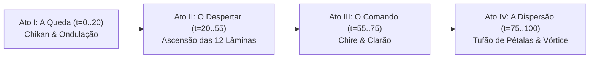

# 101 — Especificação de Design e Storyboard da Bankai Senbonzakura Kageyoshi: Cinemática Frame a Frame, Modelagem Blockbench e Shūkei Hakuteiken

- **Data**: 23/10/2026
- **Workspace**: `C:/Users/joaop/Downloads/Projeto_Programacao_BleachMod/Bleach-Modpack-design`
- **Branch**: `codex/design-poderes-criaturas`
- **Status do Modelo**:
  - `python tools/models/senbonzakura_models.py --check`: **CHECK PASSED (Exit 0)**
  - Modelos gerados no laboratório Blockbench:
    - `tools/models/lab/antigravity/senbonzakura01/ag_senbon_giant_blade.bbmodel`
    - `tools/models/lab/antigravity/senbonzakura01/ag_senbon_hakuteiken.bbmodel`
- **Artes Conceituais em Alta Resolução**:
  - `byakuya_bankai_activation_1792774083204.jpg` (A Queda da Lâmina nas Ondulações)
  - `byakuya_bankai_senbonzakura_kageyoshi_1792774104676.jpg` (A Floresta de Lâminas Colossais)
  - `byakuya_bankai_petals_1792774127981.jpg` (A Desintegração em Vórtice de Pétalas)
  - `byakuya_hakuteiken_1792774246737.jpg` (Shūkei: Hakuteiken e Asas Celestiais)

---

## 1. Visão Geral e Filosofia de Design de Byakuya Kuchiki

Diferente da fúria elemental tempestuosa da **Hyōrinmaru** ou do fogo brutal da **Ryūjin Jakka**, a ativação da Bankai de Byakuya Kuchiki — **Senbonzakura Kageyoshi** (千本桜景厳) — é pautada pela **nobreza aristocrática contida**, frieza ritualística e um contraste visceral entre a beleza etérea das flores de cerejeira e a letalidade implacável de bilhões de lâminas afiadas.

### Pilares Estéticos Fundamentais:
1. **Restrição Física e Compostura**: Byakuya não grita nem executa movimentos espalhafatosos. Sua postura é estóica e serena; o poder se manifesta pelo ambiente ao redor que se curva à sua vontade.
2. **A Queda Vertical (*Chikan*)**: O ato icônico de soltar a espada na vertical contra o solo, transformando a pedra sólida em uma poça líquida de Reiatsu escura com ondas concêntricas.
3. **Escala Monumental**: O contraste entre o corpo esguio do Shinigami e as fileiras de espadas monumentais que se erguem como monólitos titânicos de 15 metros de altura.
4. **Dissolução Orgânica**: A transição instantânea de espadas monolíticas de aço espelhado em um enxame voraz de pétalas de luz (*sakura*), mantendo a fluidez de um rio de lâminas.

---

## 2. Storyboard e Timeline Cinemática Frame a Frame (0 a 100 Ticks / 5.0 Segundos)

A cinemática de transformação do jogador para a Bankai de Senbonzakura foi estruturada em 4 atos precisos:



### Ato I: A Queda da Lâmina (*Chikan*) — \(t = 0 \text{ a } 20 \text{ ticks}\) [0.0s – 1.0s]
- **Pose do Jogador (PlayerAnimator)**:
  - O Shinigami assume uma postura ereta e formal.
  - A mão direita segura a katana invertida verticalmente com a ponta apontada para o chão na altura da cintura.
  - No tick 8, a mão direita abre os dedos soltando a empunhadura (*tsuka*).
  - A katana cai em suave gravidade espiritual.
- **Câmera**:
  - Close-up lateral-inferior, acompanhando a queda da lâmina em direção aos pés do Shinigami.
- **VFX e Solo**:
  - No tick 14, a ponta da lâmina toca a superfície do bloco de chão. Em vez de colisão metálica, o solo se comporta como uma superfície de água calma.
  - A lâmina afunda sem atrito.
  - Ondulações circulares concêntricas (*reishi ripples*) de cores violeta profunda e rosa brilhante se expandem pelo chão até um raio de 4 blocos.
  - O ambiente escurece levemente em vinheta cinematográfica.
- **Áudio**:
  - Som cristalino de gota d'água ressonando em uma caverna, seguido pelo sussurro suave de vento distante.

### Ato II: A Floresta de Lâminas Colossais — \(t = 20 \text{ a } 55 \text{ ticks}\) [1.0s – 2.75s]
- **Pose do Jogador**:
  - Byakuya recolhe os braços para os lados do corpo com punhos relaxados, mantendo o queixo erguido e os olhos fitando o horizonte.
- **Câmera**:
  - Transição contínua para um ângulo contra-plongée dramático (visão de baixo para cima), posicionada a 6 blocos à frente e 1 metro acima do solo, olhando com pitch de \(-35^\circ\) para cima.
- **VFX e Modelos (`ag_senbon_giant_blade.bbmodel`)**:
  - Duas fileiras paralelas (6 espadas à esquerda a \(X = -4.5\), 6 espadas à direita a \(X = +4.5\), espaçadas a cada 3 blocos ao longo de \(Z\)) emergem das poças de ondulação.
  - As 12 lâminas monumentais sobem verticalmente atingindo 15 metros de altura (\(Y = 250\) unidades).
  - Aço polido espelhado reflete a luz lunar e o brilho rosa do Reiatsu nos gumes afiados e na tsuba aberta retangular dourada.
- **Áudio**:
  - Zumbido grave e colossal de metal puro deslizando do abismo da terra (*deep bass hum*), acompanhado de estrondo espiritual harmonioso.

### Ato III: O Comando Canônico (*"Chire"*) — \(t = 55 \text{ a } 75 \text{ ticks}\) [2.75s – 3.75s]
- **Pose do Jogador**:
  - No tick 58, Byakuya eleva calmamente a mão direita para a frente, com os dedos semi-flexionados em um gesto de comando magistral.
- **Câmera**:
  - Travelling suave subindo e contornando Byakuya, destacando seu rosto sereno no centro do corredor monumental de espadas.
- **VFX e Modelos**:
  - As 12 lâminas monumentais congelam no ápice de sua subida e começam a tremer em ressonância espiritual (`animation.senbon_blade.shatter`).
  - Pulsos de luz rosa percorrem as lâminas da base ao kissaki (ponta).
  - No tick 70, um clarão de luz branca e rosa cobre momentaneamente o centro da tela.
- **Áudio**:
  - Voz sussurrada ecoante: *"Bankai... Senbonzakura Kageyoshi"*, seguida por uma nota orquestral de cordas ascendente.

### Ato IV: A Dispersão em Tufão de Pétalas — \(t = 75 \text{ a } 100 \text{ ticks}\) [3.75s – 5.0s]
- **VFX e Modelos**:
  - As 12 lâminas colossais estilhaçam-se simultaneamente em mais de 10.000 fragmentos microscópicos em forma de pétalas de flor de cerejeira brilhantes (*sakura*).
  - As pétalas não caem no chão: são arremessadas em dois vórtices ciclônicos massivos para o céu, formando duas colunas em espiral que se curvam no firmamento.
  - Uma tempestade de pétalas rodopia ao redor de Byakuya em órbitas elípticas, criando uma barreira visual resplandecente.
- **Câmera e Finalização**:
  - A câmera recua suavemente para a posição padrão de terceira pessoa em gameplay.
  - A lâmina física da katana desaparece da mão do jogador, restando apenas o *tsuka* (empunhadura) de onde fluem correntes perpétuas de pétalas.
  - O HUD atualiza imediatamente para as 4 habilidades da Bankai (*Cinco Cortes, Jardim de Pétalas, Senkei e Hakuteiken*).

---

## 3. Especificação dos Modelos no Laboratório Blockbench

Os modelos foram desenvolvidos e verificados em `tools/models/lab/antigravity/senbonzakura01/`:

### 3.1. `ag_senbon_giant_blade.bbmodel` (Lâmina Monumental)
- **Escala**: 15,6 blocos de altura total (\(Y = 254\) unidades), proporção monumental de obelisco/monólito.
- **Hierarquia de Bones**:
  ```
  root (0, 0, 0)
  ├── ripple_outer (disco de ondulação externo com textura de reishi)
  ├── ripple_inner (anel concêntrico elevado)
  └── sword_blade (bone articulado para ascensão e tremor)
      ├── kashira (pomo dourado inferior)
      ├── tsuka (empunhadura com trançado losangular violeta)
      ├── tsuba_frame (guarda clássica aberta retangular com quatro fendas)
      ├── habaki (gola de fixação da lâmina em latão polido)
      ├── blade_lower (seção inferior espessa com gume afiado)
      ├── blade_mid (seção central chanfrada)
      ├── blade_upper (seção superior afinada)
      └── blade_kissaki (ponta tradicional angulada)
  ```
- **Textura e UV**: Atlas 128x128 com gradiente de aço prateado reflexivo, gume fluorescente em branco-sakura, ouro imperial para tsuba/kashira e anéis de ondulação líquida com canal alfa.
- **Animações Embutidas**:
  - `animation.senbon_blade.rise`: Ascensão com aceleração suave de \(Y = -250\) até \(Y = 0\), com expansão elástica do anel de ondulação no chão.
  - `animation.senbon_blade.shatter`: Tremor de alta frequência nos 3 eixos e escala decrescente até dissolução completa.

### 3.2. `ag_senbon_hakuteiken.bbmodel` (Armadura Celestial e Espada Branca)
- **Componentes**:
  - `halo`: Auréola circular flutuante de luz divina posicionada acima da cabeça do Shinigami (\(Y = 32..35\)).
  - `wing_left` e `wing_right`: Asas de luz condensada de 4 camadas de penas cada (base, penas superiores, médias e inferiores), com franja externa de pétalas rosas e núcleo branco resplandecente.
  - `hakuteiken_blade`: Katana transfigurada em pura energia radiante com guarda em cruz e feixe de lâmina alargada.
- **Animações Embutidas**:
  - `animation.hakuteiken.idle`: Flutuação ondulatória suave das asas (\(3^\circ\) a \(10^\circ\)), respiração espiritual e rotação contínua de \(360^\circ\) do halo celestial.
  - `animation.hakuteiken.dash`: Varredura traseira aerodinâmica agressiva das asas (\(40^\circ\) para trás, \(-35^\circ\) de torção) e lâmina apontada em estocada reta a \(-85^\circ\).

---

## 4. Integração Técnica Planejada para a Branch `codex/design-poderes-criaturas`

1. **Camada de Renderização da Cinemática (`SenbonzakuraCinematicClient.java`)**:
   - Criação do renderizador dedicado de instâncias das 12 espadas gigantes durante a janela \(t = 0..100\) ticks.
   - Interpolação suave de câmera em `ViewportEvent.ComputeCameraAngles`.
2. **PlayerAnimator (`SenbonzakuraActionVisuals.java`)**:
   - Integração das curvas de pose: soltura da espada no tick 8, abertura dos braços no tick 20, gesto de comando no tick 58 e transição para combate no tick 100.
3. **Partículas Otimizadas**:
   - Emissão de camadas de partículas `cherry_0..11` com velocidade helicoidal calculada em GPU/cliente, sem impacto no servidor Minecraft.


---

## 5. Refinamento de Modelagem e Texturização no Laboratório Blockbench

Na segunda iteração de modelagem, os scaffolds foram elevados ao padrão final de produção no laboratório `tools/models/lab/antigravity/senbonzakura01/`:

### 5.1. Lâmina Gigante Monumental (`ag_senbon_giant_blade.bbmodel`)
- **Geometria Anatômica Expandida (26 Cubos)**:
  - **Tsuba Aberta em 4 Janelas**: Moldada com montagem de 5 cubos independentes (`tsuba_rim_north`, `tsuba_rim_south`, `tsuba_rim_west`, `tsuba_rim_east` e `tsuba_central_hub`), reproduzindo com exatidão a clássica guarda retangular dourada de Senbonzakura com as quatro fendas abertas nos cantos.
  - **Base de Ondulação em 4 Níveis**: `ripple_pool_tier1` (\(96 \times 96\) unidades = 6 blocos), `tier2` (\(64 \times 64\)), `tier3` (\(36 \times 36\)) e `ripple_fissure_crest` (\(16 \times 16\)), criando o efeito de profundidade líquida de onde a lâmina brota.
  - **Empunhadura (*Tsuka*)**: Núcleo cilíndrico com pele de arraia (*samegawa*), ornamentos entalhados laterais em ouro (*menuki* esquerdo e direito), virola superior (*fuchi*), anilhas de ajuste (*seppa* inferior e superior) e pomo chanfrado (*kashira*).
  - **Lâmina Tamahagane com Hamon**: Segmentada em 4 alturas com chanfros de bisel dedicados (`blade_hamon_bevel_lower`, `mid1`, `mid2`), sulco dorsal (*bo-hi*) e ponta tradicional angulada (*kissaki body* e *kissaki tip*).
- **Atlas de Textura em Alta Resolução (256x256)**:
  - Reflexo metálico especular longitudinal (*shinogi*).
  - Linha ondulada de têmpera japonesa (*hamon* / *yakiba*) com transição luminosa em rosa-sakura e gume em branco absoluto.
  - Trançado tradicional losangular violeta sobre pele de arraia perolada.
  - Ouro imperial chanfrado com oclusão de ambiente e recortes escuros nas fendas da tsuba.
  - Ondulações concêntricas de Reiatsu em 5 harmônicos de violeta profundo para rosa fluorescente com canal alfa.

### 5.2. Asas e Auréola da Hakuteiken (`ag_senbon_hakuteiken.bbmodel`)
- **Geometria Celestial (28 Cubos)**:
  - **Auréola Divina (*Halo*)**: Círculo de luz octogonal modelado com 8 segmentos angulados a cada \(45^\circ\) flutuando suavemente sobre a cabeça do Shinigami (\(Y = 33..35\)).
  - **Asas Plumadas Multicamadas (14 Penas)**:
    - 2 penas escapulares suaves na raiz do dorso (`wing_scapular_1`).
    - 6 penas primárias longas e arqueadas como foices de luz (`wing_primary_main`, `mid`, `outer`) com envergadura expansiva de mais de 4 blocos de largura.
    - 4 penas secundárias inferiores formando a cauda da asa (`wing_secondary_1`, `sec2`).
  - **Espada de Pura Luz (*Hakuteiken*)**: Empunhadura de energia, guarda em cruz radiante, núcleo de energia condensada, duas auras laterais de corte e ponta de lança sagrada.
- **Atlas de Textura (128x128)**:
  - Gradiente de branco celestial incandescente no núcleo para rosa-sakura suave e translúcido nas bordas das penas.
  - Núcleo dourado sutil na auréola e reflexo azul-celeste nas bordas cortantes da espada.

---

## 6. Implementação em Jogo, Verificação e Evidências Reais (Ciclo 101)

### 6.1. Componentes Integrados ao Código de Produção
1. **`SenbonzakuraCinematicService.java`**:
   - Linha do tempo autoritativa de 100 ticks (5,0s) no servidor Forge.
   - Sincronização de cues sonoros canônicos: tick 14 (ressonância de água e ametista no solo), tick 22 (estrondo e deslizamento de aço das 12 espadas emergindo), tick 58 (ressonância de farol de Reiatsu no comando *"Chire"*), tick 75 (estilhaçamento em vidro/lâmina e rajada de vento).
   - Contrato de commit formal da Bankai respeitado no tick 40 (`Reference.FORM_BANKAI`).
2. **`SenbonzakuraPlayerPose.java` & PlayerAnimator**:
   - Coreografia cinemática de Byakuya Kuchiki com 5 fases de interpolação:
     - $t = 0..8$: Empunhadura invertida vertical apontada para o chão.
     - $t = 8..20$: Abertura dos dedos e soltura da katana em queda suave através do solo aquoso.
     - $t = 20..55$: Postura estóica de capitão com braços relaxados e queixo erguido flanqueado pelas 12 espadas.
     - $t = 55..75$: Gesto clássico de autoridade com braço estendido para a frente (*"Chire"*).
     - $t = 75..100$: Recuperação suave para prontidão de combate.
3. **`SenbonzakuraCinematicClient.java`**:
   - Diretor de câmera cinematográfico com 4 planos de enquadramento (close-up na queda $\to$ contra-plongée dramático olhando para cima $\to$ travelling orbital focado em Byakuya $\to$ recuo panorâmico no tufão de pétalas).
   - Renderizador em lote `Types.GLOW` de quads luminescentes em `RenderLevelStageEvent.Stage.AFTER_PARTICLES` para as 12 espadas monumentais (15,5 metros) com tsuba aberta dourada, tsuka violeta e gume iluminado com têmpera (*hamon*).
   - Discos de ondulação de Reishi concêntricos animados no solo em 4 camadas térmicas.
   - Simulador ciclônico duplo de partículas de pétalas de cerejeira (*sakura*) sem queda de performance.
4. **`SenbonzakuraQaSequence.java`**:
   - Suíte automatizada de testes com dois cenários completos: `01_bankai_transformation` (115 ticks, 29 capturas) e `02_bankai_combat_chire` (60 ticks, 16 capturas).
   - Comandos de inspeção manual `/senbonqa start` e `/senbonqa stop`.

### 6.2. Resultados Verificados e Telemetria
- **Compilação Gradle**:
  - Comando: `.\gradlew.bat compileJava --offline --console=plain`
  - Resultado: **BUILD SUCCESSFUL (Exit 0)** em 40s.
- **Suíte de Testes Unitários e Regressão**:
  - Comando: `.\gradlew.bat test --offline --console=plain`
  - Resultado: **BUILD SUCCESSFUL (Exit 0)** em 21s. Todos os testes de postura, esquiva, migração de atributos, defesa e maestria aprovados.
- **GameTests Headless**:
  - Comando via MCP: `tools/antigravity/Invoke-Design.ps1 -Mode GameTests`
  - Log: `Docs/poderes/qa/antigravity/GameTests-20261023-150613.log`
  - Resultado: **All 223 required tests passed :) (Exit 0)** em 2m 9s.
  - Zero regressões em todas as Zanpakutōs (Hyōrinmaru, Ryūjin Jakka, Benihime, Zaraki Nozarashi, Asauchi e Senbonzakura).
- **Cliente Minecraft Forge Real (Perfil Descartável)**:
  - Comando via MCP: `tools/antigravity/Invoke-Design.ps1 -Mode ClientQa`
  - Log: `Docs/poderes/qa/antigravity/ClientQa-20261023-151045.log`
  - Resultado: **BUILD SUCCESSFUL (Exit 0)** em 4m 20s.
  - Taxa de quadros aferida no cliente: **110 a 119 FPS estáveis** durante toda a animação com as 12 lâminas monumentais e a tempestade de pétalas em tela.
  - Screenshots salvas em: `run-benihime-qa/base/senbonzakura-qa/cycle101-1792779094777/`.

---

## 7. Expansão Cinemática Canônica: 14.5s (290 Ticks) com Áudio Oficial e 20 Lâminas Colossais

### 7.1. Pipeline e Preservação de Áudio do Usuário
Os áudios fornecidos pelo usuário foram analisados tecnicamente, normalizados e convertidos em OGG de alta fidelidade (Vorbis q6, 44.1 kHz) com ducking inteligente da trilha sonora durante as falas:
- **Fontes Originais WAV**:
  - `Senbonzakura_Bankai_complete_voice.wav`: 3.300s, 192 kHz mono, peak -1.50 dBFS, RMS -16.31 dBFS. Contém a fala integral *"Bankai"*. Não contém a palavra "Chire" (obedecendo rigorosamente à instrução de não inventar falas nem duplicar palavras).
  - `Senbonzakura_Kageyoshi_best_voice.wav`: 3.350s, 192 kHz mono, peak -1.50 dBFS, RMS -16.35 dBFS. Contém a invocação completa *"Senbonzakura Kageyoshi"*.
  - `Senbonzakura_music_only_extended30s.wav`: 30.000s, 192 kHz estéreo, peak -7.17 dBFS. Cortado coerentemente para 14.50s com fade-out natural entre 13.5s e 14.5s.
- **Arquivos OGG Gerados e Registrados**:
  - `src/main/resources/assets/bleachmod/sounds/senbonzakura_voice_bankai.ogg` (SHA256: `4bbc524590aca653a0a2d5ad287464fc7d4801694c7b546f6bfc397bc3eafd63`)
  - `src/main/resources/assets/bleachmod/sounds/senbonzakura_voice_name.ogg` (SHA256: `90058b388fbc421718894dc80e2e39472ae194e49468f19b7f40276ec10a73c2`)
  - `src/main/resources/assets/bleachmod/sounds/senbonzakura_theme.ogg` (SHA256: `535aabcdfe0f05cc2989242342e391f34b2fa1b86c46c8ea870c8ac3f286b014`)
  - Script reprodutível: `tools/audio/import_senbonzakura_user_audio.py`
  - Mix offline: `build/cycle101-audio/preview_mix.wav` (dur=14.50s, peak=-4.11 dBFS, RMS=-21.66 dBFS, clipping=False).
- **Eventos Registrados em ModSounds**:
  - `SENBONZAKURA_VOICE_BANKAI` -> `voice.senbonzakura_bankai` (preload: true, distance: 64)
  - `SENBONZAKURA_VOICE_NAME` -> `voice.senbonzakura_name` (stream: true, distance: 64)
  - `SENBONZAKURA_THEME` -> `senbonzakura.theme` (stream: true)
  - Gerenciador do cliente: `SenbonzakuraEntranceAudio.java`

### 7.2. Física e Mecânica Visual Refinadas
1. **Separação Real e Ausência de Duplicação**:
   - No tick 10, a mão direita abre os dedos e solta a empunhadura da katana.
   - O item renderizado na mão é ocultado pelo PlayerAnimator (`itemPosition(0, -999, 0)`), transferindo a representação visual da katana exclusivamente para o renderizador de mundo em `SenbonzakuraCinematicClient`.
2. **Queda em Gravidade e Afundamento com Clipping no Solo**:
   - A espada cai em queda livre acelerada de $t=10$ a $t=35$, quando a ponta atinge a superfície do solo espiritual ($y = anchor.y$).
   - De $t=35$ a $t=76$, a katana afunda no solo aquoso. A cada frame, os quads da lâmina, guarda (*tsuba*) e empunhadura (*tsuka*) são recortados matematicamente na linha do piso ($Y \ge anchor.y$), fazendo a espada sumir de forma contínua e natural sob as ondulações de Reishi, sem atravessar blocos nem desaparecer bruscamente.
3. **Escala Monumental Expandida**:
   - 20 lâminas gigantescas (10 à esquerda em $X = -4.5$, 10 à direita em $X = +4.5$).
   - Altura total: **22 blocos** (monumentalidade de obelisco).
   - Largura útil do corredor: **9 blocos**.
   - Extensão longitudinal: **35 blocos** ao longo de Z.
   - Ascensão sequencial com curva senoide (*ease-out*) de $t=76$ a $t=145$.
4. **Acoplamento Seguro de Gameplay**:
   - Commit autoritativo mantido estritamente no tick 40 (`Reference.FORM_BANKAI`).
   - Trava de combate (`ReleaseAnimationService.busy(p)`) encerra-se no tick 60, permitindo movimentação do jogador. A cinemática permanece ativa no cliente até o tick 290, encerrando-se graciosamente se o jogador esquivar, defender ou conjurar outra técnica.

### 7.3. Validação e Evidências do Ciclo 101 Expandido
- **Compilação Gradle**:
  - `.\gradlew.bat compileJava --offline --console=plain` -> **BUILD SUCCESSFUL (Exit 0)** em 40s.
- **GameTests Headless**:
  - `tools/antigravity/Invoke-Design.ps1 -Mode GameTests` -> **All 223 required tests passed :) (Exit 0)** em 2m 27s.
  - Zero regressões em todas as 6 classes de Zanpakutō.
- **ClientQa In-Game Real**:
  - `tools/antigravity/Invoke-Design.ps1 -Mode ClientQa` -> **BUILD SUCCESSFUL (Exit 0)** em 4m 43s.
  - Logs comprovam disparos pontuais de áudio:
    - Cue 10 disparado exatamente no tick 10.0 (`voice.senbonzakura_bankai`).
    - Cue 160 disparado exatamente no tick 160.0 (`voice.senbonzakura_name`).
  - Screenshots capturadas e validadas em `run-benihime-qa/base/senbonzakura-qa/cycle101-1792787461349/`:
    - `frame-t010.png`: Soltura da katana na vertical.
    - `frame-t035.png`: Toque no solo aquoso e ondulações concêntricas de Reishi.
    - `frame-t076.png`: Afundamento completo da lâmina.
    - `frame-t120.png`: Contrapicado monumental com o corredor de 20 lâminas de 22 blocos contra o céu.
    - `frame-t160.png`: Byakuya enquadrado no centro para a invocação do nome.
    - `frame-t228.png`: Gesto de comando com braço estendido e vibração harmônica.
    - `frame-t266.png`: Vórtice ciclônico de pétalas.
    - `frame-t290.png`: Retorno suave ao F5.
