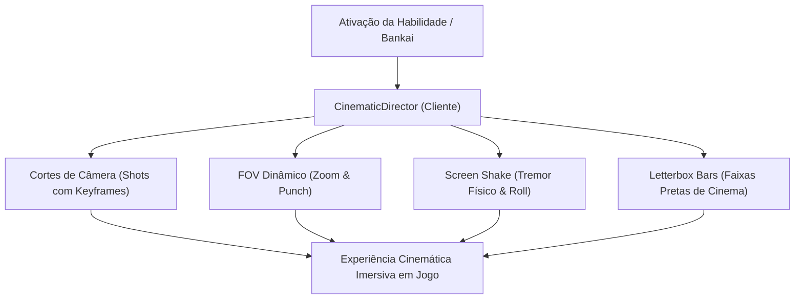

# 130 — Estudo Avançado: Jogo de Câmeras Cinemáticas, Enquadramentos Dinâmicos e VFX no Minecraft Forge

**Data**: 04/11/2026  
**Contexto**: Pesquisa técnica sobre direção de câmeras dinâmicas em mods cinematográficos (*Bleachcraft*, *Blockbuster*, *Aperture*, *Minema*, *Epic Fight* e o motor interno `CinematicDirector` do Bleach Mod), analisando como criar cortes cinematográficos, zooms de FOV, tremores de impacto (*screen shake*) e enquadramentos heróicos no Forge 1.20.1.  
**Objetivo**: Estabelecer a arquitetura de câmeras e ângulos para o novo ciclo do **Hakuteiken (Frente 1)** e a transformação do **Quincy Vollständig (Frente 2)**.

---

## 1. Como os Mods Criam "Animações Cinemáticas" no Minecraft

Em mods de alta produção, um golpe especial ou ativação de Bankai/Vollständig não é visto apenas da câmera padrão em terceira pessoa (F5 rígido). O mod assume o controle da câmera do cliente através de eventos do Forge, criando uma verdadeira **linguagem cinematográfica**:



---

## 2. Pilares Técnicos da Câmera no Forge 1.20.1

### A. Reposicionamento Livre da Câmera (`ViewportEvent.ComputeCameraAngles`)
* No Minecraft vanilla, a câmera fica fixa na cabeça ou a uma distância rígida de 4 blocos.
* Através de reflexão no método `Camera.setPosition` (`m_90581_`), o mod pode desacoplar a câmera do jogador e posicioná-la em qualquer coordenada do mundo (`Vec3 eye`).
* **Orientação Vetorial**: A direção da câmera é calculada pelo vetor `delta = target - eye`:
  ```java
  event.setYaw((float) Math.toDegrees(Math.atan2(delta.z, delta.x)) - 90.0F);
  event.setPitch((float) -Math.toDegrees(Math.atan2(delta.y, delta.horizontalDistance())));
  event.setRoll(shotRoll + shakeRoll);
  ```

### B. Zooms de FOV e Efeito "Punch" (`ComputeFovModifierEvent`)
* **FOV Estreito (Zoom In: 45° a 50° / 0.7x)**:
  * Cria tensão e foco heroico no rosto do personagem, na empunhadura da Zanpakuto ou na corda do arco Kojaku.
  * Achata a perspectiva de fundo (efeito teleobjetiva), dando dramaticidade.
* **FOV Amplo (Zoom Out: 85° a 95° / 1.3x)**:
  * Usado no ápice da abertura das asas para revelar a envergadura de 6 metros e o ambiente ao redor.
* **FOV Punch (Impact Recoil)**:
  * No instante exato do impacto da espada ou flecha contra o chão, o FOV diminui bruscamente 15° por 2 a 4 ticks e depois retorna suavemente. Isso simula o impacto cinemático do golpe no olho do espectador.

### C. Tremor e Dutch Angle (`Screen Shake` & `Roll`)
* O tremor combina oscilação nos três eixos com decaimento quadrático:
  ```java
  float decay = (shakeTicks - partial) / shakeLength;
  float amplitude = strength * decay * decay;
  Vec3 jitter = new Vec3(Math.sin(time * 5.3), Math.cos(time * 6.7), Math.sin(time * 4.4)).scale(amplitude);
  float roll = (float) Math.sin(time * 4.1) * amplitude * 25.0F;
  ```
* **Dutch Angle (Inclinação em Roll de 3° a 6°)**: Uma leve inclinação da linha do horizonte durante a preparação aérea quebra a rigidez do mundo de blocos cúbicos e confere dinamismo de anime.

### D. Letterbox Bars & Câmera Segura contra Paredes
* **Letterbox (Cinema 21:9)**: Faixas pretas desenhadas no topo e na base da tela via `RenderGuiEvent.Post`, escondendo a HUD durante os segundos do golpe especial.
* **Prevenção de Clipping**: Usar `world.clip(new ClipContext(eye, target, ...))` para encurtar a distância da câmera caso haja uma parede ou teto próximo, impedindo que a câmera entre dentro de blocos.

---

## 3. Coreografia de Câmera para as 2 Frentes

### FRENTE 1: Shukei: Hakuteiken (Ataque C em 5 Beats Cinemáticos)

| Beat | Duração | Tipo de Enquadramento | Posição da Câmera (`eye`) | FOV | Efeito de Câmera |
| :--- | :--- | :--- | :--- | :--- | :--- |
| **1. Impulso (0.0s – 0.5s)** | 10 ticks | **Low-Angle Tracking Up** | Posicionada a 1.2m do chão, 2.5m à frente, olhando para cima enquanto o jogador sobe até 5.0m. | 65° | Tremor sutil de energia subindo. |
| **2. Preparação Angelical (0.5s – 1.5s)** | 20 ticks | **Heroic 3/4 Orbiting Shot** | Câmera a 4.0m de distância na diagonal frontal-lateral, orbitando lentamente com as asas abertas. | 82° *(Zoom Out)* | Dutch Angle de 4° no horizonte; asas em destaque total. |
| **3. Rasante (1.5s – 2.0s)** | 10 ticks | **Over-the-Shoulder Dive Track** | Traseira próxima (ombro direito, 2.0m atrás), acompanhando o mergulho a 45°. | 58° *(Zoom In)* | Linhas de velocidade e vento na tela. |
| **4. Impacto (2.0s – 2.3s)** | 6 ticks | **Ground Slam Wide** | Câmera no solo a 6.0m de distância vendo a aterrissagem. | 60° → 78° *(Punch)* | Screen Shake intenso (`shake(6)`) e explosão radial de pétalas em 7m. |
| **5. Retorno ao Jogo** | 4 ticks | **Transição Suave** | Câmera interpola de volta para a posição F5 normal do jogador. | FOV Normal | Letterbox fade-out em 8 ticks. |

---

### FRENTE 2: Quincy Vollständig (Ativação e Disparos Licht Regen)

| Ação | Tipo de Enquadramento | Posição da Câmera | FOV | Efeito |
| :--- | :--- | :--- | :--- | :--- |
| **Ativação do Vollständig (G)** | **Frontal Heroica Baixa** | 3.5m à frente, apontando para o arco e para as asas de luz que se abrem atrás do corpo. | 55° → 85° | Clarão ciano de Reishi e abertura das faixas pretas cinematográficas. |
| **Licht Regen (N)** | **Vista Aérea em V (3ª Pessoa Superior)** | Câmera elevada a 4.5m apontando para baixo em direção aos inimigos. | 75° | Permite ver o leque de flechas de energia descendo e explodindo em cadeia. |

---

## 4. MCPs e Ferramentas Auxiliares

1. **`bleach-blockbench` MCP**:
   * Usar `set_camera_angle` para registrar vistas isométricas, frontais e laterais limpas das asas.
   * `screenshot_views` para validar a proporção e silhueta antes da exportação GeckoLib.
2. **`bleach-design-runtime` MCP**:
   * Executa `ClientQa` para coletar dumps de telemetria das coordenadas da câmera OpenGL sem depender de inputs manuais.
3. **PlayerAnimator SDK**:
   * Sincronização entre a posição da cabeça/torso do jogador e o ponto focal da câmera (`target`), garantindo que a câmera nunca foque no vazio.
