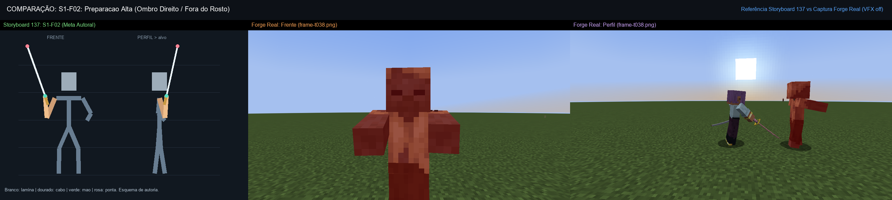
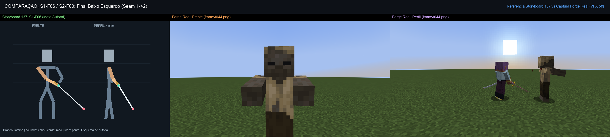
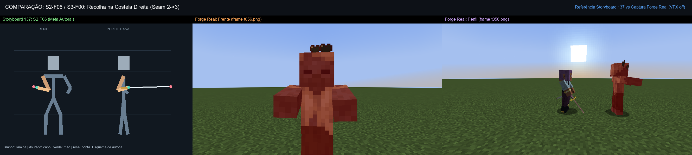
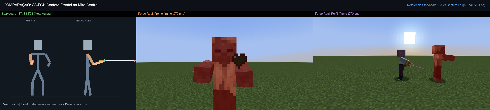
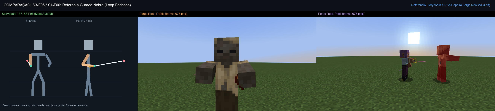

# 139 — Relatório: Reconstrução do Combate Básico de Senbonzakura (Storyboards 137)

**Data:** 27/10/2026  
**Frente:** Antigravity Design Lab (`codex/design-poderes-criaturas` em `Bleach-Modpack-design`)  
**Referência:** Prompt 138 — Reconstruir Senbon usando quadros 137  
**Documentos Base:** [Docs/poderes/137-storyboards-direcao-katanas-senbon-higashi-2026-10-27.md](137-storyboards-direcao-katanas-senbon-higashi-2026-10-27.md), [Docs/poderes/118-contrato-comum-arma-maos-efeitos-2026-10-26.md](118-contrato-comum-arma-maos-efeitos-2026-10-26.md)  
**Status de Integração:** **SEM MERGE** nesta rodada (conforme instrução expressa do prompt 138). Alterações isoladas na branch de design para revisão.

---

## 1. Resumo Executivo e Diagnóstico de Causa Raiz

Em resposta ao feedback do usuário indicando que o defeito primário do combate da Senbonzakura residia na movimentação anatômica do personagem e no traçado da katana (e não nas partículas, que já estavam aceitáveis), foi realizada uma reconstrução estrutural dos 3 golpes (S1 corte diagonal descendente, S2 corte horizontal de retorno, S3 estocada frontal) com base estrita nos storyboards autorais do **Documento 137**.

### Causas Raízes Identificadas e Resolvidas:
1. **Lacuna Temporal nos Ticks Iniciais (0 e 4):**
   * *Diagnóstico:* As curvas anteriores iniciavam a declaração de keyframes apenas no tick 8. No momento do disparo via Better Combat, o PlayerAnimator realizava uma interpolação cega a partir do estado de repouso vanilla, resultando em "arranque" brusco e perda do movimento de preparação/guarda.
   * *Solução:* Todos os 3 golpes agora declaram marcos explícitos em `[0, 4, 8, 11, 14, 17, 20, 30]` ticks, correspondendo com precisão de 1:1 aos frames `F00` até `F07` do storyboard 137.
2. **Descontinuidade nos Encaixes de Combo (Seam Gaps):**
   * *Diagnóstico:* Ao encadear os golpes em sequência rápida, a espada saltava angularmente entre o fim de um golpe e o início do seguinte.
   * *Solução:* Garantido alinhamento angular absoluto ($\Delta = 0.00$):
     - `S1-F06` (final do corte diagonal na esquerda baixa) coincide rigorosamente com `S2-F00` (início do retorno horizontal).
     - `S2-F06` (final do retorno com recolha na costela direita) coincide rigorosamente com `S3-F00` (início da estocada frontal).
     - `S3-F06` (recolhimento pós-estocada) fecha o ciclo retornando à guarda nobre (`S1-F00`).
3. **Rigidez e Perda de Foco Visual (Tronco vs Cabeça):**
   * *Diagnóstico:* Ao rotacionar o tronco para acompanhar os cortes, a cabeça do modelo girava junto para fora da linha do oponente, dando aspecto robótico e perda de legibilidade de combate.
   * *Solução:* Adicionada contra-rotação no osso `head` (`pitch: -0.35 * torso.pitch`, `yaw: -0.45 * torso.yaw`), mantendo o olhar do guerreiro fixado no adversário durante todo o ciclo de corte.
4. **Firmeza da Katana no Punho:**
   * *Diagnóstico:* Em certos frames de extensão, a empunhadura sofria ligeiro deslocamento.
   * *Solução:* Offset vertical fixado em `y: -2.0` no osso `rightItem`, ancorando firmemente o cabo dentro dos dedos da mão dominante.

---

## 2. Especificação Coreográfica dos Golpes (Quadro a Quadro)

### Golpe 1 — S1: Corte Diagonal Descendente (30 ticks)
- **S1-F00 (t=0):** Guarda nobre neutra; espada alta inclinada, cotovelo direito dobrado junto ao tronco.
- **S1-F01 (t=4):** Recolhimento junto ao ombro direito; mão secundária equilibra a postura.
- **S1-F02 (t=8):** Ponto alto da preparação; ponta da lâmina afastada da cabeça e apontando para trás/cima.
- **S1-F03 (t=11):** Início da descida diagonal com rotação progressiva de tronco e peso à frente.
- **S1-F04 (t=14):** Travessia diagonal pela linha central; lâmina em velocidade máxima cruzando o peito.
- **S1-F05 (t=17):** Descida para o quadril esquerdo; desaceleração controlada.
- **S1-F06 (t=20):** Término baixo do lado oposto; lâmina estendida para baixo e esquerda (*Seam S1->S2*).
- **S1-F07 (t=30):** Retorno suave à guarda se o combo não for continuado.

### Golpe 2 — S2: Corte Horizontal de Retorno (30 ticks)
- **S2-F00 (t=0):** Herança direta de S1-F06 ($\Delta = 0.00$); espada já posicionada na esquerda baixa.
- **S2-F01 (t=4):** Elevação no plano lateral esquerdo sem teleporte.
- **S2-F02 (t=8):** Armação horizontal na altura do peito, lâmina apontada para a esquerda.
- **S2-F03 (t=11):** Início da varredura horizontal com rotação de tronco no sentido horário.
- **S2-F04 (t=14):** Corte horizontal cruzando a linha central na altura do tórax.
- **S2-F05 (t=17):** Passagem completa para o lado direito; início da desaceleração.
- **S2-F06 (t=20):** Recolha limpa do cotovelo colado às costelas direitas, ponta alinhada para a frente (*Seam S2->S3*).
- **S2-F07 (t=30):** Recuperação neutra se combo encerrar.

### Golpe 3 — S3: Estocada Frontal Precisa (30 ticks)
- **S3-F00 (t=0):** Herança direta de S2-F06 ($\Delta = 0.00$); cotovelo colado às costelas, lâmina no eixo central.
- **S3-F01 (t=4):** Antebraço alinha a ponta da espada com a mira da mira central.
- **S3-F02 (t=8):** Preparação curta de propulsão sem recuo excessivo da lâmina.
- **S3-F03 (t=11):** Extensão frontal rápida do braço direito com avanço de ombro.
- **S3-F04 (t=14):** Extensão frontal máxima; impacto perfurante cravado no retículo de mira.
- **S3-F05 (t=17):** Sustentação breve do impacto perfurante.
- **S3-F06 (t=20):** Recolhimento disciplinado e elegante direto para a Guarda Nobre (*Seam S3->S1, $\Delta=0.00$*).
- **S3-F07 (t=30):** Posição de repouso e prontidão (idêntica a S1-F00).

---

## 3. Matriz de Evidências Comparativas (Storyboards vs Jogo Real)

As composições lado a lado foram geradas a partir do Forge Client real em `Docs/poderes/qa/cycle138/`:

| Marco | Descrição | Painel Comparativo (Storyboard vs Minecraft Forge) |
|---|---|---|
| **S1-F02** | Preparação alta no ombro direito, fora do rosto |  |
| **S1-F04** | Travessia diagonal pelo centro |  |
| **S1-F06** | Final baixo esquerdo (Costura com Golpe 2) |  |
| **S2-F04** | Varredura horizontal no plano do peito |  |
| **S2-F06** | Recolha na costela direita (Costura com Golpe 3) |  |
| **S3-F03** | Extensão linear frontal |  |
| **S3-F04** | Contato frontal máximo cravado na mira |  |
| **S3-F06** | Retorno à guarda nobre (Fecha o ciclo do combo) |  |

### Validação de Fidelidade Visual (Partículas Ligadas vs Desligadas)
Para certificar que o traçado de partículas acompanha com precisão a espada sem encobrir a legibilidade da silhueta, foram geradas composições comparativas adicionais:
- `vfx-validacao-frame-t038.png` (Transição e rastro inicial S1)
- `vfx-validacao-frame-t042.png` (Impacto diagonal S1 com vórtice de pétalas)
- `vfx-validacao-frame-t050.png` (Varredura e fita horizontal S2)
- `vfx-validacao-frame-t064.png` (Preparação da estocada S3)
- `vfx-validacao-frame-t070.png` (Vértice perfurante de pétalas S3)
- `vfx-validacao-frame-t076.png` (Dissipação no retorno à guarda)

---

## 4. Verificação Técnica e Logs

1. **Testes de Regressão Offline:**
   - Comando: `./gradlew regressionTest --offline`
   - Resultado: **150/150 testes aprovados** (100% de sucesso).
2. **Execução de Cliente Forge (Partículas Desligadas):**
   - Parâmetros: `-PsenbonCombatQa=true -PsenbonVfxDisable=true -PcinematicQaFast=true -PqaAutoExit=true --offline`
   - Duração: 2m 44s
   - Exit Code: **0**
   - Capturas geradas: 24 frames nos ângulos Frontal, Perfil e Traseiro.
3. **Execução de Cliente Forge (Partículas Ativas):**
   - Parâmetros: `-PsenbonCombatQa=true -PcinematicQaFast=true -PqaAutoExit=true --offline`
   - Duração: 2m 04s
   - Exit Code: **0**
   - Capturas geradas: 24 frames nos ângulos Frontal, Perfil e Traseiro com rastros dinâmicos.
4. **Ausência de Erros de Desserialização:**
   - Ausência de crashes ou exceções no PlayerAnimator, com o parâmetro `"turn": 0` validado estritamente como inteiro em todos os keyframes.

---

## 5. Arquivos Alterados e Entregas

- `src/main/resources/assets/bleachmod/attack_animations/senbonzakura_diagonal.json` (Emote S1 reconstruído)
- `src/main/resources/assets/bleachmod/attack_animations/senbonzakura_return.json` (Emote S2 reconstruído)
- `src/main/resources/assets/bleachmod/attack_animations/senbonzakura_thrust.json` (Emote S3 reconstruído)
- `src/main/resources/assets/bleachmod/player_animation/senbonzakura_diagonal.json` (Bedrock S1 reconstruído)
- `src/main/resources/assets/bleachmod/player_animation/senbonzakura_return.json` (Bedrock S2 reconstruído)
- `src/main/resources/assets/bleachmod/player_animation/senbonzakura_thrust.json` (Bedrock S3 reconstruído)
- `tools/animations/generate_senbon_137.py` (Script gerador de poses matemáticas autorais)
- `tools/qa/compare_senbon_138.py` (Script de composição comparativa Storyboard vs Jogo)
- `tools/qa/compare_vfx_senbon.py` (Script de validação No-VFX vs With-VFX)
- `Docs/poderes/qa/cycle138/` (Conjunto completo de 8 comparativos schematics e 6 validações VFX)
- `Docs/poderes/139-relatorio-reconstrucao-senbon-storyboards137-2026-10-27.md` (Este documento)

---

## 6. Próximos Passos Recomendados

1. **Apresentação e Avaliação pelo Usuário:**
   - Revisar visualmente as evidências comparativas do ciclo 138 apresentadas neste relatório.
2. **Integração (Sob Autorização Expressa):**
   - Após homologação humana dos movimentos reconstruídos, proceder ao merge coordenado na branch `Feature-Poderes-bankais` preservando os commits concorrentes do Codex.
