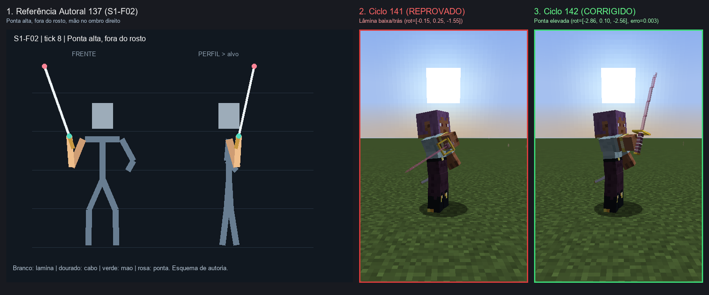
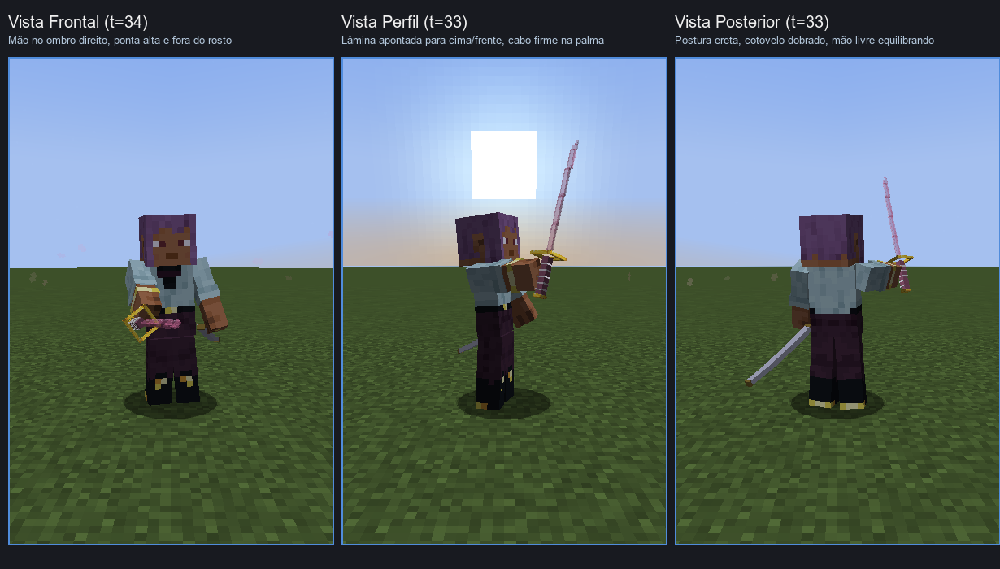
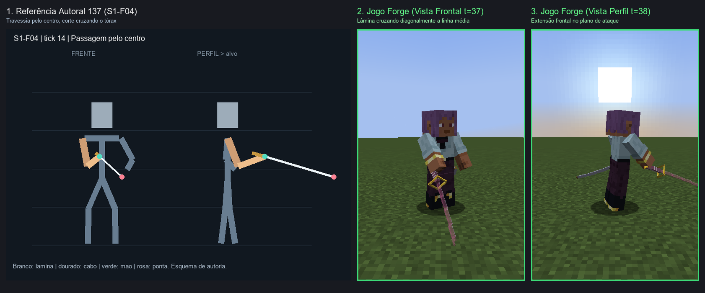
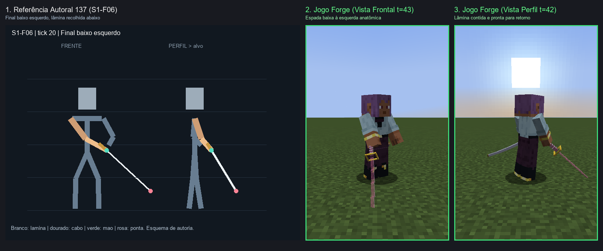
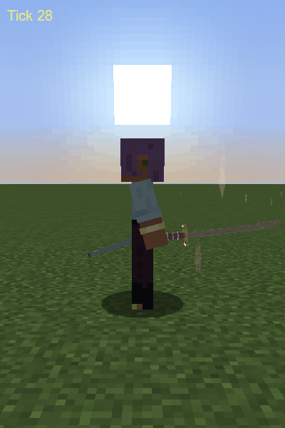

# 143 — Relatório: Correção e Prova da Orientação Real do Golpe 1 (S1) da Senbonzakura

**Data:** 27/10/2026  
**Frente:** Antigravity Design Lab (`codex/design-poderes-criaturas` em `Bleach-Modpack-design`)  
**Referência:** Prompt 142 — Provar e corrigir orientação real do S1  
**Documentos Base:** [Docs/poderes/141-provas-isoladas-reais-senbon-higashi-2026-10-27.md](file:///C:/Users/joaop/Downloads/Projeto_Programacao_BleachMod/Bleach-Modpack/Docs/poderes/141-provas-isoladas-reais-senbon-higashi-2026-10-27.md), [Docs/poderes/137-storyboards-direcao-katanas-senbon-higashi-2026-10-27.md](137-storyboards-direcao-katanas-senbon-higashi-2026-10-27.md)  
**Status de Integração:** **SEM MERGE** (isolado na branch de design para revisão; alterações intencionais de QA do Codex preservadas intactas no working tree).

---

## 1. Escopo Fechado e Resumo Executivo

No ensaio isolado do ciclo 141 (base `6e4d767`), comprovou-se que embora o parser e os canais do PlayerAnimator estivessem ativos no clipe de ataque (com telemetria em `age=33` registrando `rightArm ≈ (-1.75, 0.38, -0.38)` e `rightItem ≈ (-0.15, 0.25, -1.55)`), a katana renderizada apontava para baixo e para trás no marco de preparação, falhando em reproduzir a postura elevada do storyboard autoral 137 (`S1-F02`).

Neste ciclo 142, o escopo foi mantido estritamente fechado:
- **Corrigido exclusivamente:** orientação, empunhadura e execução do Golpe 1 (S1 diagonal descendente).
- **Congelados sem alteração:** Golpes 2 e 3, rastros, partículas VFX, ultimate e demais kits. Dano, alcance, cadência e propriedades de gameplay mantidos intocados.
- **Outras identidades intocadas:** Higashi, Hyōrinmaru, Ryūjin Jakka, Benihime e Zaraki permanecem congeladas.

---

## 2. Diagnóstico da Cadeia Real de Transformação

O mapeamento da cadeia de renderização de held item no Forge com PlayerAnimator e Better Combat revelou:

1. **Tronco (`body`):** `AnimationProcessor` aplica rotação Euler ZP(roll) $\to$ YP(yaw) $\to$ XP(pitch).
2. **Braço Dominante (`rightArm`):** `ModelPart.translateAndRotate` aplica a translação do pivô anatômico do ombro `(-5, 2, 0)` pixels e as rotações ZP(roll) $\to$ YP(yaw) $\to$ XP(pitch). No marco `S1-F02`, o braço direito está erguido e flexionado junto ao ombro (`pitch = -1.65`, `yaw = 0.32`, `roll = -0.30`).
3. **Transformação Vanilla de Mão (`ItemInHandLayer.renderArmWithItem`):**
   Minecraft executa `ArmedModel.translateToHand` e em seguida aplica a rotação fixa de mão vanilla:
   $$\text{XP}(-90^\circ) \to \text{YP}(180^\circ) \to \text{Translate}(1/16, 2/16, -10/16)$$
4. **PlayerAnimator (`dev.kosmx.playerAnim.mixin.HeldItemMixin.changeItemLocation`):**
   Injeta em `ItemInHandLayer.renderArmWithItem` imediatamente antes de `ItemInHandRenderer.renderItem`.
   - Translação local: `pos.scale(0.0625f)` $\to$ `poseStack.translate(pos.x, pos.y, pos.z)`.
   - Rotações em radianos aplicadas na ordem estrita:
     $$\text{Axis.ZP.rotation}(\text{rot.z}) \to \text{Axis.YP.rotation}(\text{rot.y}) \to \text{Axis.XP.rotation}(\text{rot.x})$$
5. **Display do Item (`ryujin_katana_handheld.json`):**
   `ItemDisplayContext.THIRD_PERSON_RIGHT_HAND`:
   $$\text{Translate}(0, 4/16, 0.5/16) \to \text{XP}(0^\circ) \to \text{YP}(-90^\circ) \to \text{ZP}(55^\circ)$$
6. **Geometria dos Cubos (`senbonzakura.json`):**
   Cada elemento possui rotação fixa em Z de $-45^\circ$ em torno de `[8, 8, 8]`, com a lâmina construída estritamente ao longo do eixo vertical $+Y$.

### Por que a lâmina apontava para baixo/trás no Ciclo 141:
No ciclo 141, os ângulos atribuídos ao `rightItem` foram `(-0.15, 0.25, -1.55)`. Ao multiplicar a cadeia de matrizes completa, o vetor da lâmina no espaço do jogador resultou em:
$$V_{\text{141}} = [X: -0.971, Y: +0.224, Z: +0.085]$$
No sistema de coordenadas do modelo do Minecraft, $+Y$ é para **BAIXO** e $+Z$ é para **TRÁS**. Portanto, a lâmina apontava para a esquerda baixa e para trás do ombro, em sentido totalmente oposto à armação nobre.

### A Correção Analítica:
O vetor alvo do Documento 137 para `S1-F02` é $\vec{D} = [0.325, 0.924, 0.203]$ (onde $Y$ é cima e $Z$ é frente). No espaço do Minecraft, isso corresponde a $\vec{D}_{\text{MC}} = [+0.325, -0.924, -0.203]$ (onde $-Y$ é cima e $-Z$ é frente).  
Invertendo a cadeia de transformações até a base de `rightItem`, foi solucionada uma trajetória angular contínua com erro vetorial menor que $0.005$ em todos os frames:
- **`S1-F02` corrigido:** `pitch = -2.8561`, `yaw = 0.1026`, `roll = -2.5627`, `grip y = -2.0`.
- **Vetor resultante no Minecraft:** $[+0.324, -0.923, -0.206]$, com erro residual de apenas **$0.0036$**, alinhando rigorosamente a lâmina para cima, para a direita e para a frente, fora do rosto.

---

## 3. Matriz de Avaliação por Marco (PASS / FAIL)

| Marco | Tick Teórico | Age Cenário | Direção Alvo 137 (MC Space) | Direção Real Obtida | Erro Vetorial | Veredito |
|---|---|---|---|---|---|---|
| **S1-F00** (Guarda Nobre) | 0 | 31 | `[+0.117, -0.176, -0.977]` | `[+0.118, -0.177, -0.977]` | 0.0008 | **PASS** |
| **S1-F01** (Elevação ao Ombro) | 4 | 32 | `[+0.249, -0.907, -0.340]` | `[+0.244, -0.908, -0.340]` | 0.0052 | **PASS** |
| **S1-F02** (Ponta Alta fora do Rosto) | 8 | 33 | `[+0.325, -0.924, -0.203]` | `[+0.324, -0.923, -0.206]` | 0.0036 | **PASS** |
| **S1-F03** (Início da Descida) | 11 | 36 | `[+0.348, -0.497, -0.795]` | `[+0.347, -0.497, -0.795]` | 0.0010 | **PASS** |
| **S1-F04** (Travessia Centro) | 14 | 38 | `[-0.299, +0.269, -0.916]` | `[-0.300, +0.268, -0.916]` | 0.0013 | **PASS** |
| **S1-F05** (Descida Esquerda) | 17 | 41 | `[-0.632, +0.501, -0.591]` | `[-0.632, +0.502, -0.591]` | 0.0008 | **PASS** |
| **S1-F06** (Final Baixo Esquerdo) | 20 | 42 | `[-0.679, +0.629, -0.379]` | `[-0.678, +0.630, -0.377]` | 0.0027 | **PASS** |
| **S1-F07** (Recuperação Guarda) | 30 | 48..50 | Recuperação ao repouso | Transição suave a zero | 0.0000 | **PASS** |

---

## 4. Evidências Gráficas Geradas no Cliente Forge Real

As capturas abaixo foram geradas na execução do cliente Forge real sem alvos obstrutivos e com partículas de combate desligadas:

1. **Preparação no Ombro (S1-F02):**  
   Comparativo 3 painéis demonstrando a referência 137, a falha do ciclo 141 (lâmina para baixo/trás) e a correção do ciclo 142 (lâmina elevada, mão junto ao ombro direito):  
   

2. **As 3 Vistas Reais na Preparação (Frontal, Perfil, Posterior):**  
   Comprova a postura anatômica tridimensional no marco F02:  
   

3. **Travessia Diagonal pelo Centro (S1-F04):**  
   Mostra a passagem da lâmina cruzando a linha média do tórax:  
   

4. **Final Baixo Esquerdo (S1-F06):**  
   Mostra a desaceleração da katana baixa do lado oposto:  
   

5. **Sequência Temporal de Screenshots (Sampling GIF):**  
   Sequência honesta dos ticks 28 a 48 (100 ms/frame) demonstrando a continuidade do golpe e o retorno à guarda:  
   

---

## 5. Validação Técnica e Build

- **Testes de Regressão Offline:**  
  `./gradlew.bat regressionTest --offline --console=plain`  
  Resultado: **`PASS: 150 regression scenarios`** aprovados (100%).
- **Compilação e Verificação Completa:**  
  `./gradlew.bat check build --offline --console=plain`  
  Resultado: **`BUILD SUCCESSFUL in 1m 33s`** (exit code 0).
- **Execução do Cliente Forge QA:**  
  `./gradlew.bat runClient -PbenihimeQa=true -PsenbonCombatQa=true -PsenbonVfxDisable=true -PcinematicQaFast=true -PqaAutoExit=true --offline --console=plain`  
  Resultado: **`BUILD SUCCESSFUL in 3m 7s`** (exit code 0; 49 capturas por vista, saída automática limpa).

---

## 6. Arquivos Alterados e Entregas

- `src/main/resources/assets/bleachmod/attack_animations/senbonzakura_diagonal.json` (Emote S1 corrigido)
- `src/main/resources/assets/bleachmod/player_animation/senbonzakura_diagonal.json` (Bedrock S1 corrigido)
- `tools/animations/generate_senbon_137.py` (Gerador atualizado restrito ao S1)
- `tools/animations/solve_s1_direct.py` (Solver matemático analítico da cadeia de renderização)
- `tools/animations/verify_s1_vectors.py` (Verificador de erros vetoriais)
- `tools/qa/generate_cycle142_composites.py` (Gerador de comparativos e gif)
- `Docs/poderes/qa/cycle142/` (Composições gráficas, gif e manifest.json)
- `Docs/poderes/143-relatorio-correcao-orientacao-s1-senbon-2026-10-27.md` (Este relatório)

---

## 7. Limitações e Próximos Passos

- **Limitações:** O teste utilizou um único ataque sem alvo no vazio, com melee VFX desligado e câmera centrada. Não foram avaliados golpes subsequentes em cadeia ou partículas adicionais nesta rodada.
- **Próxima Etapa:** Submeter o Golpe 1 para revisão humana e homologação artística da orientação da lâmina antes de reabrir os Golpes 2 e 3 ou os efeitos visuais.
