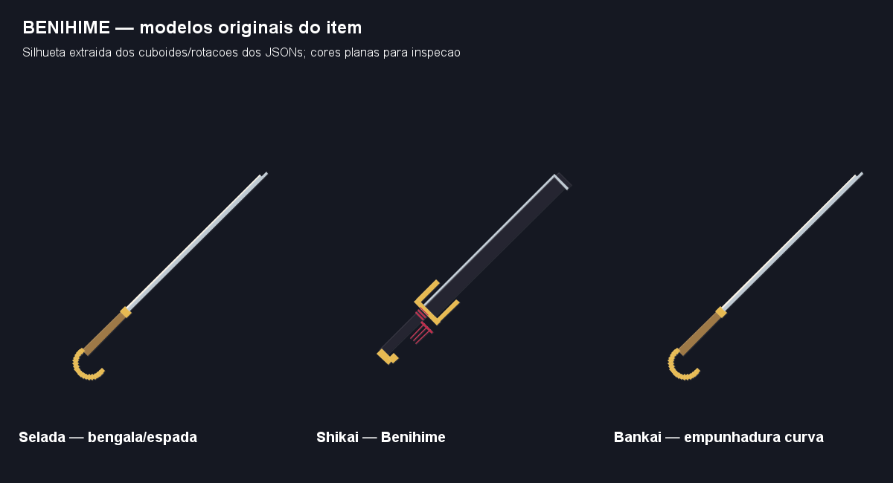
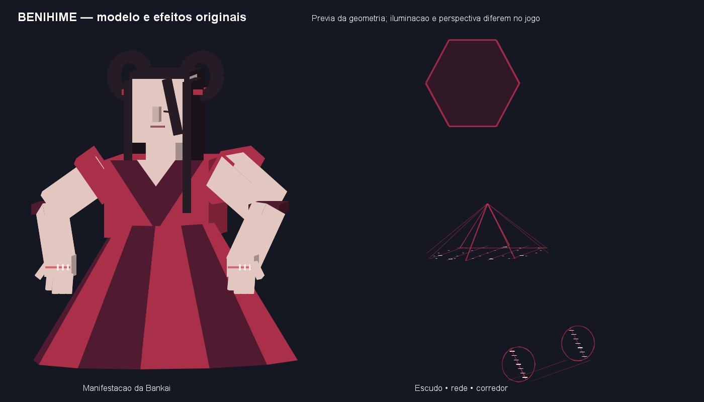

# Ciclo 47 — Benihime: kit completo de Urahara

> Refinamento vigente no [ciclo 48](48-benihime-rede-cargas-marionete-2026-10-15.md): Shibari expansiva/contrátil de diâmetro 20, reestruturação com impactos, três cargas de corredor vertical e nova presença articulada. Valores abaixo registram a primeira entrega.

Data: 15/10/2026. Branch `Feature-Poderes-bankais`. Usuário aprovou implementar a proposta do ciclo 46, pediu cura passiva de aliados, regeneração pessoal maior na Bankai e identidade visual própria da zanpakutō. Essa autorização sucede o aviso histórico de não implementar ainda. Git estava limpo e alinhado ao origin na branch correta, HEAD `fe13377`, ao iniciar. Sem push/merge.

## Contrato implementado

Identidade/item `benihime`, indestrutível, vínculo único e progresso isolado. Selada conserva ataques básicos; os oito slots especiais são quatro Shikai e quatro Bankai. A exceção de arsenal selado de Byakuya continua exclusiva dele. Aquisição narrativa ainda depende da equipe.

Manifestação acompanha o jogador por trás, como visual sem IA, vida própria ou ataques autônomos. Área operacional de referência 18 blocos; cada técnica tem alcance específico abaixo. Todos os valores são parâmetros iniciais para playtest, não homologação de equilíbrio. Dano/cura em pontos de vida: 2 pontos = 1 coração. Técnicas usam reiatsu, sem custo adicional de stamina. Permanecem os controles de slots e transformações existentes.

| Forma/slot | Técnica | Comportamento inicial | Reiatsu / intervalo |
|---|---|---|---|
| Shikai 1 | Nake, Benihime | Corte carmesim viaja até 14 blocos, para em colisão; dano bruto 8 uma vez por alvo. | 12 / 3 s |
| Shikai 2 | Chikasumi no Tate | Barreira frontal hexagonal por 4 s; reserva 24, absorve 85% de golpes físicos/projéteis elegíveis até esgotar. Não cobre costas, magia ou explosões. | 18 / 7 s |
| Shikai 3 | Shibari, Benihime | Mira até 12, rede de raio 3; prepara 0,5 s, captura alvos presentes por até 4 s com Lentidão IV e atração horizontal suave. Sem dano próprio. | 20 / 8 s |
| Shikai 4 | Hiasobi, Benihime, Juzutsunagi | Exige e consome rede ativa próxima; contas se acendem ao longo do fio, seguida de explosão após 0,8 s, raio 4 e dano bruto 14. Sem dano a blocos. | 25 / 10 s |
| Bankai 1 | Dissecação | Mira até 16; incisão anunciada por 0,6 s, raio 4, dano bruto 12 e exposição por 3 s, +20% aditivo aos ataques desse usuário. | 25 / 7 s |
| Bankai 2 | Reconstrução | Mira um aliado elegível até 12 ou trata a si mesmo. Três pulsos de 2 pontos em 1,5 s; interrompe se o aliado perder elegibilidade, visão ou alcance. Rejeita alvo com vida cheia. | 28 / 12 s |
| Bankai 3 | Reestruturação corporal | Costura os braços: +30% aditivo nos próximos três golpes manuais bem-sucedidos, por até 5 s. Não fortalece técnicas nem compra atributos permanentes. | 22 / 10 s |
| Bankai 4 | Abertura de caminho | Prepara 0,3 s e abre corredor de até 12 blocos por 3 s, com saída apoiada e caminho livre. Dono e jogadores aliados entram pela origem e atravessam uma vez cada. Dissipa projéteis hostis e barreiras Benihime que cruzam o corredor. | 30 / 13 s |

Requisitos de maestria da forma por slot: 0/20/40/60. Cooldowns e custos administrativos respeitados. A abertura não atravessa terreno, não destrói construções nem promete compatibilidade com todo escudo de outros kits. Saída, apoio, fronteira, chunks e volume de colisão são revalidados ao usar o corredor; parede colocada depois da ativação impede a passagem. Não há invulnerabilidade na travessia. Manter passagem disponível exige proximidade do dono aos extremos.

Alvos ofensivos respeitam elegibilidade compartilhada, aliados, cobertura e limite de 16. A rede não paralisa completamente: permite resistência/deslocamento; controles usam concessões de oito ticks e cessam após cancelar, sem remover efeitos alheios. Guarda manual X não acumula com Chikasumi. Ações em execução bloqueiam esquiva/ataque manual; a janela de Guard Break interrompe execução. Troca de forma/arma, morte, espectador, logout e descarregamento cancelam estados temporários.

## Cura e regeneração aprovadas

Com Benihime vinculada e empunhada, Bankai legítima e jogador vivo:

- Próprio usuário: **1 ponto de vida por segundo** (meio coração/s).
- Aliados em **raio 8**, com linha de visão: **1 ponto a cada 2 segundos**.
- Aliado é jogador no mesmo time formal do scoreboard ou animal domesticado pelo próprio usuário. Proximidade sozinha não concede aliança; desconhecidos não recebem cura.
- Auras de vários usuários não multiplicam a cura no mesmo alvo dentro da janela de dois segundos. Usuário com sua própria regeneração Benihime não recebe essa aura adicional.
- Cura passiva não concede maestria. Reconstrução ativa só conta prática quando restaura vida de fato e respeita os bloqueios de treino administrativo/repetição existentes.

Cadência direta de cura, sem manter efeito vanilla de regeneração, evita rebaixar/substituir poções de terceiros. A Bankai mantém suas regras comuns de transformação/reiatsu; a passiva não tem cobrança separada.

## Identidade visual e implementação

Três modelos de item próprios: selada/Bankai com empunhadura dourada curva de bengala e lâmina fina; Shikai com lâmina negra larga, fio claro, guarda própria e cordão carmesim. Bainha específica de bengala, preservando escala/posição homologadas das outras armas. Texturas vanilla usadas em geometria original; não foram copiadas texturas de personagem da imagem anexada.



Manifestação de aproximadamente 7,5 blocos: vestido carmesim em painéis, cabelo escuro com laços laterais, olhos fechados, braços articulados, dedos e costuras. Os braços mudam de gesto durante as habilidades. Escudo, rede, contas, incisão, espiral de cura, braços reconstruídos e portais/corredor têm geometria própria branca/vermelha. Efeitos são desenhados com vértices e materiais próprios, sem depender apenas de nuvens de partículas. Figura escreve profundidade; fios usam transparência.



A prévia vem do mesmo `BenihimeGeometry` usado no cliente, com projeção simplificada. Não é captura do Minecraft e não valida iluminação, primeira pessoa ou FPS. A referência do usuário orientou a silhueta; protótipo segue estilo geométrico do jogo.

Estados e decisões no servidor; cliente recebe somente quadros visuais. Máximo quatro quadros por dono/tick, observadores em 80 blocos, expiração visual de oito ticks, cache cliente limitado a 32 efeitos e oito manifestações. A regeneração compartilhada tem registro limitado e limpeza. Não há entidade persistente para a figura. Rede **2.15**, schema **8**: clientes e servidor precisam da mesma build. Estado temporário não é salvo nem restaura cura/cargas ao reconectar.

Arquivos principais: `BenihimePolicy`, `BenihimeTechniqueService`, `BenihimeGeometry`, `BenihimeRenderer`, `BenihimeFrameS2C`, `BenihimeGameTests`; integrações mínimas em vínculo, item, progresso, HUD, dano, cancelamento, guarda/esquiva e bainha. Senbonzakura permanece homologada, sem alteração de seu contrato.

## Roteiro de playtest

Em personagem Shinigami de teste, usar comandos administrativos existentes:

```mcfunction
/give @s bleachmod:benihime
/bleachdev zanpakuto bind @s benihime
/bleachdev skill set @s zanpakuto 2
/bleachdev mastery set @s zanpakuto shikai 100
/bleachdev mastery set @s zanpakuto bankai 100
```

Empunhar Benihime, selecionar a forma com os controles existentes e usar os quatro slots. Testar dano/mitigação em sobrevivência: invulnerabilidade criativa vanilla permanece. Se ativar custos gratuitos/cooldowns desabilitados, não esperar treino de maestria.

1. Conferir item em inventário, primeira/terceira pessoa, bengala/curvatura, Shikai, Bankai e bainha.
2. Nake contra alvo frontal e parede; Chikasumi pela frente/costas até quebrar, sem empilhar X.
3. Shibari e depois Hiasobi; tentar detonar sem rede e longe dela.
4. Bankai: presença da figura, incisão anunciada, três golpes reforçados e expiração.
5. Reconstrução com vida reduzida, em si e em outro jogador do mesmo `/team`; confirmar que desconhecido não cura. Criar time com `/team add teste` e adicionar jogadores com `/team join teste <jogador>`.
6. Aura em dois jogadores e dois usuários Benihime, verificando alcance, cobertura e ausência de empilhamento. Confirmar que a passiva não treina.
7. Corredor em chão plano livre; entrar pela origem, verificar passagem única/expiração e bloqueio se colocar parede depois. Confirmar construções preservadas.
8. Desequipar, trocar forma, morrer/reconectar e trocar dimensão; verificar cancelamento e limpeza dos visuais.

## Validação

`check build runGameTestServer --offline --console=plain`: **BUILD SUCCESSFUL, 95 regressões e 108 GameTests obrigatórios aprovados**. Log local `build/cycle47-final-validation.log`; artefato `build/libs/bleachmod-0.2.0.jar`. Testes específicos cobrem custos, bloqueios, combo, cura própria/aliada, cadência/não empilhamento, prática, exposição, cargas, segurança do corredor e cancelamento; regressões cobrem pacote, geometria, identidade e HUD temporário.

A primeira execução encontrou uma falha de reposicionamento do FakePlayer no corredor, corrigida com atualização explícita de posição antes da confirmação vanilla, e uma falha do jardim antigo em mundo de testes reutilizado. O mundo anterior foi preservado em `build/cycle47-first-world` e a suíte inteira passou em mundo novo, sem alterar a lógica da Senbonzakura. Acrescentado teste que coloca parede após lançar o corredor. Três modelos (23/17/23 cuboides), limites/refs de texturas, seis sprites vanilla, traduções pt_br/en_us e inclusão de classes/assets no JAR conferidos. Duas prévias estáticas inspecionadas; não substituem playtest.

Não houve homologação visual no cliente, medição de FPS ou teste com dois clientes reais. Essa conferência fica para o playtest do usuário. Aizen segue adiado; próximos kits/fila preservados: Uryū Ishida, Mentor/Proficiências após confirmação da equipe, revisão final de Hyōrinmaru/Tōshirō. Gin removido.
