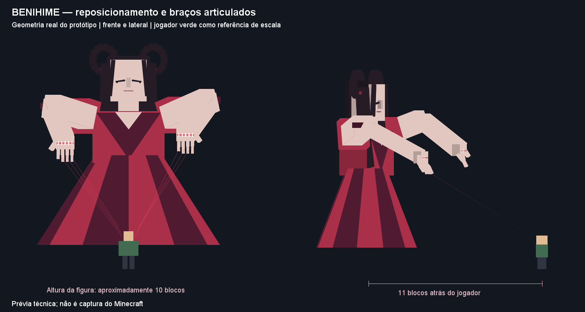
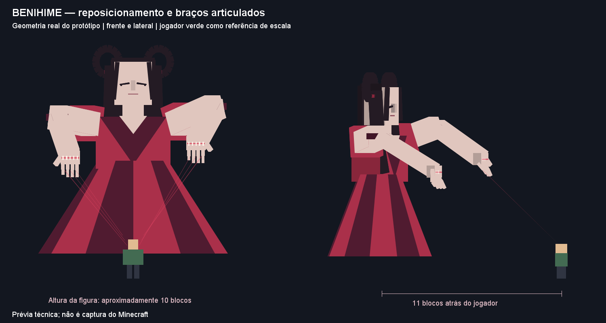

# Ciclo 48 — Rede expansiva, corredor em cargas e Benihime articulada

> Correções de Shibari/Hiasobi no [ciclo 49](49-shibari-solo-hiasobi-radial-2026-10-15.md): malha acima do chão, explosão sobre toda a área atual da rede e contenção reforçada. O raio fixo 4 do Hiasobi descrito abaixo foi sucedido pelo raio da rede no momento da ativação.

Branch `Feature-Poderes-bankais`, base limpa `9adef25`. Solicitação do usuário após playtest do ciclo 47: ampliar/contrair Shibari, dar impacto visual à reestruturação, três usos do caminho com mira vertical e redesenhar a presença de Benihime. Confirmado pelo usuário: **20 blocos de diâmetro, raio 10**, para a rede.

## Shibari

A mira continua a 12 blocos. A rede se estende do centro até raio 10 durante **1 segundo**. Ao concluir essa abertura, captura os alvos elegíveis presentes e começa a contrair por até **5 segundos**, até raio mínimo 1,4. A posição inicial de cada alvo determina seu trajeto para dentro: a malha encolhe e arrasta os presos junto dela. Um aro marca a borda; fios cruzados e hastes convergem para o centro.

O puxão horizontal é aplicado no servidor, limitado a 0,32 bloco/tick, com colisão vanilla e verificação de espaço. Funciona também em mobs sem IA; jogadores recebem confirmação de posição a cada quatro ticks. Lentidão IV continua em concessões curtas; não há dano da rede nem travessia de paredes. Perder elegibilidade, cobertura ou distância de segurança solta o alvo. A captura ocorre uma vez, ao fim da expansão; não recaptura continuamente quem entrar depois.

Hiasobi continua consumindo a rede e detonando seu centro, raio 4. Esperar a contração reúne os alvos para a explosão; detonar cedo pode deixar os alvos periféricos fora dela. Custos 20/25 e cooldowns 8/10 s mantidos. Limite de alvos consultados do serviço Benihime ampliado de 16 para 64; aliados, NPCs protegidos e regras de PvP continuam respeitados. Não promete prender quantidade ilimitada de entidades.

## Reestruturação corporal

Mantém três golpes manuais reforçados, +30% aditivo por até 5 segundos. Acrescentados volumes de punhos espectrais, costuras mais largas e fios de controle; a manifestação mantém pose ativa durante o efeito. Cada golpe confirmado cria incisão cruzada/anel de impacto no alvo e **empurra os inimigos elegíveis em raio 2,5**, respeitando visão/cobertura. Não acrescenta dano de área: o dano reforçado permanece no golpe principal. Um acerto consome uma carga; técnicas não consomem nem disparam esse efeito.

## Abertura de caminho

Agora possui **três cargas**, mostradas no HUD. Cada ativação válida custa 30 reiatsu. Os dois primeiros usos não iniciam o cooldown; o terceiro inicia **13 segundos**, após os quais o lote de três retorna. Preparação continua em seis ticks. Reutilizar substitui o corredor anterior, permitindo encadear reposicionamentos assim que termina a preparação.

Direção segue a mira completa, inclusive para cima/baixo, até 12 blocos. Movimento horizontal continua exigindo apoio próximo ao destino; uma inclinação vertical significativa permite saída no ar. Verificam-se volume de colisão, chunks carregados, borda e limites verticais do mundo. **Não concede voo**: após sair no ar, gravidade e queda normais voltam a agir; a travessia zera apenas a queda acumulada até aquele instante. Não atravessa blocos.

A exigência de apoio é determinada pela mira original: um caminho horizontal com pequeno desnível continua exigindo chão, inclusive se o chão mudar após lançar. O corredor dura três segundos, mantém entrada/saída visíveis e permite travessia única por jogador elegível. Cargas parcialmente usadas sobrevivem à troca de forma/cancelamento de efeitos e à troca de item. Seguem o contrato transitório dos cooldowns atuais para morte/reconexão/reset administrativo; não são uma nova progressão persistente. Cooldowns desativados dão usos livres. Tentativa inválida não cobra carga nem reiatsu.

## Manifestação e prévia

Benihime fica **11 blocos atrás**, elevada **1 bloco**, com escala 1,35 (figura de aproximadamente 10 blocos de altura). Braços ficam erguidos/projetados à frente, cotovelos articulados, mãos pendentes e dedos em dois segmentos. Ombros, braços, mãos, dedos e mechas têm movimento periódico em repouso. As habilidades alteram a pose; fios finos conectam as mãos ao jogador. Rosto fechado preserva identidade de Benihime e as mechas foram afastadas dos olhos.

O cliente interpola acompanhamento e direção; a animação usa tempo contínuo com fração de tick, evitando depender de mudanças discretas nos pacotes. A inspiração na marionete de Pitou se limita a postura, fios e movimento; a silhueta, roupa e cabelo continuam sendo de Benihime. Modelo da arma aprovado no ciclo 47 preservado.

Prévia gerada a partir de `BenihimeGeometry`, com jogador esquemático verde para escala. PNG e GIF são desenhos técnicos da geometria, não captura do Minecraft; projeção simplificada, sem shaders/texturas/oclusão idênticos ao cliente. O GIF mostra um ciclo de seis segundos e 24 quadros. Em jogo, os quadros são interpolados pelo renderizador. Conferir câmera de primeira/terceira pessoa e comportamento ao girar/correr no playtest.

## Validação e roteiro

Protocolo **2.16**, schema **8**. Atualizar cliente/servidor juntos. Artefato local `build/libs/bleachmod-0.2.0.jar`. Resultado final em `build/cycle48-verified.log`.

- Rede: colocar mobs no centro, a 8 e a 11 blocos do centro; conferir expansão, captura dos internos e deslocamento para dentro. Testar parede e Hiasobi cedo/tarde.
- Reestruturação: verificar punhos/fios, impacto e empurrão em três golpes; conferir expiração e alvos aliados.
- Caminho: subir, descer, usar terceira carga; quarta tentativa deve aguardar recarga. Conferir HUD, teto/parede/limites de altura e troca de forma sem recuperar cargas gastas.
- Manifestação: correr, girar, parar e lançar cada habilidade; conferir braços/dedos sempre animados, distância atrás do personagem e limpeza ao sair da Bankai.

Testes acrescentados para raio/arrasto da rede, três travessias verticais com recarga, preservação de cargas na troca de forma e geometria animada. A primeira execução detectou ausência de arrasto efetivo em mob sem IA, corrigida com movimento autoritativo. Testes automatizados e prévias não homologam FPS, sensação de câmera ou multiplayer real; esses pontos permanecem para o usuário.

Validação final: **check/build, 97 regressões e 110 GameTests obrigatórios aprovados**. Log `build/cycle48-verified.log`; JAR `build/libs/bleachmod-0.2.0.jar`. Inclui arrasto real de mob distante, três travessias verticais/recarga, preservação de cargas na troca de forma, empurrão sem dano adicional e animação de repouso. Prévia PNG e 24 quadros do GIF conferidos, traduções e links válidos. Ainda requer playtest no cliente.
