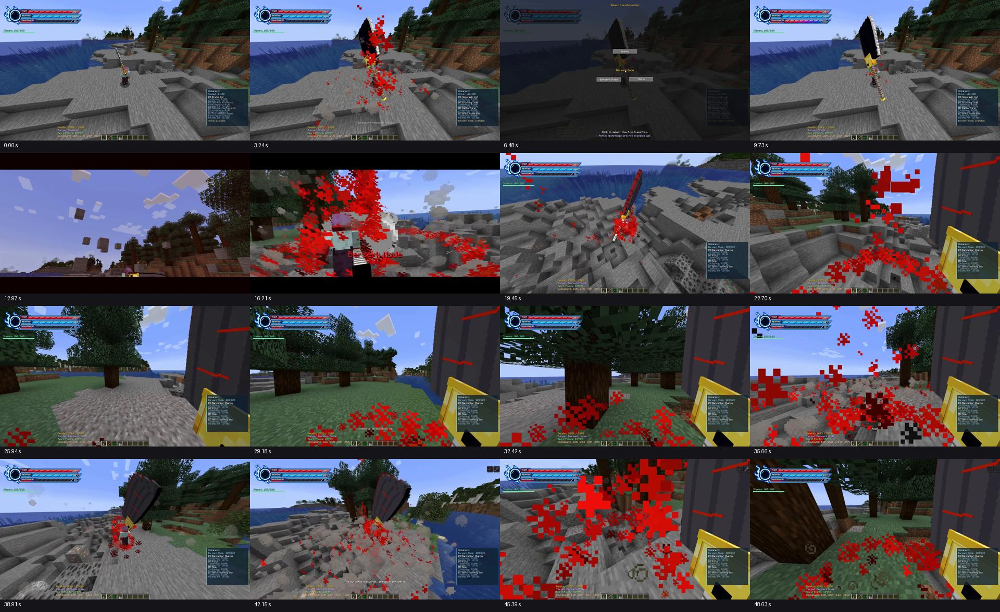

# Ciclo 51 — Better Combat, ferramentas e refatoração dos kits

> Atualização posterior: [ciclo 59](59-liberacoes-gestos-senbon-benihime-asauchi-2026-10-17.md) implementa as liberações restantes e gestos Senbon/Benihime com a infraestrutura atual. Modelos finais de inimigos, VFX especializados e integração Zaraki continuam etapas futuras; não foi instalado outro mod nesta rodada.

> Entrega posterior: [ciclo 56](56-repertorio-elemental-cinematica-combos-2026-10-17.md) implementa o repertório revisado completo, combos Ryūjin/Hyōrinmaru, pose final e dragões gigantes. Consulte sua matriz vigente; descrições abaixo registram o estado histórico.

> Pesquisa dos novos repertórios e liberações solicitados em 17/10 registrada no [ciclo 54](54-proposta-refatoracao-ryujin-hyorinmaru-liberacoes-2026-10-17.md). Ataques selecionados/passivas preservados como direção; matriz e redistribuição por forma propostas, sem código novo. Serviço comum de liberação e novo dragão serão candidatos de piloto das etapas de autoria/VFX antes de refatorar os kits; a ordem geral abaixo permanece.

> Atualização de 17/10: usuário aprovou a animação Asauchi. [Ciclo 53](53-asauchi-3d-pose-bloqueio-2026-10-17.md) atualiza seu formato 3D e acrescenta pose de bloqueio com X às cinco zanpakutō; novo visual aguarda playtest. Zaraki ainda sem commit da equipe; ordem de bibliotecas e refatorações abaixo preservada.

> Início autorizado e entregue no [ciclo 52](52-better-combat-piloto-asauchi-2026-10-16.md): dependências fixadas, adaptação de servidor e Asauchi piloto, 99 regressões/118 GameTests aprovados. A equipe providenciará o commit Zaraki; comparação/reuso e playtest de cliente ainda pendentes. A etapa 1 não está homologada apenas por essa validação automática.

Data: 16/10/2026. Branch `Feature-Poderes-bankais`, Git limpo ao iniciar, HEAD `440a2ca`. Usuário autorizou **Better Combat**, pediu inclusão das bibliotecas/ferramentas pesquisadas no roadmap e revisão de **Hyōrinmaru e Ryūjin Jakka**, sempre orientada pelos documentos da equipe. Esta entrega analisa as referências e fecha uma proposta de integração por etapas; não instala bibliotecas no mod nem altera seus poderes nesta execução.

Base permanece MC 1.20.1 / Forge 47.4.10 / Java 17, rede 2.17 / schema 8. Urahara, Senbonzakura, esquiva e defesa homologados. Hyōrinmaru e Ryūjin possuem aceite histórico, agora com nova revisão solicitada; isso não torna obsoleto todo comportamento existente nem autoriza substituir silenciosamente o repertório.

## 1. Vídeo analisado

Arquivo fornecido: `WhatsApp Video 2026-10-16 at 09.12.56.mp4`, 48,93 s, 1920×1080, codificado a 60 quadros/s, com faixa de áudio. Análise **visual** por decodificação e amostragem ao longo do vídeo, com inspeção adicional a cada 0,5 s na liberação e no trecho final; áudio não transcrito. Os 60 quadros/s do arquivo não comprovam FPS do jogo.

| Trecho aproximado | Observação | Aplicação proposta |
|---|---|---|
| 0–9 s | HUD identifica Nozarashi em Shikai, arma de silhueta ampla, efeito de liberação e seleção de transformação. | Arma, forma e repertório precisam formar uma apresentação coerente. |
| 10–16,5 s | Sequência com enquadramentos próximos, câmera elevada/inclinada, transição de cor e apresentação de Berserk Mode. | Linha de tempo de transformação com pose, câmera e VFX sincronizados; prever versão reduzida e opção de pular a câmera. |
| 17–35 s | HUD de Berserk Mode, arma alterada, aura vermelha intensa e uso em primeira pessoa. | Conferir leitura da arma/ambiente; partículas próximas à câmera não devem esconder o combate. |
| 36–48,9 s | Alternância de perspectivas, poses/orientações da arma e efeitos associados às ações. | Reaproveitar o trabalho de animação do colega, adaptando movimentos à identidade e ao tamanho de cada zanpakutō. |



O usuário informa uso de animações de combate por outro membro; o vídeo é referência de resultado e integração já existente na equipe. Ele **não identifica sozinho versões/APIs nem demonstra correção de dano, custo ou sincronização multiplayer**. No checkout atual e na consulta aos refs locais disponíveis não foi localizado o kit Nozarashi integrado. Primeiro passo técnico: localizar a branch/commit/pacote do colega, comparar dependências/formatos e reaproveitar os recursos pertinentes, sem recriar esse kit. Não houve fetch, merge, checkout ou alteração da branch da equipe nesta análise.

## 2. Skill de apoio

Lido integralmente o `SKILL.md` fornecido em `C:\Users\joaop\Downloads\SKILL.md`, nome `game-design-architect` (**Game Design Architect & GDD Engine**). Aplicação nesta frente: inferir contexto existente, registrar defaults recomendados, separar decisões de propostas, especificar entradas/estados/feedback/falhas e produzir entregas testáveis. Contexto inferido: ação/RPG 3D em Minecraft, PC/teclado e mouse, primeira/terceira pessoa, singleplayer e servidor dedicado, equipe colaborativa.

As referências `references/system_design_formulas.md`, `schell_and_mda_checklist.md`, `edge_cases_and_accessibility.md` e `gdd_master_template.md` citadas no arquivo não estavam disponíveis junto ao anexo em Downloads. Aplicadas as seções autocontidas e a documentação do repositório; **não declarar auditoria integral desses anexos nem usar fórmulas presumidas deles**. Skills complementares mencionados no texto não foram fornecidos. Não foi instalado um pacote de skills global nem criada dependência de runtime para esse arquivo.

Este documento é contrato de integração/roadmap, não um novo GDD completo. Economia, narrativa, monetização e mundo não serão redefinidos para satisfazer um template. As decisões presentes no repositório e instruções atuais do usuário prevalecem.

## 3. Documentos da equipe que orientam a implementação

- [M06 — Habilidades e Combate](../game-design/06-habilidades-e-combate.md): sequência básica de ataques, recursos, preparação/execução/recuperação, interrupção seletiva e cancelamento por capacidade. M06-02D admite combo simples; M06-02S separa dano de interrupção; M06-06I não concede cancelamento universal. Parry aprendido e Dodge distinto de Shunpo permanecem.
- [M05 — Atributos e Recursos](../game-design/05-atributos-e-recursos.md): responsabilidade dos recursos e atributos. O código atual e os contratos homologados ainda precisam ser conciliados com partes futuras do design; não migrar sete atributos para cinco por consequência da instalação do Better Combat.
- [Identidade/vínculo/maestria](16-contrato-identidade-vinculo-maestria-zanpakuto.md) e [contrato de criação de poderes](contrato-criacao-novos-poderes.md): identidade única, acesso, prática, fontes de definição e persistência.
- [Kit Ryūjin](06-plano-kit-ryujin-jakka.md), [kit Hyōrinmaru](17-plano-hyorinmaru-hitsugaya.md), [consolidação 36](36-consolidacao-homologacao-proximos-passos-2026-10-13.md) e código atual: ler os estados vigentes, não assumir que uma tabela antiga corresponde à implementação atual.
- [Pesquisa do ciclo 50](50-homologacao-urahara-pesquisa-ferramentas-2026-10-16.md): fontes e compatibilidade das ferramentas. A recomendação anterior de avaliar Better Combat foi sucedida pela autorização explícita atual.

Se uma regra conceitual da equipe e um contrato homologado divergirem, registrar a divergência na tabela de revisão do sistema e definir a alteração de forma consciente. Não aproveitar a integração para alterar custos, atributos ou recompensas sem documentar a decisão.

## 4. Bibliotecas e ferramentas entram no roadmap

| Componente | Papel planejado | Integração / dependência de etapa |
|---|---|---|
| **Better Combat** | Combos, poses e execução dos ataques físicos básicos | Integração autorizada; primeira frente técnica. Candidata oficial para nossa plataforma: `bettercombat-forge-1.9.0+1.20.1.jar`, a conciliar com a versão usada pelo colega. |
| **PlayerAnimator + Cloth Config e dependências efetivas do Better Combat** | Reprodução de animações do jogador e configuração | Resolver o grafo da versão Forge 1.20.1 escolhida. PlayerAnimator legado é a opção concreta pesquisada; não instalar PAL simultaneamente como segundo dono da mesma animação. |
| **GeckoLib 4 + dependências efetivas, incluindo mclib quando exigida** | Modelos/itens/criaturas e manifestações animadas | Piloto com recurso da equipe ou modelo pequeno; candidata GeckoLib Forge 1.20.1 4.8.4. Não converter todos os modelos de uma vez. |
| **Photon 1.x + LDLib compatível** | Autoria e execução de VFX/trilhas | Bancada após base de combate; não usar instruções Photon 2/NeoForge 1.21.1 no Forge atual. |
| **Curios** | Acessórios e equipamentos especiais | Integração quando houver slots/itens definidos, candidata útil para Quincy. Não substituir o vínculo da zanpakutō nem a bainha atual por efeito colateral. |
| **SmartBrainLib** | Organização de IA | Entrou na fila de integração, condicionada à prova de compatibilidade Forge e alinhamento com as branches de Hollow/boss da equipe. Não criar um segundo sistema de inimigos isolado. |
| **TerraBlender** | Biomas e integração de worldgen | Etapa de mundo, coordenada com o trabalho existente de dimensões; não é pré-requisito para melhorar o combate. |
| **spark** | Diagnóstico de desempenho | Preparar ambiente de medição desde o piloto; métricas de servidor e de cliente separadas. |
| **Blockbench** | Modelos, UV/texturas e animações | Ferramenta principal de autoria; manter arquivo-fonte `.bbmodel` e exportações. |
| **Aseprite ou LibreSprite** | Texturas/sprites/ícones | Escolher editor conforme equipe; ambos não são dependências obrigatórias do mod. |
| **Audacity** | Sons de armas, transformações e habilidades | Arquivos de edição e sons exportados com origem registrada. |
| **Blender** | Autoria complementar quando útil | Reutilizar o fluxo de animação da equipe se já adotado; não obrigatório para o piloto Blockbench. |

Fontes primárias de Better Combat: [arquivos 1.20.1](https://www.curseforge.com/minecraft/mc-mods/better-combat-by-daedelus/files/all?version=1.20.1), [fonte do ramo 1.20.1](https://github.com/ZsoltMolnarrr/BetterCombat/tree/1.20.1), [guia de integração](https://github.com/ZsoltMolnarrr/BetterCombat#integrate-your-mod). Conferir APIs e dependências da versão fixada; o README padrão pode descrever versões posteriores. Epic Fight não é instalado junto como segundo sistema de combate. O restante das referências está no ciclo 50.

## 5. Responsabilidades: evitar dois sistemas executando o mesmo golpe

Proposta de arquitetura:

```text
Input físico → adaptação de permissões Bleach → combo/execução Better Combat
                                                ↓
                     alvo/acerto validado no servidor → dano final Bleach
                                                ↓
                      stamina/prática/combate/HUD sem duplicação

Slot de técnica → executor da zanpakutō → dano/controle próprios
                           ↓
             eventos de animação/VFX/áudio sincronizados
```

Better Combat cuida do ataque físico básico; Bleach mantém atributos, recursos, elegibilidade, Postura/Guard Break, técnicas, vínculo e progressão. Não executar simultaneamente o ataque vanilla anterior e o novo combo. Também não somar duas vezes o multiplicador de arma/forma ou o bônus de alcance.

Revisar especialmente `BasicAttackStamina`, `CombatEvents`, `GuardService`, `DodgeService`, `MasteryPracticeService`, `TechniqueProgression`, `ReleasePassives` e alcance Senbonzakura. Hoje a stamina física passa por `AttackEntityEvent`: o novo fluxo pode atingir vários alvos por golpe. A adaptação deve identificar **cada golpe individual** e cobrar a tentativa elegível uma única vez, não uma vez por alvo/frame. Default recomendado: preservar a política atual de até 4 stamina por tentativa elegível até fechar outra regra de balanceamento. Não conceder treino por keyframe cosmético nem aplicar passiva técnica a um golpe duplicado.

O alcance final deve ter um único dono: reconciliar atributos/perfil de arma com o bônus Bankai da Senbonzakura (+1,5), sem dobrar seu efeito. Arma equipada e forma devem atualizar visual/perfil corretamente em todos os clientes. Evitar soluções NBT que a documentação moderna já sinaliza como problemáticas em multiplayer; validar o mecanismo efetivo da versão 1.20.1.

## 6. Estados e apresentação

| Estado | Comportamento recomendado | Transição/condição |
|---|---|---|
| Livre | Permite iniciar ação elegível | Input validado pelo servidor |
| Preparação física | Animação inicia, golpe ainda não acerta | Duração do movimento/perfil escolhido; não inventar um tempo único para toda arma |
| Execução física | Janela do golpe pode atingir alvos | Um resultado por alvo conforme regra, custo/maestria sem duplicação |
| Recuperação | Finalização da pose e janela do próximo golpe | Combo/finalizador de acordo com perfil |
| Guarda | Postura e mitigação existentes | Ataque não pode passar por outra entrada e ignorar X |
| Esquiva | Deslocamento e stamina existentes | Sem invulnerabilidade automática acrescentada pela biblioteca |
| Técnica/liberação | Timeline própria da capacidade | Input/rotação/movimento/cancelamento explicitados por fase |
| Quebra/controle/morte | Interrompe conforme regras existentes | Limpeza de ataque pendente, câmera, trilha e runtime |

Não transformar dano comum em interrupção automática ou knockback forte em todo golpe. Não liberar feint/cancelamento universal de uma configuração padrão que contradiga M06. Parry continua dependendo de aprendizagem/contrato próprio.

Transformação: câmera, pose, aura, som e troca de arma/forma devem compartilhar o mesmo início lógico. Recomendação de acessibilidade: opções de câmera normal/reduzida, redução de tremor/flash e partículas. Pular a câmera **não** pula preparação, custo ou desbloqueio. Sem invulnerabilidade implícita durante cinematics; registrar quais inputs ficam disponíveis. Primeira/terceira pessoa e slim/normal devem funcionar; retornar ao FOV/perspectiva originais ao cancelar, morrer, desconectar ou trocar dimensão.

## 7. Ordem de entrega proposta

Os objetivos foram autorizados; **esta ordem fina é recomendada para discussão**, não uma confirmação fictícia de versões, datas ou novos kits de habilidades.

| Etapa | Entrega | Critério de saída |
|---|---|---|
| 0 | Inventário do trabalho do colega e baseline | Identificar branch/commit/assets Nozarashi, versões, dependências e convenções; registrar o que será compartilhado. |
| 1 | Better Combat + adaptação Bleach | Uma katana piloto com combo/pose, guarda, esquiva, custo e dano corretos; teste com dois clientes e servidor dedicado. |
| 2 | Fluxo de assets + GeckoLib | Modelo/textura/animação próprios ou reaproveitados da equipe, fonte editável/exportações reproduzíveis, sem migrar toda a arte. |
| 3 | Photon/LDLib + áudio + medição | Uma liberação e uma trilha em bancada, comparação de custo e legibilidade; spark desde o início. |
| 4 | Refatoração Hyōrinmaru | Matriz antes/depois por forma/slot aprovada, dragão/armadura/asas/cauda e gelo revisados, saves preservados e novo aceite. |
| 5 | Refatoração Ryūjin Jakka | Matriz antes/depois própria, fogo/onda/muralha/tornado/corte e liberação revisados, saves preservados e novo aceite. |
| 6 | Uryū Ishida e equipamentos pertinentes | Contrato próprio de poderes/recursos; Curios entra conforme slots de acessórios definidos. |
| 7 | Mentor e Proficiências | Continuam aguardando confirmação da equipe; não antecipar migração por causa das bibliotecas. |
| Paralela coordenada | IA/SmartBrainLib e mundo/TerraBlender | Alinhar com autores das branches de Hollow/boss/dimensões; instalar nas etapas desses módulos, sem duplicar sistemas. |

## 8. Refatoração dos dois kits

Separar três tipos de mudança em cada tabela: **estrutura interna**, **apresentação**, **comportamento/balanceamento**. A homologação anterior é a baseline, não uma barreira à revisão solicitada. Primeiro mapear o que existe e o que os documentos da equipe querem; depois fechar os deltas e implementar.

Para cada identidade/forma/slot: função, gesto/arma, antecipação, execução/recuperação em ticks, regra de movimento/rotação, alvo/área/obstáculos, custo/cooldown/dreno, dano/controle, interrupções, som/VFX, limpeza e prática. Valores não definidos ficam como proposta explícita, sem declarar técnica nova aprovada. Preservar IDs de vínculo/progresso sempre que a semântica permanecer; mudanças reais de significado exigem política de migração antes de tocar o save.

Hyōrinmaru: priorizar legibilidade do gelo, articulação do dragão, armadura/asas/cauda, formação de área e impacto dos ataques. Ryūjin: priorizar gesto/arma, distinção entre chama de lâmina e fogo de área, leitura do tornado/muralha/onda e liberação com identidade. Técnicas canônicas novas ou substituições de slots precisam de contrato específico fundamentado nos documentos e pesquisa, não serão inventadas apenas para preencher uma animação disponível.

## 9. Matriz mínima de validação

- Um golpe físico contra um/muitos alvos: sem dano, stamina ou prática duplicados. Miss, alvo aliado, criativo e modo de testes têm política explícita.
- Guarda/quebra/esquiva/técnica: não pode contornar bloqueios por uma entrada alternativa do Better Combat.
- Troca de mão, item, forma, morte, dimensão e reconexão: interromper animações/ataques pendentes sem conceder acesso ou restaurar progresso indevido.
- Recursos e maestria: identidade preservada, sem crédito por efeito visual; bônus de alcance/dano uma vez.
- Cliente local, observador e servidor dedicado: golpes e transformação sincronizados; nenhum carregamento de classe gráfica no servidor.
- Câmera normal/reduzida, primeira/terceira pessoa, modelos slim/normal, arma e bainha: conferir encaixe e restauração.
- Comparar tempo de quadro/FPS do cliente e MSPT/TPS do servidor em cenários equivalentes. O vídeo não é benchmark nem prova de multiplayer.
- check/build, GameTests pertinentes e playtest para cada etapa; dependências isoladas em commits/entregas revisáveis, sem instalar o conjunto inteiro antes de validar a primeira.

## 10. Estado desta entrega

Somente `Docs/poderes` alterado. MP4 e skill lidos; amostras visuais inspecionadas; referências locais e fontes oficiais consultadas; links/diff revisados. Decodificador PyAV foi usado apenas em `build/video-analysis-tools` para analisar o anexo, sem entrar no Gradle ou no JAR do mod. Não houve instalação de Better Combat nem alterações de gameplay nesta entrega de planejamento; a autorização atual está registrada para a implementação seguinte. Não foram repetidos testes de código para mudanças documentais. Aizen adiado e Gin removido permanecem.
