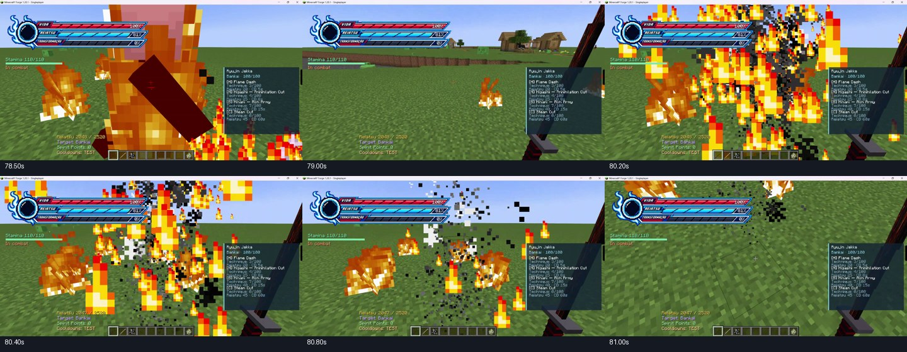

# Ciclo 62 — vídeo Higashi, câmera dirigida e piloto Photon

18/10/2026. Branch `Feature-Poderes-bankais`, Git limpo ao iniciar, base `63e2bce`. Pedido: analisar o vídeo de teste, estudar implementações de cinemáticas e começar experimentos Photon/LDLib. Sem merge do Zaraki, push ou mudança de outros kits. Este ciclo sucede a câmera experimental do ciclo 60.

## O vídeo e o problema

Arquivo recebido: `C:/Users/joaop/Downloads/Gravação/Gravação de Tela 2026-10-18 182929.mp4`: **85,73 s**, 1920×1020, 30 quadros/s, com áudio. Inspeção visual com amostras a cada 0,5 s e detalhamento a cada 0,1 s entre 78–81 s; áudio não transcrito. Os 30 quadros/s do arquivo não demonstram o FPS do Minecraft. PyAV instalado apenas em `build/video-analysis-tools`, sem entrar no mod.

No trecho final, especialmente por volta de 80,2–80,9 s, fogo e cinzas aparecem, mas a espada/mão em primeira pessoa e o HUD continuam disputando a imagem. Não há uma tomada clara que mostre o corpo do executor e o alvo juntos. Isso sustenta o relato do usuário de que a apresentação da execução não ficou legível; não é evidência de dano incorreto.



No código 60, a câmera começava **após a morte**, usava um ArmorStand temporário como entidade de câmera e forçava primeira pessoa. Era uma órbita posterior ao golpe, sem pose própria cobrindo toda a cena. Modificar posição/rotação desse suporte não equivale a dirigir de forma explícita a posição e os ângulos finais do viewport. A gravação não comprova isoladamente cada causa interna; essa é a análise do fluxo de código que motivou a substituição.

## Implementações estudadas e o que aproveitar

1. **Zaraki da equipe**, `origin/bankai-zaraki:c17d274`, `client/cinematic/CinematicDirector.java`: tomadas com posição e ponto de interesse, interpolação por trecho, mudança para terceira pessoa, pose PlayerAnimator, FOV/overlay e restauração. O controlador usa `ViewportEvent.ComputeCameraAngles` e acesso mapeado à posição de `Camera`. Foi lido diretamente da ref, sem incorporar o kit inteiro. A nova Higashi adota essa organização e o mesmo mecanismo Forge para posicionamento; as tomadas e a coreografia são próprias.
2. **Forge:** eventos de [viewport na linha 1.20.x](https://github.com/MinecraftForge/MinecraftForge/blob/1.20.x/src/main/java/net/minecraftforge/client/event/ViewportEvent.java). No projeto, o mapeamento gerado confirma `Camera.m_90581_(Vec3) → setPosition(Vec3)`. Esse é o método localizado por `ObfuscationReflectionHelper`; não depende de um nome de desenvolvimento fixo no JAR de produção. Se o acesso falhar, registrar erro e restaurar câmera normal, sem deixar apenas os ângulos presos.
3. **ReplayMod:** [documentação de caminhos/keyframes](https://www.replaymod.com/docs/#camera-paths) e [CameraProperties](https://github.com/ReplayMod/ReplayMod/blob/stable/src/main/java/com/replaymod/pathing/properties/CameraProperties.java). Aprendizado: separar posição de câmera, orientação, tempo e interpolação. ReplayMod é referência de autoria/reprodução, não foi instalado nem usado para pausar ou rebobinar o combate real. Neste piloto usamos trechos curtos com smoothstep e cortes explícitos, sem spline longa que possa passar por posições indesejadas entre keyframes.
4. **Photon 1.x oficial:** ramo [1.20.1](https://github.com/Low-Drag-MC/Photon/tree/1.20.1), commit estudado `507499fbe5a3fc72bb90993e059848cbb31f13ca`, e source JAR publicado de 1.1.17. Estudados `FX`, `FXRuntime`, `FXEffect`, `ParticleEmitter`, configuração de partículas, `FXHelper`, `FXProject` e executores de bloco/entidade. O efeito é uma definição; cada reprodução tem runtime próprio e vida útil controlada. Usamos a API para um efeito autoral, sem copiar packs de terceiros.

Photon trata **VFX**, PlayerAnimator trata **pose do jogador**, Forge trata **viewport/câmera** e o executor Bleach trata **alvo, custo e dano**. Um editor de partículas não corrige sozinho um enquadramento incorreto. Não usar exemplos Photon 2/LDLib2/NeoForge 1.21 como API desta bancada Forge 1.20.1.

## Nova experiência implementada

O servidor pode enviar uma **prévia visual** quando a Higashi é aceita e já existe um alvo elegível a até 7%. Assim a apresentação começa antes do corte. A prévia não aplica dano, não reserva a vítima nem garante execução. No tick 12 o servidor **reavalia** o alvo e o limiar, como antes; só a morte confirmada autoriza as chamas/cinzas especiais. Se o alvo se curar, sair ou o cast for cancelado, não há incineração falsa. Uma confirmação sem prévia inicia a apresentação no momento do impacto, sem reproduzir artificialmente a preparação depois da morte.

Linha de tempo visual, em ticks:

- **0–9:** plano lateral dos dois participantes, preparando a espada no quadril; FOV 64.
- **10–17:** corte para uma posição lateral mais baixa, acompanhando o golpe; impacto continua no **12**, FOV 60.
- **18–43:** afastamento e pequena elevação para ler corpo, fogo e cinzas; FOV 66.
- **44:** cena e pose encerradas; volta à perspectiva anterior. Duração nominal completa **2,2 s**, com 32 ticks após o impacto. Prévia não confirmada expira no tick 18.

`HigashiCinematicPath` calcula as tomadas em um referencial estável do atacante/alvo. A confirmação atualiza as âncoras para as posições reais do impacto, mantendo o tempo de início da prévia. O cliente aplica posição e yaw/pitch no evento final de câmera a cada quadro, com roll zero. Usa terceira pessoa para exibir o corpo e evitar a mão em primeira pessoa sobreposta à cena. HUD fica oculto enquanto essa câmera estiver ativa, com barras discretas; sem novo flash ou tremor. A curva PlayerAnimator própria sincroniza preparo, corte e recuperação, com espelhamento e sem lease de pose permanente. Observadores veem a pose/incineração; suas câmeras não são tomadas.

Há consulta de colisão entre foco e câmera; recua do bloco atingido e abandona a tomada se ficar perto demais para enquadrar. F5, menu, ataque/uso manual, movimento/pulo, dano recebido, morte, troca de câmera, afastamento, perda de arma/forma, guarda, outra técnica/liberação e mudança de mundo podem encerrar a apresentação. Não há teleporte, pausa global ou invulnerabilidade nova; a câmera é opcional (`cinematicExecutionCamera`). A preparação/recuperação autoritativa e o dano não foram prolongados para acompanhar o final visual. O trecho posterior pode ser interrompido para continuar jogando.

Limiar **até 7% antes do impacto**, alvo único de execução, custos/cooldown, proteção de aliados/criativo/PvP e regras normais de morte/loot continuam. Pétalas/Jardim e Hyōrinmaru não foram alterados. Rede passa a **2.24** pelo indicador prévia/confirmação no S2C; schema **9** e revisão de técnicas **2** mantidos. Clientes e servidor Bleach devem usar a mesma build.

## Piloto Photon/LDLib

Versões Forge fixadas e hashes SHA-512 conferidos contra metadados oficiais Modrinth:

- [Photon Editor 1.1.17](https://modrinth.com/mod/photon-editor/version/a7chTVuf), ID `a7chTVuf` — projeto do editor VFX, não o shader pack de nome semelhante.
- [LDLib 1.0.42](https://modrinth.com/mod/ldlib/version/ONxYJpRz), ID `ONxYJpRz` — linha utilizada pelas configurações do Photon 1.20.1 estudado.

`compileOnly` permite compilar a ponte; runtime é habilitado com `-PphotonPilot=true`. Dependências declaradas opcionais no Bleach. O pacote normal mantém **cinco JARs**; `preparePhotonTestPack` gera outro diretório com **sete**, incluindo as duas bibliotecas e configuração experimental. Não foi alterada uma instalação global de Minecraft.

`PhotonPilotBackend` cria dois emissores finitos: brasas laranja e cinzas escuras atrasadas. Usam textura vanilla, volume correspondente ao alvo, simulação em coordenadas de mundo, sem bloom global. São detalhes adicionais à incineração nativa, permitindo comparação. Sem dano, física de entidades ou câmera próprios. Até quatro runtimes, dois emissores com limite 128 partículas cada; redução de emissão no gráfico mínimo, encerramento forçado até 52 ticks e limpeza por troca de mundo/desconexão. Sem substituir os efeitos homologados de todo o mod.

Comandos **locais**, disponíveis após entrar no mundo:

```text
/bleachfx photon status
/bleachfx photon test
/bleachfx photon stop
/bleachfx photon export
/photon_editor
```

`test` ativa a opção experimental e reproduz um efeito a três blocos à frente, sem exigir alvo ou dano; até quatro efeitos simultâneos. `stop` desliga a opção e limpa os runtimes do nosso piloto. `export` grava **`.fx` e `.fxproj`** em `photon-pilot` dentro da pasta da instância do jogo. O `.fxproj` preserva a definição editável para abrir no editor Photon; `.fx` é export de reprodução. O comando nativo `/photon_editor` foi confirmado no source 1.20.1. A criação/abertura real da UI e os exports ainda precisam de playtest; compilação não comprova o fluxo gráfico completo.

Para comparar automaticamente na execução, habilitar `experimentalPhoton=true` no `config/bleachmod-client.toml`. O pacote experimental inclui esse valor; se a instância já possui configuração própria, alterar apenas a opção pertinente. Sem as bibliotecas ou com a opção desligada, continua a incineração nativa. A ponte não referencia tipos Photon em suas assinaturas públicas e só chama o backend após verificar os mods.

## Validação e limite concreto encontrado

- Base sem runtime Photon: `check build prepareCombatTestPack preparePhotonTestPack runGameTestServer` passou com **113 regressões e 137 GameTests obrigatórios**. Log `build/cycle62-baseline-validation.log`.
- Perfil com Photon/LDLib carregados: `-PphotonPilot=true runGameTestServer` passou com os **137 GameTests**, log `build/cycle62-photon-validation.log`. Logs identificam os dois mods carregados.
- **A inicialização desse perfil não foi limpa:** LDLib registrou oito tentativas recuperadas de carregar `com.lowdragmc.photon.gui.editor.FXEditor` no ambiente `DEDICATED_SERVER`. O servidor continuou e os testes passaram; isso não apaga os erros do log. Mantemos o conjunto como **bancada experimental, começando em singleplayer**, sem promover ao pacote principal. Revisar scanner/dist e testar negociação com dois clientes antes da adoção geral. Não alegar compatibilidade assimétrica cliente/servidor sem esse teste.
- Build/pacotes finais recompilados após completar a limpeza visual por arma/forma; sem repetir a suíte de servidor para esse ajuste exclusivamente cliente. Log `build/cycle62-final-build.log`.
- Novas regressões verificam enquadramento de ambos os participantes, orientação da câmera, recuperação/espelhamento da pose e distinção dos pacotes. Novos GameTests verificam cura entre prévia/impacto e cancelamento após prévia. Nenhuma asserção anterior removida.

**Ainda não comprovado:** nova câmera/renderização em Minecraft, API Photon executando no cliente, export/editor, FPS, shaders ou duas conexões reais. A análise do vídeo é da versão anterior; não apresentar as amostras como validação do visual novo.

## Pacotes e próximos testes

- Normal: `build/combat-test-pack/bleach-bettercombat-piloto.zip`, cinco JARs, para testar a câmera nova com as dependências existentes.
- Experimental: `build/photon-test-pack/bleach-photon-piloto.zip`, sete JARs/config, para comparar as brasas/cinzas Photon e experimentar o editor em uma instância de teste.

Primeiro, repetir o cenário gravado com um alvo já abaixo de 7%, parado durante o corte: verificar corpo inteiro/katana, transições de tomada e retorno à perspectiva. Depois testar F5/menu/movimento, parede próxima, cura/saída do alvo e modo câmera desligada. No piloto Photon, usar `status/test/stop/export`, abrir o projeto no editor e comparar native-only versus experimental com configurações iguais. No multiplayer futuro, o observador não deve receber mudança de câmera.

A próxima evolução é iterar o enquadramento com nova gravação e conciliar esse ciclo de vida com o controlador Zaraki ao integrar a branch. Não instalar outro sistema completo de combate para resolver a câmera. Integração Zaraki, Ishida, Mentor/Proficiências e demais prioridades seguem o ciclo 61; esta bancada foi antecipada pelo pedido explícito atual.
