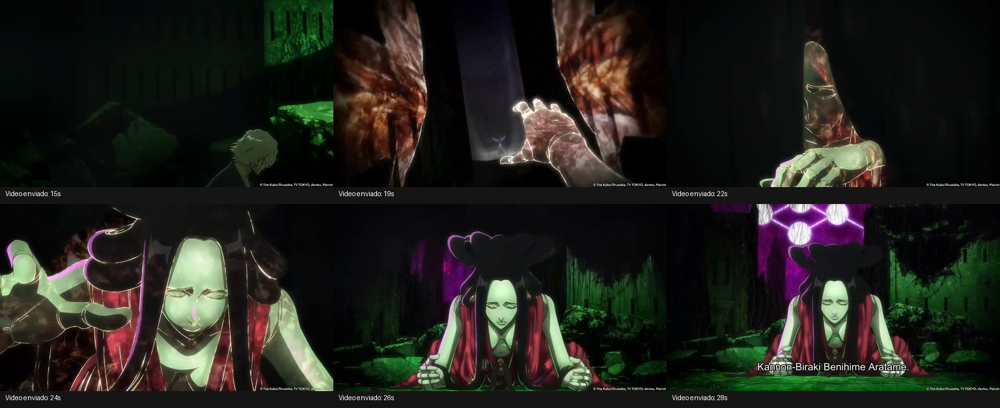

# Ciclo 64 — revisão visual Benihime e Ryūjin, sem implementação

19/10/2026. Base `ca9a067`, branch `Feature-Poderes-bankais`, Git limpo ao iniciar. Feedback: animações/cenas Ryūjin e Benihime ainda insatisfatórias; **Zaraki aprovado, não alterar**. Pedido restrito a inventário, análise do vídeo e planejamento. Nenhuma mudança em código, dependências, regras, pacotes ou cinemática Zaraki.

## Fontes conferidas

Continuidade 00; Benihime [47](47-benihime-kit-suporte-reestruturacao-2026-10-15.md), [48](48-benihime-rede-cargas-marionete-2026-10-15.md), [49](49-shibari-solo-hiasobi-radial-2026-10-15.md), [59](59-liberacoes-gestos-senbon-benihime-asauchi-2026-10-17.md); Ryūjin [56](56-repertorio-elemental-cinematica-combos-2026-10-17.md), [58](58-ryujin-coreografias-chamas-implementadas-2026-10-17.md), [60](60-higashi-execucao-jardim-persistente-2026-10-18.md), [62](62-higashi-camera-dirigida-piloto-photon-2026-10-18.md); definições/executores e renderizadores atuais. Documentos históricos registram versões anteriores: para Shibari/Hiasobi vale a correção 49, não o raio 4 inicial; Higashi inclui a execução 60/62.

## Benihime atual: repertório completo

Teclas padrão H/N/B/C, sujeitas às configurações do jogador. Técnicas custam reiatsu, sem cobrança adicional de stamina.

**Selada:** combate básico e defesa universal; não possui os oito slots especiais. Item com empunhadura curva dourada de bengala e lâmina fina.

**Shikai:** lâmina larga escura, fio claro e cordão carmesim.

- H — **Nake, Benihime:** corte carmesim projetado até 14 blocos; para em parede, dano base 8 uma vez por alvo. Custo 12, recarga 3 s. Gesto a revisar: corte corporal que dê origem ao projétil, com espada, tronco e recuperação alinhados.
- N — **Chikasumi no Tate:** escudo frontal por até 4 s, reserva 24 e mitigação de 85% de ataques físicos/projéteis elegíveis; não cobre costas, magia ou explosões. Custo 18, recarga 7 s. Gesto: erguer espada/mão livre e sustentar uma postura defensiva legível; não inventar canalização ou mudar possibilidade de movimento nesta revisão.
- B — **Shibari, Benihime:** lança rede até 12 blocos, expande por 1 s até raio 10/diâmetro 20 e captura os presentes; contrai por até 5 s até raio mínimo 1,4. Contenção firme e Lentidão V, sem dano próprio e com colisão. Custo 20, recarga 8 s. Gesto: lançar/estender os fios; contração deve continuar visualmente mesmo após terminar o gesto inicial. A malha nasce acima do chão.
- C — **Hiasobi, Benihime, Juzutsunagi:** consome a rede e fixa seu raio atual; ignição por 0,8 s e dano base 14 em todos os inimigos elegíveis dentro da malha, sem depender da mira. Custo 25, recarga 10 s. Gesto: fechar os fios e disparar a ignição, com contas percorrendo a rede antes da detonação.

**Bankai — Kannonbiraki Benihime Aratame:** manifestação feminina gigante, vestes carmesins, cabelo negro e olhos fechados. A arma mantém a identidade de bengala/lâmina fina.

- H — **Dissecação:** marca uma região até 16 blocos; incisão após 0,6 s, raio 4, dano base 12. Alvos atingidos ficam expostos por 3 s: +20% aditivo ao dano desse usuário. Custo 25, recarga 7 s. Jogador indica a incisão; mão da manifestação abre/separa visualmente a região no impacto.
- N — **Reconstrução:** trata aliado mirado em até 12 blocos ou o próprio usuário; três pulsos de 2 pontos de vida, total 6 pontos/3 corações em 1,5 s. Interrompe se perder elegibilidade/alcance/visão. Custo 28, recarga 12 s. Jogador conduz o tratamento; dedos da manifestação e costuras seguem os pulsos.
- B — **Reestruturação corporal:** três golpes manuais bem-sucedidos ganham +30% aditivo por até 5 s. Cada acerto consome uma carga, mostra incisão/impacto e empurra hostis elegíveis em raio 2,5; não acrescenta dano de área. Custo 22, recarga 10 s. Costuras e manipulação dos braços devem comunicar a transformação; três impactos precisam de variações legíveis.
- C — **Abertura de caminho:** corredor de até 12 blocos na direção completa da mira, inclusive vertical, com preparo de 0,3 s e duração de 3 s. Dono/aliados atravessam uma vez cada; bloqueios sólidos continuam impedindo passagem. Três cargas, custo 30 por uso, recarga de 13 s após a terceira. Não concede voo. Gesto: mão da manifestação separa a abertura, jogador aponta/avança; orientar também para cima/baixo.

**Passivas na Bankai empunhada:** usuário recupera 1 ponto de vida/s; aliados em raio 8 e com visão recuperam 1 ponto a cada 2 s. Aliado significa jogador do mesmo time formal ou animal domesticado pelo dono; auras não empilham. Manifestação é visual, sem IA ou ataques independentes. Distância atual ~11 blocos atrás e altura ~10 blocos; preservar essa referência até comparar enquadramento, sem presumir nova escala.

## Ryūjin: ações que exigem animação do jogador

Todas já têm algum gesto; esta lista é de revisão de qualidade/sincronismo, não de técnicas sem implementação.

- **Selada H — Corte frontal:** preparar acima do ombro, transferir peso e cortar para baixo; sem fogo.
- **Selada N — Varredura:** base aberta, rotação do quadril e corte horizontal; sem fogo. B/C não têm técnica selada.
- **Shikai H — Rajada:** corte descendente projeta frente estreita de fogo pelo chão (8 blocos).
- **Shikai N — Leque:** corte lateral direita→esquerda, com setor de fogo de 140°/14 blocos acompanhando o percurso.
- **Shikai B — Tornado:** gesto circular/giro inicial, recuperação para lutar enquanto o anel continua. Não manter o jogador rodando durante os 10 s do campo.
- **Shikai C — Jōkaku Enjō:** apontar a região; chamas sobem no campo fixo. Gesto precisa indicar onde nasce o efeito.
- **Bankai H — Investida:** tronco inclinado, katana dirigida ao avanço e pernas coerentes com o dash real; término claro na colisão/parada.
- **Bankai N — Higashi normal:** preparação no quadril, rotação curta, corte seco e recuperação. **Execução até 7% de vida:** sequência própria de golpe/enquadramento, contato no tick 12 e incineração após morte confirmada; é a prioridade de revisão, sem prometer execução de alvo inelegível.
- **Bankai B — Minami:** baixar/tocar a espada no chão e sincronizar a emergência dos soldados.
- **Bankai C — Corte de Vapor:** preparação alta e pesada, golpe decisivo e recuperação; frente de fogo e fumaça lateral, sem esconder o contato.
- **Liberações Shikai e Bankai:** desembainhar/conduzir as chamas; na Bankai, recolher o fogo para a lâmina, katana carbonizada apontando para fora do corpo, pausa breve e retorno. Nenhuma pose permanente.
- **Corpo a corpo básico e X:** conferir três golpes Better Combat e bloqueio, além das transições com técnicas. Não duplicar hitbox/dano ao refazer o visual.

Câmera completa proposta para Bankai e execução Higashi. Técnicas comuns priorizam gesto e enquadramento normal; cortes de câmera frequentes prejudicariam a leitura da luta.

## Análise visual do vídeo fornecido

Fonte local: `C:/Users/joaop/Downloads/Bing Vídeos.mp4`, duração ~90 s, 1280×720. Inspecionada a sequência completa por amostragem de 3 s e os marcos da ativação por quadros adicionais; análise visual, não validação de sincronismo de áudio. Tempos aproximados do arquivo enviado, não duração proposta no jogo.

- **0–10 s:** Urahara curvado/contido; detalhes de mão e rosto antecedem a apresentação. Não há uma longa sequência de golpes do jogador para invocar a figura.
- **15–24 s:** montagem revela a presença por partes. Antebraço/mão aparecem com linhas brilhantes e superfície em formação; depois rosto/cabelo/vestes. A figura recebe movimento próprio, em vez de aumentar inteira como um objeto rígido.
- **26–28 s:** revelação frontal ampla: Urahara pequeno no centro, manifestação atrás, inclinada e com braços/mãos apoiados no chão. Cabelo em laços/mechas e olhos fechados definem a silhueta.
- **Após a revelação:** mãos, braço e ponto de vista reforçam o domínio da figura sobre o espaço. Aproximadamente 69–78 s mostram mudanças no braço do adversário; são referência de linguagem de reestruturação, não um novo poder automaticamente aprovado.

O verde pertence à iluminação do ambiente; os círculos/linhas roxos ao adversário. Preservar a identidade carmesim/negro/pele da Benihime. A postura de revelação no chão difere do repouso de marionete com mãos suspensas do nosso protótipo 48: separar entrada fiel e comportamento de acompanhamento posterior.

## Proposta para a próxima implementação

Roteiro adaptado de **5–6 segundos**, sujeito a fechamento do contrato; atualmente são 60 ticks/3 s com commit no 40. Alterar duração/marco modifica a janela de ação, por isso não tratar a nova duração como simples mudança cosmética já aprovada.

1. **Preparação, ~0–0,8 s:** jogador contido, leve inclinação e katana baixa. Plano próximo de tronco/arma; manter o rosto legível em skins Minecraft.
2. **Braços, ~0,8–2 s:** recuar a câmera para três quartos; mãos/antebraços se formam atrás, com linhas de reconstrução discretas. Animar dedos/cotovelos, sem esticar verticalmente o modelo inteiro.
3. **Revelação, ~2–3,5 s:** rosto, cabelo e vestes completam a silhueta; câmera frontal baixa se afasta e mantém jogador + figura no mesmo quadro.
4. **Apoio, ~3,5–4,7 s:** figura se inclina, mãos descem e se apoiam visualmente na superfície. Vestes/cabelo terminam o movimento com atraso; jogador permanece central e visível. Sem impacto destrutivo ou dano novo.
5. **Assinatura e saída, ~4,7–5,5 s:** breve pausa do conjunto, olhos fechados, nome da Bankai se desejado; restaurar câmera e controle suavemente. Após a entrada, passar ao acompanhamento articulado e aos gestos de cada habilidade.

Durante a cena, usar âncora/direção estáveis para não girar todo o cenário a cada movimento do mouse. Preservar inicialmente os ~11 blocos de afastamento; resolver escala com lente/posição da câmera antes de mudar a distância homologada. Apoio das mãos exige adaptação visual ao terreno, com alternativa para água, ar e espaços apertados; não enterrar os braços ou alterar colisões reais.

**Ferramentas já disponíveis:** PlayerAnimator para corpo/arma do jogador; modelo articulado e keyframes próprios da manifestação, com GeckoLib 4 já no projeto como opção para autoria; controlador exclusivo Benihime para câmera/tomadas; partículas vanilla/geometria para fios e Photon opcional para detalhes. A qualidade principal virá de poses, silhueta, pivôs, transições e enquadramento, não de adicionar partículas. Não tornar Photon requisito do pacote estável nesta revisão.

**Ordem de trabalho proposta:** storyboard e prévia animada Benihime → aprovação visual → modelo/rig e ativação → oito técnicas com interação jogador/manifestação → Ryūjin, começando por transformação/Higashi e depois demais golpes. Preservar Zaraki e suas fontes/assets. Para Benihime, a manifestação atual é geometria procedural: migrar para modelo articulado exige preservar estado/gestos/observadores, não apenas trocar o arquivo de textura.

**Aceite:** jogador e manifestação visíveis no mesmo plano de assinatura; katana sem cruzar o corpo; mãos sem entrar no chão; nenhum crescimento rígido como efeito principal; personagem não fica preso em pose; câmera volta corretamente; destro/canhoto e classic/slim; cenário apertado; efeitos e observadores sincronizados. Preview é estudo, captura real é a prova de acabamento. Dano/custos/cargas/passivas existentes ficam fora da revisão de equilíbrio.

Somente documentação e quadro de referência nesta rodada. Sem build/testes, por não haver alteração de runtime.
