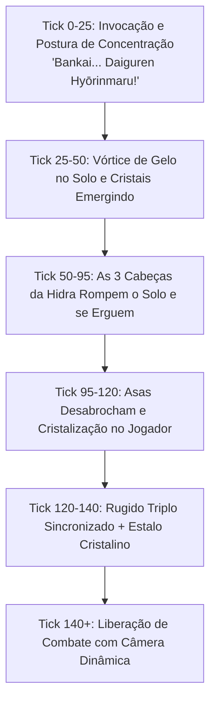

# Planejamento — Refinamento Hyōrinmaru: Hidra Glacial de Três Cabeças, Transformação Cinematográfica e Repertório Visual

**Data:** 21/10/2026  
**Branch de trabalho:** `codex/design-poderes-criaturas`  
**Referência:** Arco TYBW / Daiguren Hyōrinmaru com manifestação de **Hidra Glacial Gigante de 3 Cabeças** (ajuste de design aprovado pelo usuário).

---

## 1. Visão Geral e Conceito da Hidra Glacial (Three-Headed Ice Hydra)

Em substituição à estrutura tradicional de corpo quadrúpede, a manifestação espiritual da Daiguren Hyōrinmaru ergue-se como uma **Hidra Glacial Colossal de Três Cabeças** diretamente atrás e acima do Shinigami:

### Anatomia e Fantasia Visual:
1. **Três Pescoços Serpentinos e Cabeças Independentes:**
   - **Cabeça Central (Dominante):** Maior, focinho alongado, chifres maiores em coroa de gelo e mandíbula maciça. Ruge diretamente para a frente/céu.
   - **Cabeça Esquerda & Cabeça Direita (Flancos):** Mais ágeis e pontiagudas, sibilando e rugindo em ângulos de ±35°, protegendo os flancos e mirando adversários nas laterais.
   - **Olhos Carmesim Luminescentes:** As três cabeças possuem olhos vermelhos brilhantes emitindo fagulhas de reiatsu, criando contraste estético marcante com o gelo azul-celeste e branco.
2. **Asas Colossais de Cristal:**
   - Expandem-se a partir da base dorsal da Hidra, formando uma barreira monumental de cristais pontiagudos de gelo ao redor do Shinigami.
3. **Manto e Armadura no Jogador:**
   - O Shinigami recebe as asas articuladas nas costas, cauda segmentada de gelo, braço direito com garras e lâmina congelada, e as 3 flores de 4 pétalas flutuando em arco.

---

## 2. A Nova Sequência Cinematográfica — O Despertar da Hidra (140 Ticks / 7 Segundos)



### Detalhamento dos Marcos:
- **Marco 1 — "Bankai... Daiguren Hyōrinmaru!" (Ticks 0–25):**
  - O jogador firma a base com a Zanpakutō erguida à frente, ponta descendo em direção ao solo.
  - Câmera frontal aproximada com contração sutil de FOV (efeito de foco espiritual) e zumbido criogênico crescente.
- **Marco 2 — Erupção Glacial e Vórtice no Chão (Ticks 25–50):**
  - O solo em raio de 8 blocos congela com textura de geada translúcida e estilhaços verticais pontiagudos.
  - Uma tempestade em espiral de névoa ártica densa e partículas de gelo envolve o jogador.
- **Marco 3 — A Ascensão da Hidra Glacial (Ticks 50–95):**
  - Os três pescoços serpentinos colossais rompem o chão atrás do jogador:
    - O pescoço central sobe reto e altivo.
    - Os pescoços esquerdo e direito emergem contorcendo-se em arcos dinâmicos.
  - Câmera faz um movimento de órbita ascendente em terceira pessoa, capturando a escala titânica das três cabeças acima do jogador.
- **Marco 4 — Asas da Hidra e Cristalização do Jogador (Ticks 95–120):**
  - As asas gigantescas de cristais de gelo desabrocham dos flancos da Hidra com efeito sonoro de vidro quebrando e vento ártico.
  - No corpo do jogador, cristalizam-se as asas menores de combate, a cauda de gelo e as três flores de lótus de gelo flutuantes atrás da cabeça.
- **Marco 5 — O Rugido Triplo e Liberação de Combate (Ticks 120–140):**
  - As três cabeças abrem suas mandíbulas articuladas simultaneamente num rugido devastador em três direções (centro, esquerda, direita).
  - Uma onda de choque gélida dissipa a névoa, restaurando o controle suave do jogador para a esgrima e movimentação livre.

---

## 3. Matriz de Habilidades com a Hidra Integrada

### Forma Selada
- **H:** Corte Glacial Frontal (alcance 6, corte afiado com vento ártico).
- **N:** Varredura Glacial (alcance 6, varredura horizontal atingindo múltiplos alvos).
- **B:** Postura da Bainha (bloqueio físico que desacelera atacantes).
- **C:** Choque Glacial (pequeno cone de ar subzero à queima-roupa com repulsão).

### Shikai (Hyōrinmaru)
- **H — Dragão de Gelo Único:** Disparo da cabeça serpentina clássica de gelo que morde o alvo até 18 blocos.
- **N — Corrente Crescente (Ryōjin Hyōheki):** Lâmina de gelo amarrada por corrente de reiatsu que empala e puxa o oponente.
- **B — Choque Glacial Expandido:** Repulsão de 360° em 5 blocos, congelando projéteis.
- **C — Zona Glacial:** Campo contínuo de gelo em raio 12 com escorregamento e lentidão contínua.

### Bankai (Daiguren Hyōrinmaru)
- **Passiva Visual:** Manto de Daiguren no jogador (asas articuladas de gelo, cauda oscilante, flores de lótus gélidas e garras).
- **H — Sanryū Hyōketsu (Ataque Triplo da Hidra):**
  - As **três cabeças da Hidra** se projetam para frente em leque (0° e ±25°), devorando uma área maciça de 24 blocos com mandíbulas móveis, dano de impacto e congelamento profundo.
- **N — Ryūsenka (Flor de Gelo do Dragão):**
  - Dash instantâneo perfurante; o alvo atingido é encerrado em uma escultura colossal de flor/cruz de gelo que se estilhaça em estilhaços letais após 2 segundos.
- **B — Sennen Hyōrō (Prisão de Mil Anos):**
  - Pilares monumentais de gelo brotam em anel ao redor do alvo e convergem ao centro como um sarcófago criogênico esmagador.
- **C — Hyōten Hyakkasō (Funeral das Cem Flores):**
  - Tempestade celestial com flocos gigantes de flores de gelo caindo do céu, germinando estátuas de flores gélidas em cada inimigo tocado.

---

## 4. Arquitetura de Modelagem no Blockbench (GeckoLib)

O modelo da criatura será estruturado como `ice_hydra.bbmodel` (`geo/ice_hydra.geo.json`):

```
root
├── base_origin (ponto de fixação atrás do jogador)
├── hydra_wings (asas colossais de cristal)
│   ├── wing_left_joint_1 -> wing_left_joint_2 -> wing_left_feathers
│   └── wing_right_joint_1 -> wing_right_joint_2 -> wing_right_feathers
├── neck_center_1 -> neck_center_2 -> neck_center_3 -> head_center
│   ├── jaw_center (articulada)
│   ├── horns_center (cristais superiores)
│   └── eyes_center (emissivo vermelho)
├── neck_left_1 -> neck_left_2 -> neck_left_3 -> head_left
│   ├── jaw_left (articulada)
│   └── eyes_left (emissivo vermelho)
└── neck_right_1 -> neck_right_2 -> neck_right_3 -> head_right
    ├── jaw_right (articulada)
    └── eyes_right (emissivo vermelho)
```

- **Textura:** 128x128 pixels, estilizada com tons de azul ciano, reflexos brancos de geada e mapa de emissão para os 6 olhos vermelhos.
- **Animações:**
  - `animation.ice_hydra.idle`: Movimentação sutil e ondulante dos três pescoços, como serpentes de gelo vivas.
  - `animation.ice_hydra.roar`: As três cabeças se erguem e rugem com mandíbulas abertas.
  - `animation.ice_hydra.triple_bite`: Golpe sincronizado para frente da habilidade `H`.
  - `animation.ice_hydra.cinematic_rise`: Sequência da cinemática de transformação.
