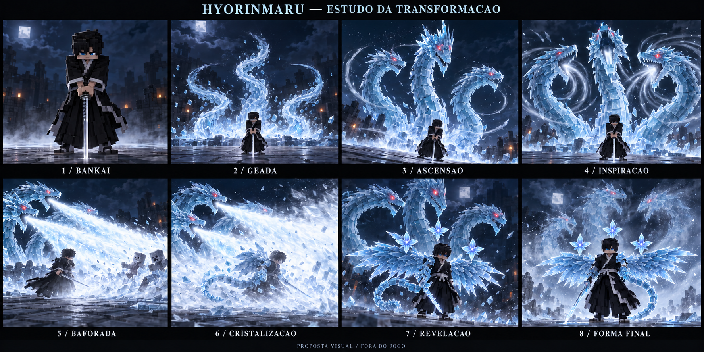

# Ciclo 86 — protótipo da ascensão, baforada e revelação da Hyōrinmaru

Data: 21/10/2026. Branch conferida: `Feature-Poderes-bankais`, com as alterações do ciclo 84 ainda presentes. Pedido vigente: analisar os cinco conceitos e o histórico entregue, compreender a nova direção e prototipar **sem codar** enquanto o usuário testa. Esta rodada altera apenas documentação e arte em Docs/poderes. Não executa Minecraft, Gradle, instalação, commit, checkout, merge ou push.

**Estado: direção visual aceita para planejamento; não implementada nem homologada no jogo.** A sequência abaixo é uma adaptação autoral para o mod. A versão jogável do ciclo 84 continua com sua transformação de140 ticks; este documento não muda essa duração nem adiciona dano à invocação atual.

Prancha gerada com a ferramenta integrada `image_gen`, seguida de revisão localizada das flores. É uma ilustração de oito marcos, fora do jogo: não é captura Minecraft, vídeo nem animação executável. Cores, iluminação e finura dos cristais são direção artística; a aplicação no mod exigirá simplificação e validação. [Prompts integrais](media/86-hyorinmaru/prompts-storyboard.txt).

## 1. Leitura dos arquivos e das propostas anteriores

Foram consultados o histórico colado, as cinco imagens entregues, o documento 83, o relatório84 e o documento 85 na branch `codex/design-poderes-criaturas`, por leitura Git sem mudar de branch. As mensagens sobre subagentes, commits, reset e checkout são histórico fornecido, não ordens para repeti-los. Não foram acionados subagentes.

O material contém duas durações diferentes: sete segundos/140 ticks no 83 e três segundos e meio/70 ticks no 85. A nova baforada e a revelação pedem uma terceira proposta de montagem, descrita abaixo, sem sobrescrever o histórico ou tratar essas versões como equivalentes.

- **Hidra/transformação:** aproveitar a cabeça central dominante, focinhos alongados, coroas de gelo, seis olhos vermelhos, pescoços curvados e diferença de alturas. A massa atrás do personagem deve ler como três serpentes de gelo, não três colunas ou um humanoide de três cabeças.
- **Slot1, Ryūsen Hyōketsu:** aproveitar a fluidez dos arcos e o direcionamento dos três dragões. A invocação com baforada será um evento próprio de transformação; não substituir automaticamente o ataque H, que continua com seus três projéteis independentes.
- **Slot2, Ryūsenka:** a cruz/flor cristalina e a pose após a estocada são boas direções para uma revisão posterior do N. Não inserir agora essa prisão no sopro da transformação.
- **Slot3, Sennen Hyōrō:** aproveitar cristais verticais, variação de espessura e leitura de recinto. A escala monumental da ilustração não deve ser copiada literalmente como centenas de blocos permanentes. Bloqueio de teleporte e prisão hermética são regras propostas no 85, não resultados comprovados pelos seus screenshots.
- **Slot4, Hyōten Hyakkasō:** aproveitar o olho da tempestade, queda de cristais florais e contraste céu escuro/gelo luminoso. Contador de cem flores, execução terminal e estátuas permanentes exigem contrato próprio; não entram por consequência da aprovação artística.

Também permanecem propostas separadas o desgaste das12 pétalas e o canal emissivo dos olhos. O desenho de uma asa luminosa não comprova emissão implementada, e capturas de QA não homologam todas as mecânicas descritas no 85.

## 2. Ideia central da nova entrada

O jogador chama a Bankai, a geada se organiza atrás dele e os três pescoços **se constroem e se erguem**, com movimento de base até a mandíbula. Depois de estabilizarem, as cabeças recuam para inspirar e soltam uma única grande baforada conjunta para a frente. O jogador permanece à frente da hidra, dentro da neve, como centro protegido da transformação. As asas, cauda, braço e flores cristalizam nessa cobertura. A neve baixa e revela sua forma completa.

Da Benihime aproveitamos a construção dramática: preparação legível, antecipação, entrada progressiva, enquadramento que mostra o movimento e uma pose final sustentada. A ação da Hyōrinmaru tem sua própria linguagem — cristalização, pescoços serpentinos, inspiração, vento e dissipação — sem reutilizar a cortina ou a movimentação corporal da boneca.

## 3. Storyboard de referência — aproximadamente10 segundos/200 ticks

Esta duração é recomendação para o protótipo, sujeita a aceite. Não é alteração no código. A cristalização acontece em paralelo com o fim da baforada; não é uma pausa extra obrigatória entre todas as fases.

1. **Bankai — 0 a1,2 s.** Jogador de pé, base firme, espada baixa à frente com duas mãos e ponta próxima ao chão. Câmera frontal próxima em três quartos, leve aproximação do rosto. Voz “Bankai” e um sopro frio contido. Ainda não exibir asas, cauda ou flores.
2. **Geada — 1,2 a2,2 s.** A câmera começa a recuar; três raízes de gelo se desenham na região atrás do jogador. Névoa baixa oculta a junção com o chão. Gelo e cristais se acumulam antes de existir uma cabeça completa; evitar aparecimento instantâneo do modelo inteiro.
3. **Ascensão — 2,2 a4,4 s.** O pescoço central inicia, seguido pelos laterais com pequena defasagem. A onda sobe pelos segmentos; as pontas descrevem curvas em S e os focinhos se orientam gradualmente. Cabeças laterais mais baixas, central maior. Cristais dorsais acompanham com atraso. Câmera ampla oblíqua, com órbita curta e lenta.
4. **Inspiração — 4,4 a5,4 s.** As três cabeças se alinham para o ataque e recuam com o pescoço arqueado. Mandíbulas abrem progressivamente, neve fina é puxada para as bocas e os olhos intensificam. Uma breve retenção torna o disparo compreensível.
5. **Baforada — 5,4 a7,2 s.** As cabeças avançam juntas e soltam três fluxos que se juntam num volume amplo de neve e gelo para a frente. Plano lateral em três quartos mostra claramente boca → jogador → área inimiga. O personagem é atravessado visualmente pela neve e não recebe dano próprio. A origem alta das bocas exige inclinação do sopro até a zona de combate.
6. **Cristalização — aproximadamente6 a8 s.** Dentro da neve, cristais pequenos crescem no braço direito, nas bases das asas e ao longo da cauda. As asas se montam primeiro recolhidas; as flores surgem por último. Manter uma silhueta reconhecível em alguns momentos, sem converter a tela inteira em branco opaco.
7. **Revelação — 8 a9,2 s.** O sopro termina; fragmentos pesados caem e a névoa deriva para os lados. As novas asas se abrem por articulações, a cauda desenrola e aparecem exatamente três flores de quatro pétalas. O jogador mantém uma pose firme de espada, não congela em posição de ataque.
8. **Forma final — 9,2 a10 s.** Voz com o nome completo acompanha a revelação; a música cede espaço à fala. Câmera retorna suavemente à perspectiva anterior. Recomendação de saída: hidra desfaz-se em geada após cumprir a invocação, deixando o jogador alado como protagonista. Sua permanência após a cena ainda pode ser discutida; não foi decidida como passiva permanente.

## 4. Como os pescoços devem se movimentar

- **Raiz estável e ponta livre:** as bases ficam ancoradas atrás do jogador; pescoço não gira como uma barra rígida a partir do chão.
- **Quatro a seis articulações por pescoço como ponto de partida de autoria:** distribuir a curvatura entre os segmentos, com silhueta em S/C, sobreposição dos cristais e volumes que escondam juntas. Aumentar segmentos não resolve sozinho o problema; a forma e a curva precisam ser desenhadas em conjunto.
- **Atraso entre segmentos:** primeiro reage a base, depois o meio, depois a cabeça. Na parada, o focinho ultrapassa um pouco a posição e se acomoda. Nada de oscilação idêntica nas três cabeças.
- **Cabeça com intenção:** olhos acompanham a frente, mandíbula abre com antecipação e a cabeça responde ao peso do movimento. Movimento lateral tem limites para não cruzar pescoços nem entrar no personagem.
- **Sincronia apenas no clímax:** a ascensão é assimétrica; inspiração e expiração são coordenadas. Pequenas diferenças de VFX não criam três aplicações de dano sobre o mesmo alvo.
- **Construção progressiva:** revelar gelo da raiz para cima, fechar a silhueta e só então completar mandíbula/coroa. Névoa ajuda a transição; não deve esconder todo o trabalho ou substituir movimento por simples aumento uniforme de escala.

O problema não se resolve apenas com mais FPS ou afastamento da câmera. Precisamos de poses intermediárias, curvas de velocidade, articulações adequadas e interpolação de renderização. O caminho recomendado é autoria no Blockbench/GeckoLib e coreografia do jogador na integração PlayerAnimator já existente; nenhuma biblioteca nova é necessária para avaliar essa primeira direção.

## 5. Espaço, câmera e leitura da baforada

Medidas iniciais de estudo: base da hidra aproximadamente8–10 blocos atrás, cabeças a12–16 blocos de altura, central cerca de2 blocos acima das laterais. São referências de composição, não constantes aprovadas. Não apresentar um grande torso cúbico flutuando; a base pode ficar parcialmente encoberta pela geada.

A câmera sai do close e abre espaço **antes** da ascensão completa. Órbita curta, sem girar360 graus nem inverter o eixo durante o sopro. O plano lateral precisa mostrar que o jogador está entre a hidra e o campo inimigo. O retorno começa no último enquadramento real, evitando salto para outro ponto.

Separar camadas: fluxo direcional saindo das três bocas; nuvem ampla que avança; fragmentos maiores de gelo; névoa baixa; cristais de formação aderidos ao personagem. Reduzir densidade perto da câmera e preservar contraste do jogador na revelação. A neve cobre temporariamente a metamorfose, mas o início e a dispersão continuam legíveis.

O dono pode ter direção de câmera cinematográfica configurável. Observadores veem a manifestação e o ataque no mundo sem terem suas câmeras sequestradas. Terreno irregular, tetos e paredes exigirão ajustes de âncora e enquadramento na futura implementação; o protótipo ilustrado usa arena plana.

## 6. Baforada ofensiva — proposta de contrato para discutir

O usuário pediu dano, lentidão e fragilidade nos inimigos à frente. Isso adiciona um **evento de combate novo à transformação**, além do efeito visual, e precisa de balanceamento próprio.

Ponto de partida ilustrativo, sem aprovação de valores: alcance24 blocos à frente do jogador, abertura frontal de90 graus e cerca de1,6 s de onda ativa. Dano inicial sugerido8 antes das regras normais de defesa, Lentidão II por4 s e Fragilidade Gélida por4 s. Fragilidade sugerida: o próximo golpe direto válido recebe15% de bônus e consome a marca; não acumula, não se aplica ao próprio sopro e não executa automaticamente o alvo. Valores finais devem ser comparados a custos, progressão e recargas existentes.

As três bocas formam uma única onda de gameplay: cada alvo recebe o dano inicial uma vez, mesmo dentro da sobreposição dos três fluxos. O volume pode avançar durante a janela, com rastreamento compartilhado dos alvos já atingidos. Paredes bloqueiam o alcance; caster e aliados ficam imunes. Não há destruição permanente de blocos nesta proposta.

Fragilidade não foi encontrada no serviço atual de controle de gelo: ele já oferece lentidão/congelamento. Portanto ela será uma mecânica adicional a especificar, com feedback visível e regras de consumo/expiração, não um efeito que já está pronto.

Antes de codar é preciso fechar o comportamento de movimento, interrupção e repetição da transformação: sair da câmera não pode repetir o sopro, confirmar o dano antes do momento visual ou concluir instantaneamente a cena. Não propor nova invulnerabilidade, câmera obrigatória para observadores ou dano repetido por reativação sem limite.

## 7. Aparência final e som

Asas do jogador com raiz no dorso, articulação proximal/distal e lâminas de cristal separadas, em tamanho menor que a manifestação. Cauda única segmentada com base no quadril e movimento que progride até a ponta, sem atravessar pernas ou chão. Braço direito com gelo e garras; preservar a identidade e a skin do jogador. Exatamente três flores de quatro pétalas, em arco acima das costas, com espaço para ler cada uma.

Olhos vermelhos da hidra pedem uma máscara emissiva específica; não presumir que uma textura vermelha ou um shader externo produza esse resultado. Material deve manter volume e arestas mesmo no perfil base. Photon/LDLib pode enriquecer o sopro e a dispersão depois; dano e montagem não dependerão dele.

Áudio proposto: silêncio relativo e vento grave na preparação; estalos que sobem com os pescoços; inspiração invertendo o fluxo do vento; rugido breve no disparo; camada grave de vento e estilhaços na baforada; queda da música para a fala final. Priorizar inteligibilidade das duas falas, aplicando o aprendizado da Benihime. Esta rodada não cria, substitui ou mixa arquivos de voz/música.

## 8. Próxima validação, quando a implementação for autorizada

Primeiro provar um pescoço com formação e movimento orgânico; depois compor os três, fechar câmera e inspiração, acrescentar sopro e só então unir a cristalização/revelação do jogador. Dano/estados entram com o contrato definido e um único evento autoritativo no servidor. Validar de dia/noite, primeira/terceira pessoa, piso irregular, espaço estreito, interrupções e observador antes de considerar fechado.

Critérios principais: nenhuma cabeça pronta aparecendo do nada; três pescoços distinguíveis; mandíbula e base conectadas; sopro claramente frontal passando pelo jogador; inimigo atingido uma única vez; asas e cauda novas visíveis após a neve; voz compreensível; retorno suave à perspectiva anterior. O storyboard registra a direção para discutir, não encerra esses critérios.

Continuação: [plano de implementação e kit completo87](87-plano-implementacao-hyorinmaru-transformacao-kit-2026-10-21.md).

Reorganização posterior do kit: [ciclo88](88-revisao-kit-hyorinmaru-hidra-erupcao-storyboards-2026-10-21.md). A transformação/baforada desta prancha continua distinta da reinvocação ofensiva das cabeças em Bankai N.
