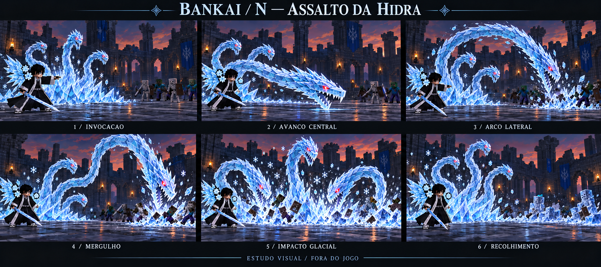
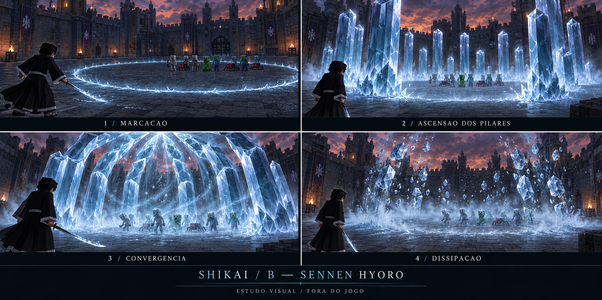
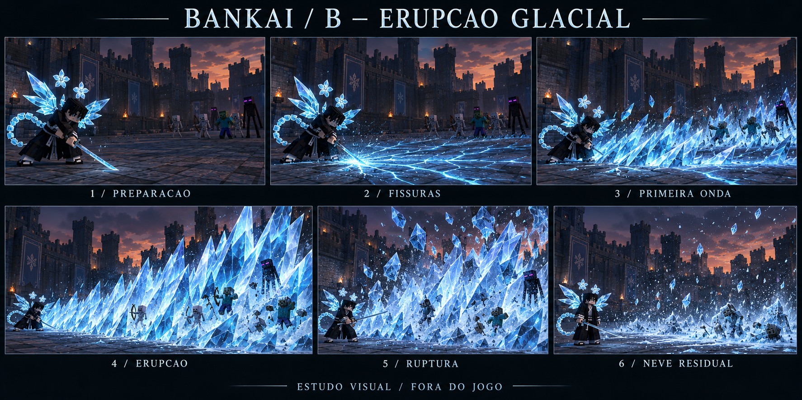

# Ciclo 88 — novos slots, Assalto da Hidra, Sennen Shikai e Erupção Glacial

21/10/2026. Branch conferida: `Feature-Poderes-bankais`. Pedido: mover Ryūsenka para H; substituir o disparo triplo por nova invocação ofensiva das três cabeças, usando o primeiro vídeo como referência de movimento; ampliar Sennen Hyōrō e colocá-la na Shikai; substituí-la na Bankai por erupção/espinhos como no segundo vídeo. **Esta rodada é planejamento, análise de vídeos e storyboards. Nenhuma dessas trocas foi implementada.** A versão testável continua sendo 84 e suas alterações de código foram preservadas.

Este documento **substitui o mapa de slots do 87** nos pontos abaixo. Selada, passivas e transformação 86 continuam como referências, salvo refinamento posterior. Nomes como Assalto da Hidra e Erupção Glacial são rótulos autorais de trabalho, não afirmações de técnicas oficiais do anime.

## 1. Leitura dos dois vídeos

Análise visual por quadros amostrados; não foi feita avaliação auditiva nem reprodução contínua. Originais permanecem nas pastas fornecidas pelo usuário. Metadados, hashes e tempos extraídos: [video-metadata.json](media/88-hyorinmaru/video-metadata.json).

**190055.mp4 —14,63 s,30 fps,974 ×864.** O recorte exibe “Move (X): Hydra”. Nos quadros de 0,1–0,7 s, cabeças se alongam a partir da região de origem; por volta de 1,3–2,2 s, os pescoços formam arcos altos e retornam em mergulho. Entre2,5–3,4 s ficam partículas/manchas na região de impacto. A segunda passagem, aproximadamente9,4–13 s, ajuda a ver o arco e o recolhimento sob outro enquadramento. Aproveitar **extensão, curvatura, antecipação e retorno**; a cor roxa e as regras do jogo de origem não são transferidas. Nossa adaptação terá exatamente três cabeças de gelo.

- [Contato geral](media/88-hyorinmaru/video1-contato.jpg).
- [Estudo de movimento0,1–3,4 s](media/88-hyorinmaru/video1-movimento.jpg).

**190644.mp4 —24 s,30 fps,1918 ×1078.** O recorte identifica “[C] Ice Eruption”. Aproximadamente2,2–2,8 s mostram a preparação curta, um clarão e a rápida formação de uma grande massa de gelo;3,0–3,5 s mostram a presença do volume antes de ele desaparecer. Novas passagens ocorrem aproximadamente7–8 s,11–13 s e18–22 s. Os quadros de 20,6–21,2 s mostram melhor o perfil lateral: gelo nasce junto ao piso e cresce para a frente, com escala muito maior que o personagem. Aproveitar **propagação pelo solo, crescimento rápido, alturas variadas e permanência breve**. Clarão branco e números do vídeo não especificam automaticamente nosso dano ou cegamento.

- [Contato geral](media/88-hyorinmaru/video2-contato.jpg).
- [Detalhes da erupção](media/88-hyorinmaru/video2-movimento.jpg).

Para decodificar foi instalado apenas `imageio-ffmpeg 0.6.0` em `build/video-review-tools`, a partir de wheel em cache via índice oficial PyPI; sem alterar Python global ou dependências do mod. Binário FFmpeg 7.1, versão/hash registrados em [decoder.json](media/88-hyorinmaru/decoder.json). Vídeos não foram enviados ao gerador de imagens. Storyboards são novas ilustrações criadas com `image_gen`, não capturas do Minecraft: [prompts completos](media/88-hyorinmaru/prompts-storyboards.txt).

## 2. Novo mapa do kit

### Bankai

- **H — Ryūsenka:** a estocada/investida com cruz de gelo e ruptura retardada, anteriormente planejada emN, passa paraH. Preservar a direção de animação do 87;14 blocos de percurso continuam proposta, enquanto o código atual percorre aproximadamente6.
- **N — Assalto da Hidra Glacial:** nova invocação ofensiva das três cabeças e pescoços, com avanços, arcos e mergulho de grande alcance. **Substitui** os três dragões soltos em leque neste kit futuro. Não será uma segunda tecla para disparar os mesmos projéteis antigos.
- **B — Erupção Glacial:** ataque novo em leque, com grandes espinhos crescendo pelo chão. Ocupa a posição antes reservada à Sennen.
- **C — Hyōten Hyakkasō:** tempestade floral/versão ampliada da zona, com reativação coletiva, conforme87. Preservar sua identidade de pressão sustentada e finalização; não transformar C noutra onda de espinhos.

### Shikai

- **H:** dragão de gelo único permanece.
- **N:** Corrente Crescente permanece.
- **B:** recebe **Sennen Hyōrō ampliada** no lugar do Choque Glacial Expandido proposto no 87.
- **C:** Zona Glacial permanece.

Essa ocupação deB é a recomendação de organização para manter quatro slots. O Choque Glacial continua disponível no planejamento da **seladaC**, preservando a técnica solicitada anteriormente. Não criar uma quinta tecla nem uma troca oculta de habilidades para encaixar todas.

Passivas e selada ficam como no 87; não acrescentar voo livre, invulnerabilidade ou regeneração pela mudança de aparência. As novas posições não mudam a build atual até implementação/migração.

## 3. Bankai N — Assalto da Hidra Glacial

### Movimento e escala propostos

Reinvocar a mesma identidade de hidra da transformação, mas em uma entrada rápida de combate, sem repetir os dez segundos ou a fala completa da Bankai. Três bases de gelo se montam atrás do jogador; três pescoços permanecem conectados a elas. As cabeças se projetam para a frente por curvas longas, golpeiam e voltam ao ponto de origem antes de se fragmentar.

Referência inicial: até32 blocos de alcance, cabeças com focinho/mandíbula de aproximadamente4–6 blocos de comprimento e arcos a10–16 blocos de altura quando houver espaço. São medidas propostas, maiores que o alcance 24 do disparo anterior. Evitar ampliar uniformemente toda a malha: largura das cabeças, comprimento dos pescoços e envelope de movimento precisam ser trabalhados separadamente.

### Storyboard e cadência — aproximadamente2,8 s

1. **0–0,45 s, invocação.** Jogador dá um comando curto com katana/braço livre. Bases e pescoços cristalizam rapidamente atrás dele. Gesto termina cedo o suficiente para não prender toda a movimentação durante a resolução dos impactos.
2. **0,45–0,95 s, avanço central.** A cabeça central se alonga baixa na direção do grupo à frente, com pescoço curvado e ponta acelerando. O acerto acompanha a travessia da mandíbula; não ocorre antecipadamente na pose de preparação.
3. **0,95–1,45 s, arco lateral.** Uma cabeça lateral sobe, curva e varre a região lateral marcada. A cabeça central já recua; a terceira prepara o arco maior.
4. **1,45–1,95 s, mergulho.** A terceira cabeça completa um arco alto e golpeia a região central/final. A antecipação revela onde cairá; não persegue indefinidamente quem saiu da área.
5. **1,95–2,3 s, impacto.** Pequenas explosões de neve, placas de geada e fragmentos de gelo marcam até três regiões atingidas. As vítimas recebem congelamento/controle dentro dos limites aprovados.
6. **2,3–2,8 s, recolhimento.** A onda de movimento volta das pontas às bases, que se desfazem. Neve e cristais ficam nos pontos de impacto por aproximadamente4–6 s, com dispersão gradual.

Os seis quadros são marcos ilustrativos; velocidade e curvas terão de ser avaliadas em animação contínua. O recuo elástico não significa esticar uma cabeça como borracha: as articulações mudam a curva e a distribuição do comprimento visível.

### Acerto e congelamento

Ponto inicial de geometria: corredor varrido pela cabeça e disco de impacto de até4 blocos por ponto. Pescoço completo não causa dano só por ser uma peça visual enorme. Três mandíbulas **no total**, não três hidras de três cabeças nem cabeças adicionais para simular rastro.

Proposta de dano a discutir: três contatos intencionais de4+4+10, teto 18 por alvo/invocação. Cada contato só registra uma vez a vítima; sobreposição de segmentos ou partículas não duplica esse evento. Essa possibilidade de três golpes sequenciais é **uma mudança explícita** em relação ao disparo antigo, que compartilhava um único acerto entre os três projéteis. Se os testes indicarem controle/dano excessivo, reduzir para um impacto dominante por vítima antes de aumentar números.

Congelamento inicial sugerido de até2 s em mobs comuns, com janela bem menor/resistência em jogadores e bosses; não reiniciar aprisionamento completo a cada frame ou em cada segmento do pescoço. A neblina residual é prioritariamente visual; não acrescentar DOT oculto por cada partícula.

Paredes interrompem cada trajeto que colidir. Área e orientação são fixadas pelo servidor após preparação curta; a câmera ou o mouse durante o impacto não teleportam as cabeças para outro alvo. Não obrigar a apontar individualmente para cada inimigo: os grupos dentro dos volumes de impacto são avaliados pelo servidor, respeitando aliados e o cenário.

O controle atual de gelo combina lentidão e congelamento vanilla; isso não equivale a imobilização total. Se a proposta exigir prender completamente mobs na crosta de gelo, implementar um estado temporário explícito, com expiração, resistência e restauração, sem desligar permanentemente sua IA ou prender jogadores indefinidamente. Separar esse controle do simples desenho de gelo sobre o alvo.

## 4. Shikai B — Sennen Hyōrō ampliada

Identidade: **recinto circular de controle**. Base de estudo: selecionar o centro à frente por mira no terreno até24 blocos; raio 10/diâmetro 20, pilares de aproximadamente12–14 blocos e duração ativa de até4–5 s. Comparação: o campo Sennen atual de Bankai usa raio 5; esta proposta dobra o raio e aumenta bastante a composição visual, mesmo mudando para Shikai.

1. **Marcação,0–0,6 s.** Uma linha de geada chega ao centro e desenha o perímetro; jogador permanece fora quando possível. O indicador deixa claro que a técnica é circular, diferente da futura erupção frontal.
2. **Ascensão,0,6–1,2 s.** Pilares hexagonais sobem em grupos com pequena defasagem, alturas variadas e bases alinhadas ao piso local.
3. **Convergência,1,2–3,8 s.** Pontas se inclinam ao centro, névoa ocupa o interior e o controle puxa os inimigos gradualmente para a zona de pressão. Alvos precisam continuar legíveis entre os pilares.
4. **Dissipação,3,8–4,8 s.** Rachaduras percorrem os cristais; os pilares se quebram em fragmentos que se desfazem antes de deixar terreno permanente.

Manter dois pulsos de dano como primeira referência de trabalho, sem multiplicar dano pela quantidade de pilares. Não presumir que dobrar o raio deva dobrar dano ou duração. Rebalancear custo/recarga ao promover a habilidade para Shikai; não herdar automaticamente o antigo custo baixo do ChoqueGlacialB.

O centro precisa ser obtido pela superfície atingida e ajustado ao terreno, evitando posicionar o volume dentro do chão ao mirar perto dos pés. Cada base recebe ajuste limitado de altura, sem varrer ou carregar chunks ilimitados. Tetos limitam pilares; o efeito não destrói construções para caber.

O desenho de uma cúpula não aprova automaticamente prisão hermética. Controle, resistência e possibilidade de fuga devem existir; colisão sólida, bloqueio de projéteis ou teleporte só serão prometidos se um contrato específico os implementar e testar. Preservar a diferenciação entre apresentação e regra de combate.

## 5. Bankai B — Erupção Glacial

Identidade: **ataque ofensivo que se propaga pelo chão**, com cristais pontiagudos e inclinados para a frente. Não é prisão circular nem reuso do contorno da Sennen. O movimento de referência é a formação rápida de uma massa enorme, com volume baixo no início e grande altura no fim.

Base de estudo: alcance 32 blocos, leque de aproximadamente60°, três frentes de crescimento e cristais máximos de10–14 blocos. As imagens exageram detalhe/luz para comunicar intenção; número de cristais e resolução devem respeitar o perfil base do mod.

### Storyboard — aproximadamente2,4–3 s

1. **Preparação,0–0,4 s.** Jogador firma a base, recolhe a katana e prepara o contato com o chão. Evitar a animação genérica de corrida.
2. **Fissuras,0,4–0,7 s.** Contato da lâmina gera um clarão curto e linhas de geada avançam pelo leque. Esse é o aviso do ataque, não uma tela branca prolongada.
3. **Primeira onda,0,7–1 s.** Espinhos menores nascem logo à frente do jogador. A origem deixa margem para o dono não ficar visualmente empalado.
4. **Erupção,1–1,5 s.** Duas outras frentes crescem no meio e no final do alcance; grandes lâminas cristalinas inclinadas ocupam o volume de combate. Tamanho e ordem de subida tornam a propagação legível.
5. **Ruptura,1,5–2 s.** Cristais racham e lançam fragmentos e neve, encerrando o dano principal.
6. **Neve residual,2–3 s.** Volumes grandes desaparecem, deixando geada/pequenos cristais e névoa baixa por poucos segundos. O jogador já recupera a postura de combate; a duração do resíduo não prende seus braços.

Proposta de dano para estudo: impacto 8 + ruptura 16, teto 24 por alvo, sem dano adicional por cada espinho decorativo. O contato precisa acompanhar a chegada da frente à posição da vítima; ninguém no fim do alcance recebe o impacto no momento em que surgem os espinhos próximos do caster. Lentidão/congelamento seguem um orçamento de controle por alvo, sem aprisionamento infinito pelas três frentes.

Escolher a área a partir da orientação do jogador, não apenas do alvo que ele estiver mirando. Todas as vítimas válidas dentro do leque atingido participam. Paredes/obstáculos e desníveis devem ser considerados por trechos, sem atravessar prédios ou preencher áreas subterrâneas. Tetos cortam o crescimento visual de acordo com o volume de ataque.

Nesta proposta, gelo não deixa blocos permanentes, crateras ou estruturas danificadas. Se futuramente se desejar destruição, isso será outra decisão com proteção/restauração própria; não decorre de “larga escala”. O vídeo inspira volume e tempo, não autoriza dano ao mapa.

## 6. Diferenciar as cinco apresentações de gelo

- **Transformação86:** hidra emerge devagar, inspira e sopra neve que revela o jogador; cena de aproximadamente10 s e regra de baforada própria.
- **BankaiN:** reinvocação rápida; pescoços se alongam e golpeiam; cerca de 2,8 s; não repete a transformação nem a montagem da armadura.
- **BankaiB:** fissuras e espinhos avançam num leque; cerca de 2,4–3 s; não invoca hidra.
- **ShikaiB:** pilares hexagonais delimitam e comprimem uma área circular; cerca de4–5 s; jogador sem asas/cauda/flores da Bankai.
- **BankaiC:** tempestade de flores cai do céu e culmina em ruptura coletiva; mantém a identidade sustentada do 87.

Nenhum desses ataques regulares precisa sequestrar a câmera para mostrar o efeito. Usar animação corporal e enquadramento natural de combate; câmera dirigida continua reservada à invocação/configuração específica. Outros jogadores observam o mundo normalmente.

## 7. Como aplicar no mod posteriormente

**Hidra:** compartilhar materiais, cabeças e linguagem visual com a manifestação86, mas ter uma coreografia de combate distinta. Modelar pescoços com articulações suficientes e cristais sobrepostos. Para o alcance 32, estudar percurso da ponta controlado por marcos e solução de cadeia por comprimento; uma animação fixa pode não servir para toda distância. Começar com três faixas de alcance/poses limitadas antes de prometer adaptação livre em qualquer direção. Root, comprimento aparente e alvo precisam evitar esticar cada cubo uniformemente.

Servidor calcula trajetória simplificada de cada cabeça, corredores varridos e regiões de impacto. O cliente reconstrói a curva/rig com o mesmo identificador, âncora, orientação e tempo de cast. Colisores não precisam acompanhar cada dente ou escama; precisam corresponder ao volume ofensivo legível da cabeça. Animar cliente e aplicar uma explosão instantânea desconectada no servidor não atende o contrato.

**Pilares/espinhos:** gerar conjuntos reutilizáveis de malhas e variações determinísticas, guiados por fases. Pilares da Sennen e espinhos da erupção usam formas, pivôs e ordens de crescimento diferentes. O servidor amostra o solo com orçamento fixo e registra as regiões de impacto; cliente renderiza e dissolve o conjunto. Evitar uma entidade por dente, estilhaço, floco ou cubo.

**Neve residual:** despachar eventos de impacto com ponto/superfície e expiração. Cliente mantém pequenos emissores limitados por distância/densidade, distribuídos onde houve acerto. Perfil base com partículas e componentes visuais; Photon/LDLib opcional para fluxos, estilhaços e dispersão. Nenhum dano depende do perfil gráfico.

**Jogador:** gestos próprios via PlayerAnimator e retorno ao Better Combat/locomoção quando acabar a preparação/recuperação. A hidra pode continuar atacando e a neve continuar caindo após terminar o gesto do dono. Não travar o jogador por toda a vida das partículas.

## 8. Balanceamento, progressão e migração

Os valores acima são referências de protótipo. Ryūsenka leva sua identidade e custo/recarga paraH como ponto inicial:25 Reiatsu/8 s do planejamento87. N ganha mecânica e alcance novos, e B ganha área/dano novos; precisam de orçamento próprio de custo/recarga, não simplesmente dos números associados às teclas antigas. A Sennen ampliada em Shikai também precisa de novo balanceamento.

Na futura migração, ler uma fotografia dos dados antigos antes de escrever novos slots: Ryūsenka do antigoN deve transferir seu progresso paraH sem sobrescrever prematuramente o antigoH. Definir explicitamente como o progresso do antigo dragão será herdado pelo novoN; recomendação inicial é preservar esse investimento como evolução da técnica. B selado, formas desbloqueadas e progresso de Shikai permanecem separados; mover Sennen não deve conceder Bankai nem desbloquear automaticamente outra forma.

ParaB, especificar preservação do investimento já existente e pré-requisitos da nova técnica antes de tocar no save. Rever `techniqueRevision`, identificadores/maestrias, cooldowns salvos, HUD, tradução, definição central, executor, snapshots e testes em conjunto. Não basta trocar duas entradas num JSON. Nenhuma revisão ou protocolo foi incrementado nesta rodada.

## 9. Ordem de trabalho e validação futura

1. Fechar este mapa de slots e os limites de dano/controle/área, mantendo a transformação 86 como trabalho visual principal.
2. Provar a extensão/arco/mergulho de **um** pescoço em curto e longo alcance; depois compor as três cabeças.
3. Ligar impactos/congelamento/resíduo da hidra ao servidor, com limites por fase e por vítima.
4. Provar uma faixa de espinhos com terreno irregular; depois formar o leque de três frentes e sua ruptura.
5. Ampliar e mover Sennen para Shikai, mantendo seu caráter de controle e distinguindo-a dos espinhos ofensivos.
6. Aplicar trocaH/N, novas definições, migração e HUD, com testes dos três ataques antes de integrar todo o repertório.
7. Conferir cliente base e Photon separadamente, observador/segundo cliente, espaços estreitos, tetos, paredes, desníveis, morte/dimensão/desequipar, resistência de bosses e alvos que entram/saem durante cada fase.

Casos essenciais: exatamente três cabeças; nenhuma vítima atingida na preparação; amplitude visual compatível com hitbox; acertos limitados por fase; sem dano próprio/amigo; congelamento não renovado a cada frame; partículas apenas na área atingida; projeção da erupção chegando ao alvo antes do dano; Sennen não enterrada; recuperação do dono antes do fim da neve; nenhuma alteração permanente de terreno.

As pranchas não comprovam fluidez contínua, desempenho nem implementação. A próxima prova de movimento será em animação/cliente real, quando autorizada. Não foram executados Minecraft, Gradle ou novos GameTests nesta rodada. As demais pendências do roadmap 72 continuam: nada nesta reorganização elimina Benihime, Ryūjin, Uryū, Mentor/Proficiências ou NPCs/quests posteriores; Zaraki permanece preservada.
