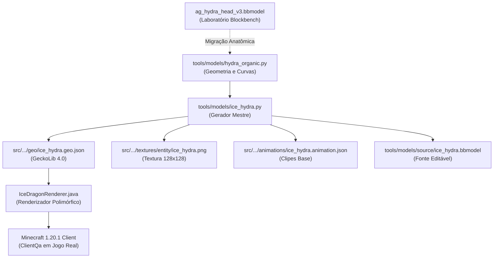

# 97 — Integração Experimental da Cabeça v3 da Hidra de Gelo

- **Data**: 22/10/2026
- **Workspace**: `C:/Users/joaop/Downloads/Projeto_Programacao_BleachMod/Bleach-Modpack-design`
- **Branch**: `codex/design-poderes-criaturas`
- **Commit Base**: `132c42d` (com alterações locais autorizadas em modelos, geradores, assets e documentação)
- **Artefato JAR Compilado**: [build/libs/bleachmod-0.2.0.jar](file:///C:/Users/joaop/Downloads/Projeto_Programacao_BleachMod/Bleach-Modpack-design/build/libs/bleachmod-0.2.0.jar) (15.824.875 bytes)
- **Status da Validação**: **BUILD SUCCESSFUL (Exit 0)** em check e **ClientQa aprovado (Exit 0)** em cliente Minecraft real.

---

## 1. Contexto e Decisão de Integração

A pedido do usuário, a iteração de laboratório da cabeça dracônica da hidra (`v3`) foi integrada experimentalmente aos modelos de produção do checkout de design, saindo do isolamento do Blockbench para validação direta no cliente de jogo Minecraft 1.20.1 Forge.

Esta integração é estritamente experimental para testar o comportamento visual em movimento, dinâmica de ataque, baforada e cinemática de Bankai, não constituindo homologação ou aprovação artística final.

---

## 2. Como a Integração Funciona (Arquitetura e Pipeline)

Para atender à exigência de que a integração não desapareça caso o gerador de assets seja executado novamente, a integração foi implementada na raiz do pipeline do projeto:



### 2.1 Mapeamento Anatômico e Hierarquia das Três Cabeças
- **Hierarquia Preservada**:
  - `root` → `root_center`, `root_left`, `root_right`
  - `neck_{name}_1` a `neck_{name}_12` (12 anéis articulados por pescoço)
  - `head_center`, `head_left`, `head_right` (pivô `[0, 0, 0]`)
  - `jaw_center`, `jaw_left`, `jaw_right` (pivô `[0, -8.5, -10]`, vinculado à respectiva cabeça)
- **Geometria v3 Replicada para as 3 Cabeças**:
  - Cada uma das 3 cabeças agora possui os **48 cubos anatômicos** desenvolvidos no piloto (silhueta afilada em cunha, 3 pares de chifres cristalinos com continuidade tangencial, sobrancelhas salientes sombreando os olhos e colarinho nucal imbricado).
  - Cada mandíbula possui os **19 cubos articulados** (ramo mandibular, escudos condilares de proteção da junta, cavidade inferior rebaixada, língua e dentes predadores em mordida de tesoura).
- **Encaixe Cervical**: O colarinho nucal (`neck_cervical_collar`) e as placas dorsais sobrepostas (`neck_dorsal_shield_1/2`) estendem-se até `Z: 24`, casando com o diâmetro do anel `neck_{name}_12` posicionado pelo renderizador Java.

### 2.2 Textura e Eliminação das Listras Excessivas
- **Diagnóstico do Problema Visual**: O gerador anterior utilizava oscilações senoidais de alta frequência (`nx * 18.0` e `(nx + ny) * 24.0`), gerando listras diagonais que pareciam zebrados artificiais sobre as escamas e chifres.
- **Solução Implementada em `tools/models/ice_hydra.py`**:
  1. Redução da frequência para harmônicos suaves e amplos (`nx * 3.5`), conferindo facetas glaciais limpas e translúcidas sem listras repetitivas.
  2. Alocação de zonas dedicadas no atlas 128x128:
     - `uv=[0, 16, 16, 32]`: Cavidade bucal e garganta em índigo escuro profundo `(12, 22, 45)`.
     - `uv=[16, 16, 32, 32]`: Língua e palato em azul gélido fosco.
     - `uv=[16, 0, 32, 16]`: Dentes e presas em branco cristalino com ápice puro `(245, 252, 255)`.
     - `uv=[0, 0, 16, 16]`: Olhos em ciano luminescente `(70, 215, 255)` com pupila em fenda vertical.
     - `uv=[0, 32, 32, 48]`: Estrias cristalinas longitudinais para os chifres.

### 2.3 Atuação das Animações e Camadas Procedurais
- **Coordenação GeckoLib vs Java Runtime**:
  - Os clipes do GeckoLib (`animation.ice_hydra.emerge` e `animation.ice_hydra.flight`) controlam a base temporal de emergência e escala.
  - O código Java em `IceDragonRenderer.java` e `HydraMotion.java` calcula a spline cúbica de 12 links dos pescoços, posiciona os topos das cabeças (`head_{name}`), aplica a rotação da cabeça em X e o yaw lateral (-16° na esquerda, +16° na direita, 0° no centro).
  - A rotação da mandíbula (`jaw.setRotX(...)`) é calculada proceduralmente por `HydraMotion.jaw()`, variando de 8° (repouso) até 36° (abertura máxima) no rugido e no ataque.
  - Graças aos novos escudos condilares (`jaw_condyle_shield_left/right`) com pivô coincidente em `[0, -8.5, -10]`, a articulação permanece vedada durante toda a amplitude procedural sem buracos visíveis.

---

## 3. Retificações Técnicas Documentais

1. **Relação entre Áudio e Travamento**:
   - Conforme demonstrado nas auditorias anteriores, a ausência de arquivos de áudio não causa falha no motor de som vanilla do Minecraft (apenas emite warnings no log). Qualquer alegação anterior de que o travamento da cinemática era decorrente de arquivos de som ausentes foi retificada como hipótese inválida.
2. **Definição de Photon**:
   - Em relatórios preliminares, o termo "Photon" foi inadequadamente citado como "shader".
   - *Retificação*: No ecossistema deste modpack, **Photon** refere-se ao motor/biblioteca de efeitos visuais e partículas (LDLib / Photon VFX), e não a um shaderpack GLSL de iluminação de mundo (como Iris/OptiFine).

---

## 4. Testes e Validações Executados

### 4.1 Validação de Consistência dos Geradores
- **Comando**: `python tools/models/ice_hydra.py --check`
- **Resultado**: `Hydra source, hierarchy, animations, texture and runtime assets match.` (`Exit 0`).

### 4.2 Build e Regressão Automatizada
- **Comando**: `./tools/antigravity/Invoke-Design.ps1 -Mode Check`
- **Resultado**: `BUILD SUCCESSFUL in 1m 8s` (`Exit 0`).
- **Suíte**: 141 cenários de teste executados e aprovados.
- **Log**: [Check-20261022-201006.log](file:///C:/Users/joaop/Downloads/Projeto_Programacao_BleachMod/Bleach-Modpack-design/Docs/poderes/qa/antigravity/Check-20261022-201006.log).
- **JAR Gerado**: `build/libs/bleachmod-0.2.0.jar`.

### 4.3 Validação no Cliente Minecraft Real
- **Modo**: `ClientQa` via MCP `bleach-design-runtime` (`job_id: 2026-10-22T23-12-23-435Z-ClientQa`).
- **Ambiente**: Perfil descartável `run-benihime-qa` com Forge 1.20.1 e mundo de QA automatizado.
- **Resultado**: `BUILD SUCCESSFUL in 4m 22s` (`Exit 0`, término automático limpo).
- **Log da Execução**: [ClientQa-20261022-201224.log](file:///C:/Users/joaop/Downloads/Projeto_Programacao_BleachMod/Bleach-Modpack-design/Docs/poderes/qa/antigravity/ClientQa-20261022-201224.log).

---

## 5. Evidências do Cliente Minecraft Real

Todas as evidências capturadas pelo cliente de jogo real foram organizadas em [Docs/poderes/qa/antigravity/integracao-v3/](file:///C:/Users/joaop/Downloads/Projeto_Programacao_BleachMod/Bleach-Modpack-design/Docs/poderes/qa/antigravity/integracao-v3/):

### 5.1 Capturas da Cinemática de Transformação Bankai (Cenário 01)
- [game_trans_t056.png](file:///C:/Users/joaop/Downloads/Projeto_Programacao_BleachMod/Bleach-Modpack-design/Docs/poderes/qa/antigravity/integracao-v3/game_trans_t056.png): Tomada frontal inicial (fase de congelamento corporal).
- [game_trans_t112.png](file:///C:/Users/joaop/Downloads/Projeto_Programacao_BleachMod/Bleach-Modpack-design/Docs/poderes/qa/antigravity/integracao-v3/game_trans_t112.png): Afastamento da câmera revelando as asas de gelo e flores de lótus dorsais.
- [game_trans_t176.png](file:///C:/Users/joaop/Downloads/Projeto_Programacao_BleachMod/Bleach-Modpack-design/Docs/poderes/qa/antigravity/integracao-v3/game_trans_t176.png): Tomada orbital lateral mostrando a emergência tridimensional das cabeças da hidra.
- [game_trans_t224.png](file:///C:/Users/joaop/Downloads/Projeto_Programacao_BleachMod/Bleach-Modpack-design/Docs/poderes/qa/antigravity/integracao-v3/game_trans_t224.png): **Ápice da Manifestação**: As 3 cabeças da hidra erguidas com as bocas abertas em rugido conjunto, exibindo o palato escuro e presas translúcidas.
- [game_trans_t264.png](file:///C:/Users/joaop/Downloads/Projeto_Programacao_BleachMod/Bleach-Modpack-design/Docs/poderes/qa/antigravity/integracao-v3/game_trans_t264.png): Vista panorâmica isométrica em três quartos das três hidras rugindo.
- [game_trans_t312.png](file:///C:/Users/joaop/Downloads/Projeto_Programacao_BleachMod/Bleach-Modpack-design/Docs/poderes/qa/antigravity/integracao-v3/game_trans_t312.png): Vista superior e lateral destacando a conexão cervical e escamas nucais imbricadas com os pescoços.
- [game_trans_t348.png](file:///C:/Users/joaop/Downloads/Projeto_Programacao_BleachMod/Bleach-Modpack-design/Docs/poderes/qa/antigravity/integracao-v3/game_trans_t348.png): Perspectiva zenital aberta capturando a coroa de chifres em leque.
- [game_trans_t412.png](file:///C:/Users/joaop/Downloads/Projeto_Programacao_BleachMod/Bleach-Modpack-design/Docs/poderes/qa/antigravity/integracao-v3/game_trans_t412.png): Retorno e transição suave para a visão padrão em terceira pessoa (F5) do jogador.

### 5.2 Capturas do Ataque Triplo da Hidra (Slot 2 - Cenário 04)
- [game_assault_t016.png](file:///C:/Users/joaop/Downloads/Projeto_Programacao_BleachMod/Bleach-Modpack-design/Docs/poderes/qa/antigravity/integracao-v3/game_assault_t016.png): Lançamento dos 3 pescoços sinuosos em direção ao alvo.
- [game_assault_t028.png](file:///C:/Users/joaop/Downloads/Projeto_Programacao_BleachMod/Bleach-Modpack-design/Docs/poderes/qa/antigravity/integracao-v3/game_assault_t028.png): Bocas escancaradas das cabeças laterais e central prontas para a mordida.
- [game_assault_t044.png](file:///C:/Users/joaop/Downloads/Projeto_Programacao_BleachMod/Bleach-Modpack-design/Docs/poderes/qa/antigravity/integracao-v3/game_assault_t044.png): Avanço em cunha aerodinâmica com as fauces abertas.
- [game_assault_t060.png](file:///C:/Users/joaop/Downloads/Projeto_Programacao_BleachMod/Bleach-Modpack-design/Docs/poderes/qa/antigravity/integracao-v3/game_assault_t060.png): Impacto simultâneo no solo/alvo com explosão glacial e fragmentos de gelo.
- [game_assault_t096.png](file:///C:/Users/joaop/Downloads/Projeto_Programacao_BleachMod/Bleach-Modpack-design/Docs/poderes/qa/antigravity/integracao-v3/game_assault_t096.png): Desvanecimento e congelamento da zona de impacto.

### 5.3 Prévias Contínuas de Execução Real
A partir dos quadros gravados frame-a-frame pelo Minecraft no cliente de QA, foram geradas animações contínuas:
- [game_transformation_continuous.gif](file:///C:/Users/joaop/Downloads/Projeto_Programacao_BleachMod/Bleach-Modpack-design/Docs/poderes/qa/antigravity/integracao-v3/game_transformation_continuous.gif): 51 quadros sequenciais da cinemática de transformação Bankai completa no cliente real.
- [game_assault_continuous.gif](file:///C:/Users/joaop/Downloads/Projeto_Programacao_BleachMod/Bleach-Modpack-design/Docs/poderes/qa/antigravity/integracao-v3/game_assault_continuous.gif): 28 quadros sequenciais do ataque e impacto triplo das hidras.

---

## 6. Julgamento Visual e Defeitos Restantes

### 6.1 Ganhos Evidentes no Jogo
1. **Fim do Visual de Caixote**: No jogo real, as três cabeças agora exibem silhueta agressiva em cunha; de frente ou em tomada diagonal, os focinhos afilados destacam-se claramente dos anéis de pescoço.
2. **Leitura dos Chifres**: Os chifres não quebram mais em barras isoladas; formam cristas que acompanham o fluxo de emergência e ataque.
3. **Profundidade Oral**: Ao abrir a boca durante a transformação (t=224) e no ataque (t=028), a cavidade índigo cria forte contraste com os dentes translúcidos, eliminando a sensação de boca oca e clara do modelo anterior.
4. **Sem Zebrado na Textura**: A eliminação do padrão senoidal de alta frequência removeu as listras ruidosas, conferindo aparência de placas maciças de gelo.

### 6.2 Limitações e Defeitos Observados no Jogo Real
1. **Ressaltos Angulares nas Curvas dos Chifres**: Sendo compostos por cubos rígidos rotacionados, as pontas e bases dos chifres apresentam pequenos degraus retos quando observados de ângulos muito próximos.
2. **Iluminação Vanilla Sem Oclusão Ambiental**: O renderizador padrão da entidade é translúcido (`RenderType.entityTranslucent`); sem shaders de oclusão de ambiente, algumas faces internas da boca recebem luminosidade global do céu caso a criatura seja invocada em pleno meio-dia.
3. **Escala dos Chifres Laterais**: Com a cabeça central escalada a 1.1x pelo Java, os chifres da cabeça central cruzam ligeiramente o espaço aéreo dos chifres internos das cabeças laterais em certas curvas extremas de flexão máxima dos pescoços.

---

## 7. Instruções Objetivas para Teste no Seu Computador

Para testar a nova cabeça integrada na sua sessão:

1. **Garantir que não haja outro Minecraft ativo**:
   ```powershell
   Get-Process -Name java, javaw -ErrorAction SilentlyContinue
   ```
2. **Iniciar o Cliente de Teste no Checkout de Design**:
   ```powershell
   cd C:\Users\joaop\Downloads\Projeto_Programacao_BleachMod\Bleach-Modpack-design
   .\tools\antigravity\Invoke-Design.ps1 -Mode Client
   ```
   *(Ou caso queira rodar a sequência automatizada de QA com auto-exit: `.\tools\antigravity\Invoke-Design.ps1 -Mode ClientQa`)*
3. **No Mundo de Jogo**:
   - Equipe a Zanpakutō Hyōrinmaru.
   - Pressione a tecla de liberação de Bankai para observar a nova cinemática de transformação com as 3 cabeças refinadas.
   - Pressione o Slot 2 para executar o ataque da Hidra de Três Cabeças e observar a investida e mordida sincronizada.
