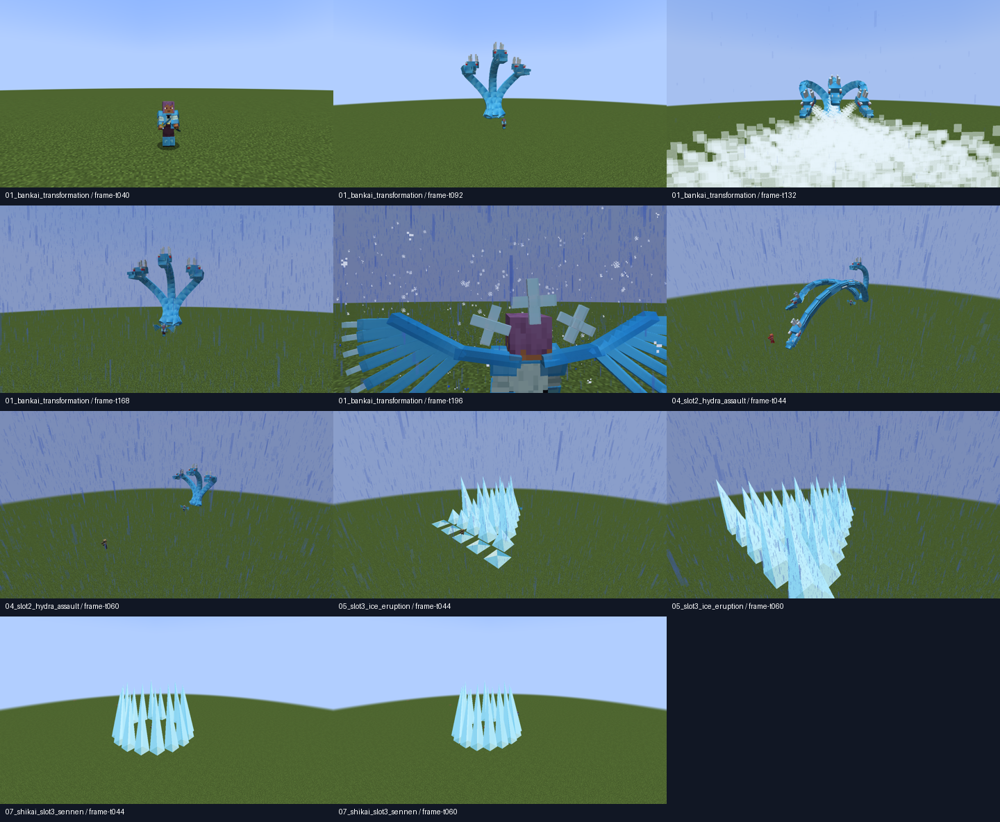

# QA real — ciclo89 / Hyōrinmaru

21/10/2026, branch Feature-Poderes-bankais. Referência inicial c206585, protocolo2.33, schema9/revisão técnicas4. Fontes locais anteriores preservadas; sem commit.

## Reprodução

- Base: `gradlew.bat check build runGameTestServer prepareCombatTestPack --offline --console=plain`.
- Photon: `gradlew.bat -PphotonPilot=true check build runGameTestServer prepareCombatTestPack preparePhotonTestPack --offline --console=plain`.
- Cliente isolado: `gradlew.bat -PbenihimeQa=true -PcinematicQaFast=true -PhyorinmaruQa=true -PqaAutoExit=true runClient --offline --console=plain`. Acrescentar `-PphotonPilot=true` para o perfil opcional.
- Modelo: `python tools/models/ice_hydra.py --check`.

Os perfis usam run-benihime-qa/base e run-benihime-qa/photon, criam mundos próprios e fecham o cliente ao terminar. Não foi usado Iniciar-Teste.bat nem o save principal. A primeira inicialização Photon teve onboarding de acessibilidade, corrigido apenas nas opções do diretório isolado.

## Evidência

[Verificação, origens, contagens, FPS amostrado, SHA256 e integridade dos pacotes](verification.json). Os arquivos `*-frames.jsonl` são a lista original das capturas reais, incluindo ticks e posições. As pastas originais completas permanecem em run-benihime-qa, identificadas no JSON.

[Transformação base amostrada](base-01_bankai_transformation.mp4), [Assalto da hidra base](base-04_slot2_hydra_assault.mp4), [Erupção base](base-05_slot3_ice_eruption.mp4).

[Transformação Photon amostrada](photon-01_bankai_transformation.mp4), [Hidra Photon](photon-04_slot2_hydra_assault.mp4), [Erupção Photon](photon-05_slot3_ice_eruption.mp4).

Vídeos derivados de screenshots do framebuffer Forge a cada quatro ticks. Duração corresponde ao intervalo entre os ticks registrados; sem áudio, interpolação ou alegação de gravação contínua de todos os frames. As imagens conceituais86/88 não são usadas como evidência do cliente.

## Avaliação própria e limites

Primeira versão jogável, **pendente de homologação artística pelo usuário**. Curvas/conexão dos pescoços3/5, mandíbulas/silhueta3/5, câmera3/5, pose do jogador3/5, VFX/legibilidade3/5. Escalas são julgamento visual, não métricas automáticas. As curvas e o ataque amplo estão presentes; a malha ainda é estilizada e o clima anterior pode produzir chuva em bioma quente. Fluidez completa depende da revisão dos movimentos: os clipes amostrados não demonstram cada frame.

Base+Photon passaram139 regressões/173 GameTests; cenários reais de cliente descritos no JSON. Sem demonstração em dois clientes reais ou servidor dedicado com observador. Noite, espaço estreito, terreno acidentado, skins variadas, latência e escuta humana ainda exigem validação. FPS capturado não equivale a benchmark de frametime, e singleplayer não prova sincronização multiplayer.

Os pacotes ficam em build/combat-test-pack (cinco JARs) e build/photon-test-pack (sete). O SHA256 e a comparação dos recursos/JAR do mod entre os dois ficam em verification.json.
