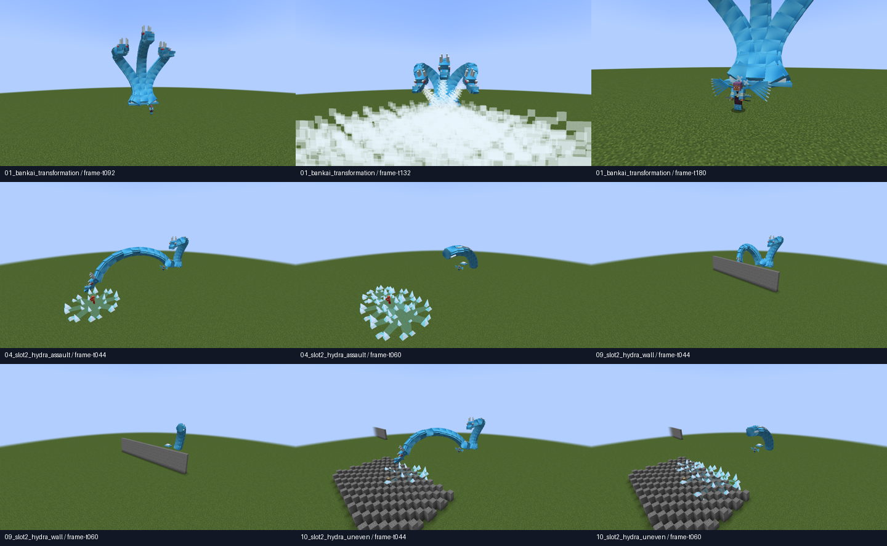

# QA real — ciclo91 / Hyōrinmaru

22/10/2026, branch Feature-Poderes-bankais; referência c26a4e3. Rede2.34, schema9/revisão técnicas4. Sem commit e sem alterar saves principais ou conteúdo Zaraki.

## Reprodução

- Base: `gradlew.bat check build runGameTestServer prepareCombatTestPack --offline --console=plain`.
- Photon: `gradlew.bat -PphotonPilot=true check build runGameTestServer prepareCombatTestPack preparePhotonTestPack --offline --console=plain`.
- Cliente: `gradlew.bat -PbenihimeQa=true -PcinematicQaFast=true -PhyorinmaruQa=true -PqaAutoExit=true runClient --offline --console=plain`; acrescentar `-PphotonPilot=true` para o perfil opcional.
- Fontes/modelo: `python tools/models/ice_hydra.py --check`.

Baseline139/173; final140 regressões/176 GameTests nos dois perfis. Os testes novos cobrem curva sem retorno, preparo sem dano, explosão na região da mira, acúmulo limitado, paredes e clima natural/limpo sem alterações. Suporte e testes de clima legado permanecem separados do kit atual.

A primeira captura identificou encerramento antecipado no roteiro de QA. Corrigido para esperar o servidor; repetidos os cenários, incluindo parede e chão irregular. Os registros finais usam ticks do servidor e origens em verification.json.

## Evidências

[Origens, cenários, amostras FPS, integridade e SHA256](verification.json). Metadados originais: arquivos `*-frames.jsonl`. As pastas completas de screenshots permanecem em run-benihime-qa/base e run-benihime-qa/photon, identificadas no JSON.

[Transformação base](base-01_bankai_transformation.gif) · [N base](base-04_slot2_hydra_assault.gif) · [N contra parede](base-09_slot2_hydra_wall.gif) · [N em terreno irregular](base-10_slot2_hydra_uneven.gif).

[Transformação Photon](photon-01_bankai_transformation.gif) · [N Photon](photon-04_slot2_hydra_assault.gif) · [Parede Photon](photon-09_slot2_hydra_wall.gif) · [Terreno Photon](photon-10_slot2_hydra_uneven.gif).

GIFs derivados dos PNGs reais, com duração pelos ticks registrados; resolução/paleta reduzidas, sem áudio, interpolação ou alegação de captura de todos os frames. Não contêm imagens conceituais usadas como prova do jogo.

## Auditoria e limites

Primeiras capturas confirmaram silhueta maior/mais robusta, céu sem tempestade, placas/cristais nos impactos e aproximação da câmera para revelar o jogador. O modelo ainda tem caráter cúbico; cabeça/dentes e a empunhadura das duas mãos precisam de acabamento. Proporção/conexão4/5; animação/mandíbulas3/5; câmera/legibilidade3/5: avaliação própria qualitativa, não medição automática nem aceite do usuário.

Aceite artístico, escuta humana, câmera em espaços estreitos, noite e servidor dedicado com dois clientes/observador/latência continuam pendentes. Singleplayer e GameTestServer não provam esses cenários. Nenhum novo editor, plugin ou biblioteca foi instalado.

Pacotes: build/combat-test-pack com5 JARs; build/photon-test-pack com7. Ambos usam o mesmo JAR do mod. Verificar hash/recursos no JSON; usar clientes/servidor compatíveis com2.34.

Captura final:10 cenários por perfil,294 PNGs base/292 Photon. No terreno irregular, o alvo oculto atrás do relevo permaneceu sem dano; obstáculos também limitam explosões e gelo visual. Esse caso comprova a execução até o fim e a preservação da obstrução, não que todos os inimigos de uma região irregular devam ser atingidos.
