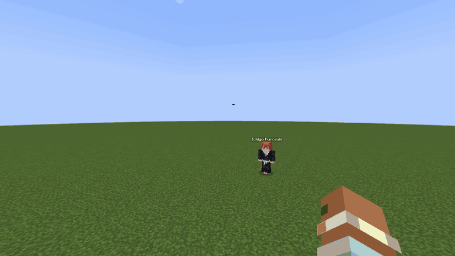

# Garganta — saída articulada do boss

Data: 20/10/2026. Branch: `feat/Jigui/cinematic/hollow-boss`. Referência: `cdb3787319342fc0e3d7e80902e317d403471afc`.
Este ciclo refina a entrada anterior, que já estava modificada e sem commit no workspace. O estado inicial, o diff e as três fontes principais anteriores foram preservados em `build/entrance-motion-baseline`. Sem checkout, commit, push ou alteração de Zaraki/Benihime.

## Problema e alteração

A primeira entrada deslocava o corpo quase como uma peça única. Os braços e pernas tinham deslocamentos locais para atrasar a revelação, mas não sustentavam o avanço. O pedido deste ciclo foi dar naturalidade à passagem, mantendo cabeça primeiro e portal já implementado.

A nova coreografia articula o rig existente, sem mover membros para fora dos seus encaixes ou esticar segmentos. Cabeça e olhar antecipam o tronco; peito e quadril giram em tempos diferentes. Uma mão alcança o chão, abre os dedos e apoia o primeiro avanço; a segunda vem depois. Ombros, cotovelos e punhos são resolvidos por uma cadeia de dois segmentos. Os joelhos dobram e os pés levantam em arcos separados. O quadril abaixa, muda de lado com os apoios e se recupera gradualmente. A barbatana acompanha com um movimento discreto atrasado.

O avanço tem quatro fases, com uma pausa de observação e uma pausa de transferência de peso. Mãos e pés apoiados têm alvos fixos no chão, compensando a translação do modelo. O corpo avança sobre esses apoios. Não há mais translação isolada da cabeça, dos braços ou das pernas.

| Ação | Ticks |
|---|---:|
| Aproximação/olhar | 30–64 |
| Mão direita alcança e apoia | 60–74 |
| Primeiro avanço sobre o apoio | 64–84 |
| Mão esquerda alcança e apoia | 78–94 |
| Passo direito | 78–102 |
| Passo esquerdo | 90–120 |
| Mãos são reposicionadas | direita 96–116; esquerda 112–128 |
| Apoio final, rugido e recuperação | 120–156 |
| Combate liberado | 160 |

O portal, o recorte geométrico, a duração de oito segundos, o relógio salvo/sincronizado e o contrato de combate permanecem. Dois sons leves de apoio acompanham os contatos das mãos. A sobreposição de poses é restaurada antes da avaliação seguinte do GeckoLib; as animações de idle, walk, melee, charge e slam continuam sendo avaliadas normalmente após a entrada.

## Verificação

Windows, Java 17.0.20.1, Minecraft 1.20.1, Forge 47.4.10, Gradle 8.8 e dependências locais existentes. Nenhuma instalação ou asset externo novo. Gradle offline.

| Verificação | Resultado |
|---|---|
| Baseline `build/hollow-gradle.ps1 check` | PASS, exit 0, 127 regressões |
| `build/hollow-gradle.ps1 build`, final | PASS, exit 0, 129 regressões, 31 s |
| `build/boss-gradle.ps1 runGameTestServer` | PASS, exit 0, 188 obrigatórios, 64 s |
| Fontes e assets do boss (`hollow_boss.py --check`) | PASS, 30 bones, 222 volumes, cinco clips anteriores preservados |
| Três variantes de Hollow (`hollow_variants.py --check`) | PASS, rigs e 12 clips preservados |
| `git diff --check` | PASS |

As duas novas regressões verificam alcance com comprimentos constantes, conversão entre quaternion/Euler usada pelo GeckoLib, apoios alternados, pausa no avanço e recuperação antes do combate. A primeira execução detectou um erro na conversão ZYX do JOML 1.10.5: o denominador do ângulo X usa sinal incorreto para y². A conversão utilizada pela feature foi corrigida localmente e a regressão passou, sem relaxar a tolerância. Log da falha original preservado em `build/entrance-motion-baseline/first-ik-regression-failure.log`.

O GameTest validou o contrato de entrada/combate, que não foi alterado pelas correções matemáticas e pelo ajuste final dos passos. A build final reexecutou todas as regressões, incluindo os novos horários dos passos. Nenhum teste foi desativado.

Cliente Forge real em saves descartáveis `Boss-QA-*`, com capturas `Minecraft Screenshot.grab`, frontal e oblíqua, seguidas por todas as vistas e golpes da bateria existente. `frames.jsonl` inclui posições reais de punhos e tornozelos rastreados pelo GeckoLib; a instrumentação compensa a translação externa da entrada, que o rastreamento padrão remove. `tools/qa/boss_entrance_motion.py` mede deslizamento e altura dos apoios nesses dados, sem substituir a inspeção visual. `motion-audit.json` preserva as medições da rodada final.

Uma rodada intermediária mostrou as pontas dos pés surgindo antes do momento desejado. Os alvos traseiros foram recuados e a passagem dos pés foi alinhada aos passos; as capturas finais verificam esse ajuste. Os frames/GIFs do ciclo anterior não foram substituídos.

Rodada final: `Boss-QA-1792537605186`. A auditoria dos punhos e tornozelos nas duas vistas passou: deslocamento máximo durante apoio inferior a 0,000005 bloco, erro de altura inferior a 0,000003 bloco em relação à altura de apoio do rig (incluindo o offset de renderização de 0,01 bloco do GeckoLib). A elevação amostrada dos pés foi de aproximadamente 0,60–0,625 bloco durante os passos. Os números vêm das matrizes dos bones no cliente real; não medem deformação da pele ou a qualidade artística da passada.

Cliente final: exit 0, 103 s. GIFs frontal e oblíquo: 85 amostras / 8,50 s cada. GPU registrada: AMD Radeon RX 7600; contador de FPS amostrado 103–119, sem isolamento de benchmark. Depois da entrada, trace confirmou melee em 495 HP, charge em 490 HP com deslocamento de 15,3 blocos, slam em 484,72 HP e caminhada. `combat-summary.json`, `build.log`, `gametests.txt` e `jar-sha256.json` preservam resultados e identificação do JAR. Logs gerados na raiz foram preservados em `build/entrance-motion-gradle-logs`, sem acrescentar ruído ao diff.

## Limites

Conferência visual base: cliente real, dia, piso plano, frente e vista oblíqua. Julgamento visual: articulação 4/5, leitura do peso 4/5, apoios 4/5, fluidez 4/5. Não há IK de terreno: os apoios usam o plano da origem do boss. Piso irregular, ambiente estreito, multiplayer com dois clientes reais e Photon/LDLib continuam pendentes. O servidor GameTest não equivale à validação multiplayer. Som não foi avaliado por escuta separada. Não houve medição de frametime.

Reprodução: `& ./build/boss-gradle.ps1 runClient`, depois `python tools/qa/boss_evidence.py <pasta-da-rodada> Docs/qa/boss/2026-10-20-garganta-movimento` e `python tools/qa/boss_entrance_motion.py <pasta-da-rodada> Docs/qa/boss/2026-10-20-garganta-movimento/motion-audit.json`.

