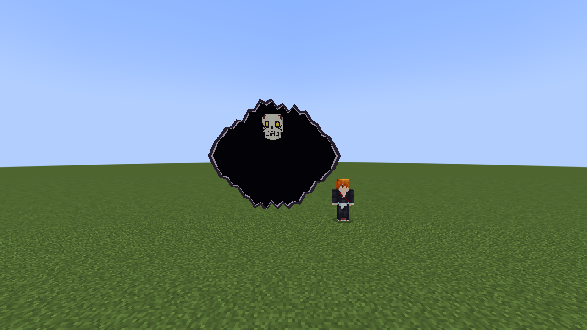
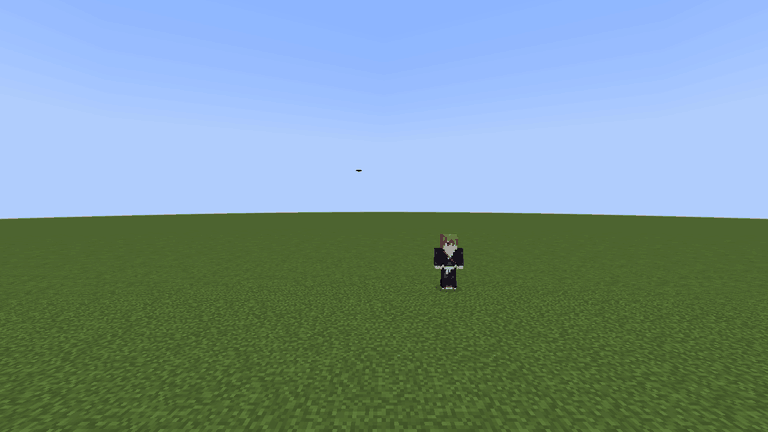
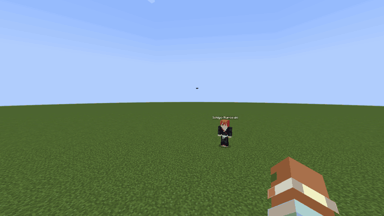

# Entrada do primeiro boss pela Garganta

20/10/2026 · branch `feat/Jigui/cinematic/hollow-boss` · referência `cdb3787319342fc0e3d7e80902e317d403471afc`.
Workspace limpo antes do trabalho. Sem checkout, commit ou push. Zaraki, Benihime, atributos e golpes do boss preservados.

Referência visual fornecida: [Ichigo & Rukia vs Fishbone D](https://www.youtube.com/shorts/wQ616_H2l9U), trecho 0:08–0:12, consultado no navegador. Implementação própria com geometria procedural; nenhum frame, áudio ou textura do anime foi incorporado.

## Comportamento

A entrada dura 160 ticks (8 s em 20 TPS). A Garganta começa como uma fissura horizontal, abre uma boca negra com bordas quebradas e mantém o vazio opaco de ambos os lados. O modelo avança de trás da superfície: máscara primeiro, depois ombros/torso, braços, pernas e corpo inteiro. O recorte é geométrico por face, com interpolação de UVs, luz e normais. Nenhum shader global, stencil ou dependência de Photon é necessário.

| Marco | Tick aproximado | Resultado esperado |
|---|---:|---|
| Fissura e abertura | 0–30 | Espaço negro vazio; boss oculto |
| Cabeça | 60–75 | Máscara isolada à frente da superfície |
| Corpo atravessando | 75–110 | Ombros, peito, braços e pernas passam gradualmente |
| Apoio e impacto | 120 | Corpo fora, partículas do chão e tremor curto |
| Rugido/apresentação | 132 | Mandíbula abre e nome localizado aparece |
| Fechamento | 136–160 | Fenda recolhe atrás do boss |
| Combate | 160 | IA e dano normais retomados |

O movimento dos bones é amostrado diretamente pelo relógio sincronizado, com curvas suaves em `HollowBossEntrance`; a entrada não reinicia uma animação local para cada novo observador. O rig e os cinco clips anteriores continuam idênticos ao arquivo Blockbench. Os novos deslocamentos são aplicados por `HollowBossModel` e removidos ao sair da entrada.

Boss fica imóvel, sem empurrão e protegido contra dano comum enquanto atravessa. `/kill` continua funcionando. A IA permanece configurada normalmente e só é bloqueada temporariamente por um goal com prioridade de entrada. O timer também avança com NoAI para permitir previews de desenvolvimento.

Tick e orientação persistem no NBT; uma entidade salva durante a cena retoma o progresso. Saves antigos com UUID são tratados como bosses já estabelecidos. Payload novo de `/summon` sem UUID inicia a cena. Criação por missão, ovo e criação direta usam a mesma entidade; a integração da missão da Rukia não foi alterada.

Quem estiver olhando para a entrada, com linha de visão e a até aproximadamente 28 blocos, recebe barras, título e tremor breve no apoio/rugido. HUD normal fica oculto apenas enquanto a entrada é visível. Não há alteração de modo de câmera, teleporte do jogador ou bloqueio de input. Ao desviar a visão, morrer, remover o boss, trocar de dimensão ou terminar a cena, a seleção deixa de existir e os efeitos cessam sem estado de câmera retido. Essas saídas foram verificadas por inspeção do código; nem todas foram exercitadas visualmente.

Sons vanilla: abertura de portal, tensão de Enderman, passo pesado, rugido de Ravager e fechamento. A execução dos gatilhos foi inspecionada; não houve avaliação auditiva separada.

## Validação

Ambiente: Windows, Java 17.0.20.1, Gradle 8.8, Minecraft 1.20.1, Forge 47.4.10, GeckoLib já fixado no projeto e PlayerAnimator 1.0.2-rc1. Sem novas instalações ou downloads de assets. Gradle executado offline com os wrappers locais.

| Verificação | Resultado |
|---|---|
| `build/hollow-gradle.ps1 check`, baseline | PASS, exit 0, 127 regressões |
| `build/hollow-gradle.ps1 check`, implementação | PASS, exit 0, 127 regressões |
| `build/hollow-gradle.ps1 build`, final | PASS, exit 0, 127 regressões, 26 s |
| `build/boss-gradle.ps1 runGameTestServer`, primeira rodada | PASS, exit 0, 188 obrigatórios |
| `build/boss-gradle.ps1 runGameTestServer`, após ajuste de NBT | PASS, exit 0, 188 obrigatórios, 69 s |
| `python tools/models/hollow_boss.py --check` | PASS, 30 bones / 222 volumes / cinco clips preservados |
| `python tools/models/hollow_variants.py --check` | PASS, três variantes e 12 clips preservados |
| `git diff --check` | PASS |

Três novos GameTests cobrem relógio/posição/dano/retomada natural da IA, persistência com NoAI e saves antigos/novos, e interrupção por morte administrativa. Os 16 testes de combate anteriores começam explicitamente após a entrada, mantendo seus contratos de contato e recarga. A suíte carrega classes comuns em servidor sem dependências de renderização.

O cliente Forge real foi executado em mundos descartáveis `Boss-QA-*` em `run/boss-qa/base`, com capturas por `Minecraft Screenshot.grab`. Sequência frontal e sequência oblíqua com HUD cinematográfico, seguidas por escala, perfil, costas, detalhe, melee, charge, slam e caminhada. O arquivo `frames.jsonl` guarda tick do jogo, tick de entrada, FPS observado, GPU, dimensões e fonte de cada captura; `combat.jsonl` guarda o trace independente do servidor integrado. GIFs são amostras reais do framebuffer reduzidas para 768 × 432, com durações derivadas dos ticks; não são renders de editor.

Rodada final: `Boss-QA-1792536548691`, exit 0 em 118 s. Cada entrada contém 85 amostras (8,45 s frontal; 8,50 s oblíqua), com 56–119 FPS observados nas amostras da rodada, GPU AMD Radeon RX 7600. Essa faixa é um contador amostrado, não um benchmark isolado. Trace posterior: melee atingiu 495 HP, charge 490 HP e deslocamento de 15,3 blocos, slam 484,72 HP. `build.log`, `gametests.txt`, `jar-sha256.json` e `combat-summary.json` preservam os resultados. Logs rotativos gerados na raiz foram movidos para `build/entrance-gradle-logs`, mantendo a árvore de alterações focada na feature.

## Observação visual e limites

Rodadas reais mostraram cabeça isolada, progressão do corpo, ausência do corpo atrás da superfície, chegada ao chão, fechamento completo e retorno às animações de combate. A segunda perspectiva permite observar o recorte em profundidade. O título usa o nome localizado existente do boss. Julgamento visual: leitura da cabeça 4/5, recorte/portal 4/5, fluidez 4/5, apoio corporal 3/5, integração do título 4/5. Os braços não agarram a borda; a proposta implementa a passagem gradual solicitada. O apoio usa deslocamento e compressão curtos, sem uma nova caminhada completa.

Validação visual base: realizada em cliente real, de dia, piso plano, duas perspectivas. Multiplayer com dois clientes reais, servidor dedicado de produção, Photon/LDLib, noite, piso irregular e espaço estreito: PENDENTES. O servidor GameTest não equivale à homologação multiplayer. Não foram medidos frametimes; a faixa de FPS amostrada consta no resumo das capturas.

Reprodução: `& ./build/boss-gradle.ps1 runClient` cria um save novo, faz as duas entradas e a sequência de combate, captura frames e encerra. Para jogo normal, invoque `bleachmod:hollow_boss` ou inicie a missão existente. O JAR gerado está em `build/libs/bleachmod-0.2.0.jar`.
